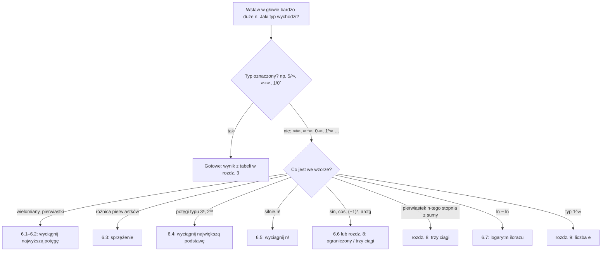

# AM – W1: Ciągi liczbowe i granice

Poprzednio: [[0_Analiza_Matematyczna|W0 – powtórzenie: funkcje elementarne]] · Następnie: [[2_Analiza_Matematyczna|W2 – ciągłość, asymptoty, pochodne]]

Materiały: [[W1_granice_ciagi_funkcje.pdf|Wykład 1 (PDF)]] · [[Z01 ciagi.pdf|Zadania Z01 (PDF)]] · [[Z01 ciagi_Rozwiazania.pdf|Rozwiązania Z01 (PDF)]]

> [!abstract] O co chodzi w tym wykładzie?
> **Ciąg** to nieskończona lista liczb ponumerowanych po kolei: $a_1, a_2, a_3, \dots$
> **Granica** odpowiada na jedno pytanie: *„do czego te liczby się zbliżają, gdy idziemy bardzo, bardzo daleko?”*
>
> Przykład: $\frac11, \frac12, \frac13, \frac14, \dots, \frac{1}{1000}, \dots$ Liczby są coraz bliżej zera, więc granica wynosi $0$.
>
> **Cały W1 sprowadza się w praktyce do jednej umiejętności: policzyć granicę.** Łatwe granice liczy się „w głowie”. Trudne to te, w których na pierwszy rzut oka wychodzi coś bez sensu, np. $\frac{\infty}{\infty}$ albo $\infty - \infty$. Na każdy taki przypadek jest jedna sztuczka i każda ma tu swój rozdział.

> [!tip] Najważniejszy nawyk: „wstaw bardzo duże $n$”
> Zanim zaczniesz liczyć, wyobraź sobie $n = 1000$ albo $n = 1\,000\,000$.
> - $\frac{1}{n}$: $0{,}001$, potem $0{,}000001$. Widać, że dąży do $0$.
> - $\frac{2n+1}{n}$ dla $n = 1000$: $\frac{2001}{1000} = 2{,}001$. Widać, że dąży do $2$.
> - $n^2 - 5n$ dla $n = 1000$: $995\,000$. Rośnie bez końca, więc dąży do $\infty$.
>
> To jest **sprawdzian**, a nie rozwiązanie. Na kolokwium musisz **uzasadnić** wynik (wymóg prowadzącego), czyli pokazać przekształcenia z rozdziałów 6–9. Ale wiedząc, co ma wyjść, dużo łatwiej to zrobić.

> [!quote] Po co mi to w ogóle?
> Granica to matematyczna odpowiedź na pytanie **„co się stanie na dłuższą metę?”**. Zadajesz je częściej, niż myślisz:
> - Ile stopni będzie miała kawa, jeśli zostawię ją na biurku? (dąży do temperatury pokoju)
> - Ile leku będzie w organizmie, jeśli biorę tabletkę codziennie? (dąży do stałego poziomu)
> - Czy mój algorytm wytrzyma milion użytkowników? (porównanie, jak szybko rośnie czas działania)
> - Jak kalkulator liczy $\sqrt2$, skoro ma nieskończenie wiele cyfr? (ciąg, który zbiega do $\sqrt2$)
>
> W rozdziałach znajdziesz ramki **🌍 Z życia**, które pokazują, gdzie dany temat naprawdę się przydaje. Zbiorczo: [[#Granice w prawdziwym życiu]].

> [!info] Jak się uczyć z tej notatki
> **Treść:** cała notatka to materiał z **W1** (wykład W1 i zadania Z01).
>
> **Czytaj po kolei, od góry do dołu.** Rozdziały budują jeden na drugim: każdy korzysta z wcześniejszych rozdziałów **tej notatki**. Czasem potrzebne są szkolne podstawy (potęgi, logarytmy, $\arcsin$). Wtedy jest link do powtórki [[0_Analiza_Matematyczna|W0]], gdyby trzeba było coś odświeżyć.
>
> Na końcu rozdziału jest zielona ramka **➡️ Teraz zrób**. Kliknij link, zrób zadanie na kartce, potem rozwiń rozwiązanie i porównaj. Wróć i czytaj dalej.
>
> | Rozdziały | Potem zadania z Z01 |
> |---|---|
> | 0 Symbole, 1 Ciąg | 0 |
> | 2 Granica, 3 Rachunek na $\infty$, 4 Ważne granice, 5 Symbole nieoznaczone, 6 Techniki | 1, 2 |
> | 7 Hierarchia wzrostu, 8 Trzy ciągi | 3 |
> | 9 Liczba $e$ | 4 |
> | 10 Granica funkcji | zapowiedź Z03 |
>
> Na kolokwium **zawsze uzasadniaj**: pisz, z jakiej własności korzystasz. Zwyczaj z wykładu: typ granicy dopisuje się w nawiasie kwadratowym, np. $\left[\frac{\infty}{\infty}\right]$.

---

## Wykład

### W1 – Ciągi liczbowe, granice, symbole nieoznaczone

#### 0. Słowniczek symboli

Tylko przejrzyj. Wracaj tu, gdy trafisz na nieznany znak.

| Symbol | Czytamy | Przykład |
|---|---|---|
| $a_n$ | „$a$ $n$-te”, czyli wyraz ciągu o numerze $n$ | $a_3$ to trzeci wyraz |
| $\lim\limits_{n\to\infty} a_n$ | „granica $a_n$, gdy $n$ dąży do nieskończoności” | $\lim\limits_{n\to\infty} \frac1n = 0$ |
| $a_n \to g$ | „$a_n$ dąży do $g$” (to samo co $\lim a_n = g$) | $\frac1n \to 0$ |
| $\infty$ | nieskończoność: **nie jest liczbą**, to skrót od „rośnie bez końca” | $n^2 \to \infty$ |
| $n!$ | silnia: $1\cdot2\cdot3\cdot\ldots\cdot n$ | $4! = 24$, $\ 0! = 1$ |
| $\sqrt[n]{a}$ | pierwiastek $n$-tego stopnia, czyli $a^{1/n}$ | $\sqrt[3]{8} = 2$ |
| $0^+$ | „zero z plusem”: bardzo mała liczba **dodatnia** | $0{,}0001$ |
| $0^-$ | „zero z minusem”: bardzo mała liczba **ujemna** | $-0{,}0001$ |
| $\left[\frac{\infty}{\infty}\right]$ | **typ granicy** w nawiasie kwadratowym: komentarz „po wstawieniu dużego $n$ wychodzi $\frac{\infty}{\infty}$”. To **nie** jest równość ani wynik, tylko uzasadnienie kolejnego kroku | $\lim\frac{4n+2}{2n+1}\left[\frac{\infty}{\infty}\right] = \dots = 2$ |
| $\varepsilon$ | epsilon: mała liczba dodatnia (szerokość „pasma”) | $\varepsilon = 0{,}01$ |
| $\forall$ / $\exists$ | „dla każdego” / „istnieje” | z [[0_Analiza_Matematyczna#0. Słowniczek symboli\|W0]] |
| $f \prec g$ | „$f$ rośnie wolniej niż $g$” | $n^2 \prec 2^n$ |
| $\mathbb{N}_+$ | liczby naturalne dodatnie $\{1, 2, 3, \dots\}$ | |

> [!question] Co oznacza nawias kwadratowy, np. $\left[\frac{\infty}{\infty}\right]$? (wyjaśnienie krok po kroku)
> **1. Znasz to ze szkoły.** Przy równaniach pisałeś:
> $$2x = 6 \quad \big|\, :2 \qquad\Rightarrow\qquad x = 3$$
> To „$|\,:2$” z prawej **nie jest częścią równania**. To dopisek: „teraz dzielę przez 2”. **Nawias kwadratowy przy granicach to dokładnie to samo: dopisek na boku.**
>
> **2. Co oznacza $\left[\frac{\infty}{\infty}\right]$.** Weź $\dfrac{4n+2}{2n+1}$ i wstaw $n = 1000$:
> - góra: $4002$, czyli **duża liczba**,
> - dół: $2001$, czyli **też duża liczba**.
>
> Im większe $n$, tym obie są większe. Krótko zapisujesz to jako $\left[\frac{\infty}{\infty}\right]$, czyli **„góra duża, dół duży”**. To jeszcze nie wynik, tylko **diagnoza**, jak u lekarza: najpierw rozpoznanie, potem leczenie.
>
> **3. Po co ta diagnoza.** „Duże przez duże” może dać **cokolwiek**:
> - $\frac{4002}{2001} \approx 2$,
> - $\frac{1\,000\,000}{1000} = 1000$, czyli bardzo dużo,
> - $\frac{1000}{1\,000\,000} = 0{,}001$, czyli prawie zero.
>
> Dopisek mówi więc: **„tu nie da się od razu podać wyniku, trzeba przekształcić”** (sposoby są w rozdziale 6).
>
> **4. Całość razem:**
> $$\lim\frac{4n+2}{2n+1}\ \underbrace{\left[\frac{\infty}{\infty}\right]}_{\text{dopisek: góra duża, dół duży}} = \lim\frac{n\left(4+\frac2n\right)}{n\left(2+\frac1n\right)} = \frac42 = 2$$
>
> **Podsumowanie:** nawias kwadratowy = **dopisek na boku**, taki jak „$|\,:2$” w równaniach. Mówi, z jakim przypadkiem masz do czynienia. Do wyniku się go nie wlicza. Na kolokwium warto go pisać, bo prowadzący wymaga pokazania, skąd wiesz, co robisz.
>
> Czasem nawias stoi tuż przed wynikiem, np. $\left[\frac{2}{\infty}\right] = 0$. Wtedy jest uzasadnieniem: „wynik to 0, bo liczba przez nieskończoność daje 0”.

> [!tip] Silnia: jedyny wzór, którego potrzebujesz
> $$(n+1)! = (n+1)\cdot n! \qquad\text{np. } 5! = 5\cdot 4! = 5 \cdot 24 = 120$$
> Z tego: $(n+2)! = (n+2)(n+1)\cdot n!$ oraz $(n-1)! = \dfrac{n!}{n}$. Przyda się w zadaniu 2c.

> [!question] ✏️ Sprawdź się – 0
> a) Oblicz $\dfrac{6!}{4!}$. b) Uprość $\dfrac{(n+1)!}{(n-1)!}$. c) Zapisz $\sqrt[5]{32}$ jako potęgę i oblicz. d) W zapisie $\lim\dfrac{n^2+1}{3n^2}\left[\dfrac{\infty}{\infty}\right] = \dfrac13$ co jest diagnozą, a co wynikiem?
>
> > [!success]- Rozwiązanie
> > a) $\dfrac{6!}{4!} = \dfrac{6\cdot5\cdot4!}{4!} = 6\cdot 5 = 30$
> > b) $(n+1)! = (n+1)\cdot n\cdot(n-1)!$, więc $\dfrac{(n+1)\,n\,(n-1)!}{(n-1)!} = n(n+1)$
> > c) $\sqrt[5]{32} = 32^{1/5} = 2$, bo $2^5 = 32$
> > d) $\left[\frac{\infty}{\infty}\right]$ to diagnoza (dopisek „góra duża, dół duży”, trzeba przekształcić), a $\frac13$ to wynik.

---

#### 1. Czym jest ciąg?

> [!important] Definicja
> **Ciąg liczbowy** to funkcja, która każdej liczbie naturalnej $n = 1, 2, 3, \dots$ przypisuje liczbę rzeczywistą $a_n$:
> $$f: \mathbb{N}_+ \to \mathbb{R}, \qquad a_n = f(n)$$

Po ludzku: ciąg to **numerowana lista**. Numer $n$ (pozycja w kolejce) → liczba $a_n$ (to, co stoi na tej pozycji). To zwykła funkcja z [[0_Analiza_Matematyczna#7. Czym jest funkcja?|W0, rozdz. 7]], tylko wkładać wolno wyłącznie $1, 2, 3, \dots$ Dlatego wykres ciągu to **kropki**, a nie linia.

Ciąg można **zadać** na dwa sposoby. „Zadać ciąg” to matematyczny żargon: znaczy **podać przepis, z którego da się wyliczyć każdy wyraz**. Wszystkich wyrazów nie wypiszesz, bo jest ich nieskończenie wiele, więc podaje się przepis:

- **wzór jawny** to „policz od razu”: chcesz $a_{100}$, wstawiasz $n = 100$ i gotowe,
- **rekurencja** to „policz z poprzedniego”: żeby mieć $a_{100}$, liczysz po kolei $a_1, a_2, \dots, a_{99}$, jak domino.

Z życia: stan konta to wzór „po $n$ miesiącach masz $1000 + 200n$ zł” (jawny) albo „na start 1000 zł, co miesiąc dochodzi 200 zł” (rekurencja). Oba opisują ten sam ciąg.

| Sposób | Jak wygląda | Przykład |
|---|---|---|
| **wzór jawny** | $a_n$ liczysz od razu z $n$ | $a_n = \frac1n$: $\ 1, \frac12, \frac13, \dots$ |
| **rekurencja** | każdy wyraz liczysz z poprzedniego | $a_1 = 3,\ a_{n+1} = \sqrt{a_n}$: $\ 3;\ 1{,}73;\ 1{,}32;\ 1{,}15;\ \dots \to 1$ |

W zadaniach Z01 występują tylko wzory jawne.

> [!example] 🌍 Z życia: rekurencja to po prostu pętla w programie
> **Jak kalkulator liczy $\sqrt2$?** Nie ma tablicy wszystkich cyfr. Liczy ciąg rekurencyjny (metoda Herona, znana od starożytności):
> $$a_1 = 1, \qquad a_{n+1} = \frac12\left(a_n + \frac{2}{a_n}\right)$$
>
> | $n$ | $1$ | $2$ | $3$ | $4$ | $5$ |
> |---|---|---|---|---|---|
> | $a_n$ | $1$ | $1{,}5$ | $1{,}416667$ | $1{,}414216$ | $1{,}414214$ |
>
> Już po 5 krokach jest 6 poprawnych cyfr ($\sqrt2 = 1{,}4142135\ldots$). W kodzie to zwykła pętla `while`: `a = (a + 2/a) / 2`. Program przerywa ją, gdy kolejne wyrazy różnią się o mniej niż np. $10^{-15}$. Dokładnie to mówi definicja granicy z rozdziału 2: od pewnego miejsca wyrazy siedzą w wąskim paśmie.
>
> **Inne ciągi wokół nas:** stan konta miesiąc po miesiącu, liczba użytkowników aplikacji dzień po dniu, pozostała rata kredytu po kolejnych wpłatach.

##### 1.1 Wypisywanie wyrazów – wstaw w miejsce n

Żeby policzyć $a_2$, wstawiasz $2$ **wszędzie**, gdzie stoi $n$. Żeby policzyć $a_{2n+1}$, wstawiasz **całe wyrażenie** $2n+1$, **w nawiasie**, wszędzie tam, gdzie stoi $n$. Technika jest ta sama co przy złożeniu funkcji ([[0_Analiza_Matematyczna#9. Złożenie funkcji|W0, rozdz. 9]]).

> [!example] $a_n = \dfrac{n}{2n+3}$
> - $a_2 = \dfrac{2}{2\cdot 2 + 3} = \dfrac27$
> - $a_{2n+1} = \dfrac{(2n+1)}{2(2n+1) + 3} = \dfrac{2n+1}{4n+2+3} = \dfrac{2n+1}{4n+5}$
>
> Bez nawiasu wyszłoby $2\cdot 2n + 1 + 3$, a to jest **błąd**.

> [!question] ✏️ Sprawdź się – 1.1
> Dany jest ciąg $a_n = \dfrac{3n-1}{n+2}$.
> a) Oblicz $a_3$. b) Wypisz $a_{2n-1}$. c) Wypisz $a_{n+1}$. d) (rekurencja) $b_1 = 2$, $b_{n+1} = 3b_n - 1$. Wypisz $b_2, b_3, b_4$.
>
> > [!success]- Rozwiązanie
> > a) $a_3 = \dfrac{3\cdot3-1}{3+2} = \dfrac85$
> > b) Wstawiam $(2n-1)$ w nawiasie: $a_{2n-1} = \dfrac{3(2n-1)-1}{(2n-1)+2} = \dfrac{6n-4}{2n+1}$
> > c) $a_{n+1} = \dfrac{3(n+1)-1}{(n+1)+2} = \dfrac{3n+2}{n+3}$
> > d) $b_2 = 3\cdot2-1 = 5$, $\ b_3 = 3\cdot5-1 = 14$, $\ b_4 = 3\cdot14-1 = 41$

##### 1.2 Przesunięty indeks – co wstawić, żeby wyszło to, czego chcę

Czasem wzór podano nie dla $a_n$, tylko np. dla $a_{m+1}$. Wtedy zadaj pytanie: **co wstawić za $m$, żeby w indeksie wyszło to, czego szukam?**

> [!example] $a_{m+1} = (m+10)!$. Znajdź $a_3$ i $a_m$.
> - **$a_3$:** chcę, żeby $m + 1 = 3$, czyli $m = 2$. Wstawiam $m = 2$ do prawej strony: $a_3 = (2+10)! = 12!$
> - **$a_m$:** chcę, żeby w indeksie wyszło $m$. Indeks to „coś $+1$”, więc za $m$ wstawiam $m - 1$: $\ a_{(m-1)+1} = a_m$. Prawa strona: $(m - 1 + 10)! = (m+9)!$
>
> Sprawdzenie: $a_m = (m+9)!$ daje $a_3 = 12!$ ✓

> [!question] Czym to się różni od 1.1? Tam też w indeksie było działanie ($a_{2n+1}$)
> Różnica jest w tym, **gdzie** stoi działanie: we wzorze, który **dostajesz**, czy w tym, o co cię **pytają**.
>
> | | Dany wzór (lewa strona) | Pytają o | Co robisz |
> |---|---|---|---|
> | **1.1** | czyste $a_n = \dfrac{n}{2n+3}$ | $a_{2n+1}$ | **1 krok:** wstawiasz $2n+1$ za $n$ |
> | **1.2** | $a_{m+1} = (m+10)!$, czyli **nie** czyste $m$ | $a_3$ | **2 kroki:** najpierw $m + 1 = 3$, więc $m = 2$; potem wstawiasz $2$ |
>
> **Patrz na lewą stronę danego wzoru.** Jeśli stoi tam czyste $a_n$, to od razu wstawiasz. Jeśli stoi $a_{m+1}$, $a_{k-1}$, $a_{n+2}$ itp., to indeks jest „przesunięty” i najpierw liczysz, co wstawić.
>
> **Porównanie z życia: przesunięty cennik.** Zwykły cennik (1.1): pod numerem $n$ jest cena biletu nr $n$, więc szukasz numeru i czytasz. Przesunięty cennik (1.2): ktoś przesunął etykiety i pod numerem $m$ jest cena biletu nr $m+1$. Żeby znaleźć cenę biletu nr 3, musisz zajrzeć pod numer **2**, a nie pod 3.

> [!example] Drugi przykład: $a_{k+2} = \dfrac{2k}{k+3}$. Znajdź $a_4$ i $a_n$.
> Lewa strona to $a_{k+2}$, a nie $a_k$, więc indeks jest przesunięty o $2$.
>
> **$a_4$:**
> 1. Jakie $k$ daje w indeksie $4$? $\ k + 2 = 4$, więc $k = 2$.
> 2. Wstawiam $k = 2$ do prawej strony: $\ a_4 = \dfrac{2\cdot2}{2+3} = \dfrac45$.
>
> ❌ **Typowy błąd:** wstawić od razu $k = 4$. Wyjdzie $\frac{8}{7}$, ale to jest $a_{4+2} = a_6$, a nie $a_4$!
>
> **$a_n$** (wzór „normalny”, z czystym $n$ po lewej):
> 1. Jakie $k$ daje w indeksie $n$? $\ k + 2 = n$, więc $k = n - 2$.
> 2. Wstawiam $n - 2$ **wszędzie** za $k$, w nawiasach:
> $$a_n = \frac{2(n-2)}{(n-2)+3} = \frac{2n-4}{n+1}$$
>
> **Sprawdzenie** na liczbie: z nowego wzoru $a_4 = \dfrac{2\cdot4-4}{4+1} = \dfrac45$, tyle samo co wyżej ✓
>
> Po co szukać $a_n$? Z takim „wyprostowanym” wzorem dalej pracuje się już normalnie, jak w 1.1. Na przykład $a_{2n} = \dfrac{4n-4}{2n+1}$ dostajesz jednym podstawieniem (rozpisane w ramce niżej).

> [!question] Czy przy iloczynie w indeksie ($a_{2n}$) nie trzeba przekształceń?
> Rodzaj działania w indeksie (iloczyn $2n$ czy suma $n+1$) **nie ma znaczenia**. Znaczenie ma tylko **lewa strona wzoru, z którego liczysz**.
> - Wzór ma po lewej **czyste $a_n$**: **cokolwiek** chcesz policzyć ($a_5$, $a_{2n}$, $a_{2n+1}$, $a_{n-1}$), robisz **jednym podstawieniem**.
> - Wzór ma po lewej **przesunięty indeks** ($a_{k+2}$): najpierw rozwiązujesz równanie „co wstawić”.
>
> W przykładzie wyżej najpierw „wyprostowałem” wzór do $a_n = \dfrac{2n-4}{n+1}$ (czyste $n$ po lewej). Od tej chwili każdy wyraz liczy się jednym podstawieniem.
>
> **Sposób 1: z wyprostowanego wzoru (1 krok).** Wszędzie, gdzie jest $n$, wstawiasz $(2n)$ w nawiasie:
> $$a_{2n} = \frac{2\cdot(2n) - 4}{(2n) + 1} = \frac{4n - 4}{2n + 1}$$
> Tak samo z innymi indeksami:
> - $a_{n-1} = \dfrac{2(n-1) - 4}{(n-1) + 1} = \dfrac{2n - 6}{n}$
> - $a_5 = \dfrac{2\cdot5 - 4}{5 + 1} = \dfrac66 = 1$
>
> **Sposób 2: prosto z oryginalnego wzoru $a_{k+2} = \dfrac{2k}{k+3}$ (2 kroki).** Lewa strona jest przesunięta, więc:
> 1. Jakie $k$ daje w indeksie $2n$? $\ k + 2 = 2n$, więc $k = 2n - 2$.
> 2. Wstawiasz $2n - 2$ za $k$:
> $$a_{2n} = \frac{2(2n-2)}{(2n-2) + 3} = \frac{4n - 4}{2n + 1}$$
>
> Wychodzi to samo ✓.
>
> | Z jakiego wzoru liczysz | Co robisz (dla dowolnego indeksu: $5$, $2n$, $2n+1$, $n-1$…) |
> |---|---|
> | czyste $a_n = \dots$ | **1 krok:** wstawiasz indeks w miejsce $n$ |
> | przesunięte $a_{k+2} = \dots$ | **2 kroki:** rozwiązujesz $k + 2 = \text{szukany indeks}$, potem wstawiasz |
>
> **Dlatego opłaca się raz wyprostować wzór.** Potem wszystkie kolejne wyrazy liczysz już jednym podstawieniem. Tak samo robią oficjalne rozwiązania Z01 w zadaniu 0g: najpierw liczą $a_n$, a $a_{2n}$ biorą już z niego.

> [!tip] Przepis w 3 krokach
> 1. Przyrównaj indeks ze wzoru do indeksu, którego szukasz, np. $k - 1 = n + 1$.
> 2. Wylicz zmienną: $k = n + 2$.
> 3. Wstaw ją **wszędzie** po prawej stronie, także w wykładniku: $(k+1)^k \to (n+3)^{n+2}$.
>
> Na koniec sprawdź na jednej konkretnej liczbie.

> [!question] ✏️ Sprawdź się – 1.2
> a) $a_{k+1} = \dfrac{k^2}{k+4}$. Znajdź $a_5$ i $a_n$. b) Z wyprostowanego wzoru z a) wypisz $a_{2n}$. c) $a_{m-2} = 3^m$. Znajdź $a_1$ i $a_n$.
>
> > [!success]- Rozwiązanie
> > a) **$a_5$:** $k + 1 = 5$, więc $k = 4$: $\ a_5 = \dfrac{16}{8} = 2$. **$a_n$:** $k + 1 = n$, więc $k = n-1$: $\ a_n = \dfrac{(n-1)^2}{(n-1)+4} = \dfrac{(n-1)^2}{n+3}$. Sprawdzenie: $a_5 = \frac{16}{8} = 2$ ✓
> > b) Czyste $a_n$ po lewej, więc jeden krok: $a_{2n} = \dfrac{(2n-1)^2}{2n+3}$
> > c) **$a_1$:** $m - 2 = 1$, więc $m = 3$: $\ a_1 = 3^3 = 27$. **$a_n$:** $m - 2 = n$, więc $m = n+2$: $\ a_n = 3^{n+2}$. Sprawdzenie: $a_1 = 3^3 = 27$ ✓

##### 1.3 Zgadywanie wzoru na n-ty wyraz

Masz kilka pierwszych wyrazów i szukasz wzoru $a_n$. Typowe schematy:

| Co widzisz | Wzór | Przykład |
|---|---|---|
| stała **różnica** $r$ między wyrazami (arytmetyczny) | $a_n = a_1 + (n-1)r$ | $2, 5, 8, 11$: $\ r = 3$, $\ a_n = 3n - 1$ |
| stały **iloraz** $q$ (geometryczny) | $a_n = a_1 \cdot q^{n-1}$ | $3, 6, 12, 24$: $\ a_n = 3\cdot 2^{n-1}$ |
| znaki $+, -, +, -$ | czynnik $(-1)^{n+1}$ (start od $+$) albo $(-1)^n$ (start od $-$) | $1, -1, 1, -1$: $\ (-1)^{n+1}$ |
| ułamki | patrz **osobno** na liczniki i mianowniki | $\frac12, \frac23, \frac34$: $\ \frac{n}{n+1}$ |
| kwadraty, potęgi dwójki | $n^2$: $1, 4, 9, 16, 25$; $\ 2^n$: $2, 4, 8, 16, 32$ | |

> [!tip] Sztuczka z ułamkami
> Jeśli liczniki „skaczą”, sprowadź je do jednej liczby. Ciąg $2, \frac12, \frac29, \frac18, \frac{2}{25}$ wygląda chaotycznie, ale po zapisie $\frac21, \frac24, \frac29, \frac{2}{16}, \frac{2}{25}$ od razu widać kwadraty w mianowniku: $a_n = \frac{2}{n^2}$.
>
> **Zawsze sprawdź wzór** dla $n = 1, 2, 3$.

> [!question] ✏️ Sprawdź się – 1.3
> Zapisz $n$-ty wyraz: a) $5,\ 9,\ 13,\ 17,\ \dots$ b) $2,\ -6,\ 18,\ -54,\ \dots$ c) $\dfrac13,\ \dfrac25,\ \dfrac37,\ \dfrac49,\ \dots$ d) $-1,\ 4,\ -9,\ 16,\ \dots$
>
> > [!success]- Rozwiązanie
> > a) Arytmetyczny, $r = 4$: $a_n = 5 + (n-1)\cdot4 = 4n + 1$. Sprawdzenie: $5, 9, 13$ ✓
> > b) Geometryczny, $q = -3$: $a_n = 2\cdot(-3)^{n-1}$. Sprawdzenie: $2, -6, 18$ ✓
> > c) Liczniki $1, 2, 3, 4$ to $n$, mianowniki $3, 5, 7, 9$ to $2n+1$: $a_n = \dfrac{n}{2n+1}$
> > d) Kwadraty $1, 4, 9, 16$, znak zaczyna się od $-$: $a_n = (-1)^n n^2$

> [!success] ➡️ Teraz zrób
> [[#Zadanie 0 – wyrazy ciągu|Zadanie 0]] (obie części). Potem wróć i czytaj rozdział 2.

---

#### 2. Granica ciągu

##### 2.1 Cztery typowe zachowania

Zobacz, co może się dziać z ciągiem, gdy $n$ rośnie:

![[AM_W1_zachowania_ciagow.svg|700]]

| Ciąg | Co robi | Nazwa |
|---|---|---|
| $\frac1n$ | zbliża się do $0$ | **zbieżny**, granica $0$ |
| $(-1)^n\frac1n$ | skacze nad i pod zerem, ale coraz bliżej $0$ | **zbieżny**, granica $0$ |
| $n$, $\ 2^n$ | rośnie bez końca | **granica niewłaściwa** $+\infty$ (mówi się też „rozbieżny do $+\infty$”) |
| $(-1)^n$ | skacze między $1$ a $-1$ | **rozbieżny**, granicy nie ma |
| $\sin n$ | skacze chaotycznie po $[-1, 1]$ | **rozbieżny**, granicy nie ma |

> [!example] 🌍 Z życia: rzeczy, które „dążą do czegoś”
> - **Lek przyjmowany codziennie.** Bierzesz 100 mg dziennie, a organizm w ciągu doby usuwa połowę. Rano po tabletce masz: $100,\ 150,\ 175,\ 187{,}5,\ 193{,}75,\ \dots$ mg, czyli $a_{n+1} = \frac12 a_n + 100$. Ciąg dąży do $200$ mg. Dlatego lekarz mówi, że lek „zaczyna działać na pełnych obrotach po kilku dniach”: poziom zbliża się do granicy.
> - **Paradoks Zenona.** Żeby przejść 1 m, musisz przejść $\frac12$ m, potem $\frac14$, potem $\frac18$… Po $n$ krokach przeszedłeś $1 - \frac{1}{2^n}$ metra. Kroków jest nieskończenie wiele, ale ta suma ma granicę $1$, więc dojdziesz. Starożytni nie mieli pojęcia granicy i uważali to za paradoks.
> - **Skoczek spadochronowy.** Prędkość w kolejnych sekundach rośnie coraz wolniej i dąży do ok. 55 m/s (ok. 200 km/h), bo opór powietrza rośnie razem z prędkością. Fizycy nazywają tę granicę **prędkością graniczną**.
> - **Rozbieżny przykład:** temperatura w ciągu kolejnych dni skacze (dzień–noc) jak $(-1)^n$, więc „na dłuższą metę” nie dąży do jednej liczby.

> [!question] ✏️ Sprawdź się – 2.1
> Nazwij zachowanie ciągu (zbieżny do…, granica niewłaściwa, rozbieżny): a) $3 - \dfrac1n$ b) $2\cdot(-1)^n$ c) $n^3$ d) $\dfrac{(-1)^n}{n^2}$
>
> > [!success]- Rozwiązanie
> > a) $\frac1n \to 0$, więc wyrazy $2;\ 2{,}5;\ 2{,}67;\ \dots$ zbliżają się do $3$: **zbieżny**, granica $3$
> > b) skacze między $-2$ a $2$: **rozbieżny**, granicy nie ma
> > c) rośnie bez końca: **granica niewłaściwa** $+\infty$
> > d) skacze nad i pod zerem, ale coraz bliżej $0$: **zbieżny**, granica $0$

##### 2.2 Definicja: pasmo wokół granicy

Intuicja „zbliża się” jest za mało precyzyjna. Precyzyjnie mówi się tak: **narysuj wokół $g$ pasek dowolnej szerokości. Od pewnego miejsca wszystkie wyrazy ciągu wskakują do paska i już z niego nie wychodzą.**

![[AM_W1_pasmo_epsilon.svg|700]]

> [!important] Definicja granicy (właściwej)
> $$\lim_{n\to\infty} a_n = g \quad\Longleftrightarrow\quad \forall \varepsilon > 0\ \ \exists N\ \ \forall n \ge N:\ \ |a_n - g| < \varepsilon$$
> Ciąg, który ma granicę (skończoną), nazywamy **zbieżnym**.

Przetłumaczmy wzór słowo po słowie:

| Kawałek | Znaczy |
|---|---|
| $\forall \varepsilon > 0$ | „jakkolwiek **wąskie** pasmo wybierzesz…” (np. $\varepsilon = 0{,}001$) |
| $\exists N$ | „…znajdę **numer** $N$…” |
| $\forall n \ge N$ | „…taki, że **wszystkie** dalsze wyrazy…” |
| $\lvert a_n - g\rvert < \varepsilon$ | „…są od $g$ bliżej niż $\varepsilon$”, czyli leżą w paśmie $(g - \varepsilon,\ g + \varepsilon)$ |

Na rysunku: dla $\varepsilon = 0{,}25$ wystarczy $N = 9$. Węższe pasmo wymagałoby większego $N$, ale **zawsze jakieś się znajdzie**. Na tym polega zbieżność. Kilka (skończenie wiele) wyrazów może leżeć poza pasmem i nie ma to znaczenia.

> [!example] 🌍 Z życia: $\varepsilon$ to tolerancja
> - **Inżynier** zamawia wałek o średnicy $20$ mm z tolerancją $\pm 0{,}01$ mm. To jest dokładnie pasmo $(g - \varepsilon,\ g + \varepsilon)$ z $g = 20$, $\varepsilon = 0{,}01$.
> - **Programista** w pętli przybliżającej (jak metoda Herona z rozdz. 1) ustawia warunek stopu `abs(a - g) < eps`. Definicja granicy gwarantuje, że pętla kiedyś się skończy, **jakkolwiek małe** `eps` wybierzesz.
> - **GPS** podaje pozycję z dokładnością do kilku metrów. Im dłużej zbiera sygnał (większe $n$), tym węższe pasmo wokół prawdziwej pozycji.

> [!example]- Przykład z wykładu: dowód, że $\frac1n \to 0$ (rozwiń)
> Trzeba pokazać: dla każdego $\varepsilon > 0$ jest takie $N$, że dla $n \ge N$ mamy $\left|\frac1n - 0\right| < \varepsilon$.
>
> **Licz „od tyłu”:** $\frac1n < \varepsilon \Leftrightarrow n > \frac1\varepsilon$. Więc wystarczy wziąć $N = \left\lfloor \frac1\varepsilon \right\rfloor + 1$ (pierwsza liczba całkowita większa od $\frac1\varepsilon$).
>
> Konkretnie: $\varepsilon = 0{,}01$ daje $N = 101$. Rzeczywiście $\frac{1}{101} \approx 0{,}0099 < 0{,}01$, a dalsze wyrazy są jeszcze mniejsze. ∎
>
> Takich dowodów na kolokwium raczej nie ma. Liczy się, żebyś **rozumiał obrazek z pasmem**.

> [!question] ✏️ Sprawdź się – 2.2
> a) $a_n = \dfrac2n$, $g = 0$, $\varepsilon = 0{,}01$. Od jakiego $N$ wszystkie wyrazy są w paśmie? b) $a_n = 1 + \dfrac{1}{n^2}$, $g = 1$, $\varepsilon = 0{,}0001$. Znajdź $N$. c) Prawda czy fałsz: „Jeśli pierwsze 1000 wyrazów leży poza pasmem, to $g$ nie może być granicą”.
>
> > [!success]- Rozwiązanie
> > a) $\left|\frac2n - 0\right| < 0{,}01 \Leftrightarrow n > 200$, więc $N = 201$
> > b) $\left|\frac{1}{n^2}\right| < 0{,}0001 \Leftrightarrow n^2 > 10\,000 \Leftrightarrow n > 100$, więc $N = 101$
> > c) **Fałsz.** Skończenie wiele wyrazów poza pasmem nie ma znaczenia. Liczy się tylko, czy **od pewnego miejsca** wszystkie są w środku.

##### 2.3 Granica niewłaściwa $\pm\infty$

> [!important] Definicja
> $$\lim_{n\to\infty} a_n = +\infty \quad\Longleftrightarrow\quad \forall M\ \ \exists N\ \ \forall n > N:\ \ a_n > M$$
> Po ludzku: **jakkolwiek wysoko postawisz poprzeczkę $M$, od pewnego miejsca wszystkie wyrazy są nad nią.** Dla $-\infty$ analogicznie: od pewnego miejsca wszystkie wyrazy są pod dowolnie niską poprzeczką $m$.

> [!warning] Nie wystarczy „być nieograniczonym”
> Ciąg $0, 2, 0, 4, 0, 6, 0, 8, \dots$ ma dowolnie duże wyrazy, ale **nie dąży** do $\infty$. Co drugi wyraz wraca do zera, więc nigdy „wszystkie” nie są nad poprzeczką. Ten ciąg nie ma granicy.

> [!question] ✏️ Sprawdź się – 2.3
> a) $a_n = n^2$, poprzeczka $M = 10\,000$. Od którego wyrazu wszystkie są nad nią? b) $a_n = -2n$. Od którego wyrazu wszystkie są poniżej $-1000$? c) Czy ciąg $1, 0, 2, 0, 3, 0, 4, \dots$ dąży do $+\infty$?
>
> > [!success]- Rozwiązanie
> > a) $n^2 > 10\,000 \Leftrightarrow n > 100$, więc od $n = 101$
> > b) $-2n < -1000 \Leftrightarrow n > 500$, więc od $n = 501$. Ciąg dąży do $-\infty$.
> > c) **Nie.** Ma dowolnie duże wyrazy, ale co drugi to $0$, więc nigdy „wszystkie” nie są nad poprzeczką. Granicy nie ma.

##### 2.4 Dwa ważne fakty

> [!important] Granica jest tylko jedna
> **Każdy ciąg zbieżny ma dokładnie jedną granicę.** Wyrazy nie mogą jednocześnie siedzieć w wąskim paśmie wokół $1$ i w wąskim paśmie wokół $-1$.

> [!important] Podciągi
> **Podciąg** to część ciągu, np. tylko wyrazy o numerach parzystych: $a_2, a_4, a_6, \dots$
>
> Ciąg ma granicę $g$ $\Leftrightarrow$ **każdy** jego podciąg ma tę samą granicę $g$.
>
> **Zastosowanie: dowód, że granicy nie ma.** Znajdź dwa podciągi z różnymi granicami. Dla $(-1)^n$: parzyste wyrazy to $1, 1, 1, \dots \to 1$, nieparzyste to $-1, -1, \dots \to -1$. Granice są różne, więc $(-1)^n$ nie ma granicy.

> [!question] ✏️ Sprawdź się – 2.4
> a) Pokaż podciągami, że $a_n = (-1)^n\dfrac{n}{n+1}$ nie ma granicy. b) Wiadomo, że $a_n \to 5$. Do czego dążą $a_{2n}$ i $a_{n+3}$? c) Czy $\cos(n\pi)$ ma granicę?
>
> > [!success]- Rozwiązanie
> > a) Parzyste $n$: $\frac{n}{n+1} \to 1$. Nieparzyste $n$: $-\frac{n}{n+1} \to -1$. Dwa podciągi, różne granice, więc granicy nie ma.
> > b) Oba do $5$: każdy podciąg ciągu zbieżnego ma tę samą granicę.
> > c) $\cos(n\pi) = -1, 1, -1, 1, \dots = (-1)^n$. Podciągi dążą do $1$ i $-1$, więc granicy **nie ma**.

---

#### 3. Rachunek na nieskończonościach

Nieskończoność **nie jest liczbą**, ale w rachunkach traktujemy ją jak „wirtualną liczbę”. Każda reguła poniżej to skrót od twierdzenia. Na przykład „$\infty + \infty = \infty$” znaczy: jeśli $a_n \to \infty$ i $b_n \to \infty$, to $a_n + b_n \to \infty$.

**Sprawdzaj każdą regułę „dużymi liczbami”**: zamiast $\infty$ wstaw w głowie $1\,000\,000$, a zamiast $0^+$ wstaw $0{,}000001$.

Niech $c > 0$ będzie zwykłą liczbą.

| Reguła | Sprawdzenie dużymi liczbami |
|---|---|
| $c \pm \infty = \pm\infty$ | $5 + 1\,000\,000$ jest ogromne |
| $c \cdot (\pm\infty) = \pm\infty$, $\ (-c)\cdot(\pm\infty) = \mp\infty$ | $-2 \cdot 1\,000\,000 = -2\,000\,000$ |
| $\infty + \infty = \infty$, $\ -\infty - \infty = -\infty$ | |
| $\infty \cdot \infty = \infty$, $\ (-\infty)\cdot\infty = -\infty$, $\ (-\infty)(-\infty) = \infty$ | znaki jak przy zwykłym mnożeniu |
| $\infty^c = \infty$, $\ \infty^{-c} = 0$ | $1\,000\,000^{-2} = \frac{1}{10^{12}}$ |
| $\dfrac{c}{\pm\infty} = 0$ | $\frac{5}{1\,000\,000} = 0{,}000005$ |
| $\dfrac{1}{0^+} = +\infty$, $\ \dfrac{1}{0^-} = -\infty$ | $\frac{1}{0{,}000001} = 1\,000\,000$ |
| $\dfrac{0}{\pm\infty} = 0$ | malutkie przez ogromne to jeszcze mniejsze |
| $\dfrac{\infty}{0^+} = \infty$ | ogromne przez malutkie to jeszcze większe |
| $(0^+)^\infty = 0$ | $0{,}5^{1000}$ to praktycznie zero |
| $\infty^{-\infty} = 0$ | $= \frac{1}{\infty^\infty}$ |

> [!warning] Dzielenie przez zero „bez znaku”
> Reguła $\frac{1}{0^+} = +\infty$ wymaga, żeby mianownik był od pewnego miejsca **dodatni**. Jeśli mianownik skacze ze znakiem, jak $(-1)^n\cdot\frac1n$, to $\frac{1}{(-1)^n/n} = (-1)^n n$ skacze między $+\infty$ a $-\infty$, więc **granicy nie ma**.
>
> Przykłady z wykładu: $\sqrt[n]{3} - \sqrt[n]{2} \to 0^+$ (bo $\sqrt[n]3 > \sqrt[n]2$), więc $\frac{1}{\sqrt[n]3 - \sqrt[n]2} \to +\infty$. Z kolei $\sqrt[n]2 - \sqrt[n]4 \to 0^-$, więc odwrotność $\to -\infty$.

> [!question] ✏️ Sprawdź się – 3
> Podaj typ w nawiasie i wynik: a) $\lim\dfrac{-3}{n^2}$ b) $\lim\left(5 - 2n^3\right)$ c) $\lim\left(\dfrac1n\right)^n$ d) $\lim\dfrac{1}{\sqrt[n]5 - \sqrt[n]7}$
>
> > [!success]- Rozwiązanie
> > a) $\left[\frac{-3}{\infty}\right] = 0$
> > b) $5 - 2n^3$: $[5 - \infty] = -\infty$
> > c) podstawa $\to 0^+$, wykładnik $\to \infty$: $\left[(0^+)^\infty\right] = 0$
> > d) $\sqrt[n]5 < \sqrt[n]7$, więc mianownik $\to 0^-$: $\left[\frac{1}{0^-}\right] = -\infty$

---

#### 4. Ważne granice i arytmetyka granic

##### 4.1 Cztery „klocki”, które musisz znać na pamięć

Tak jak w W0 funkcje elementarne budowało się z klocków, tak prawie każdą granicę z Z01 sprowadza się do tych czterech:

> [!important] Granice podstawowe
> **1. Potęga $n$:**
> $$\lim_{n\to\infty} \frac{1}{n^p} = \begin{cases} 0 & p > 0 \\ 1 & p = 0 \\ \infty & p < 0 \end{cases}$$
> Czyli $\frac1n, \frac{1}{n^2}, \frac{1}{\sqrt n} \to 0$, a $n, n^2, \sqrt n \to \infty$.
>
> **2. Ciąg geometryczny** ($q$ to stała):
> $$\lim_{n\to\infty} q^n = \begin{cases} \infty & q > 1 \\ 1 & q = 1 \\ 0 & \lvert q\rvert < 1 \end{cases}$$
> Dla $q \le -1$ granicy **nie ma**, np. $(-2)^n = -2, 4, -8, 16, \dots$ skacze.
>
> **3. Pierwiastek $n$-tego stopnia ze stałej:** $\ \lim\limits_{n\to\infty} \sqrt[n]{a} = 1\ $ dla każdego $a > 0$.
>
> **4. Pierwiastek $n$-tego stopnia z $n$:** $\ \lim\limits_{n\to\infty} \sqrt[n]{n} = 1$.

> [!question]- Dlaczego $\sqrt[n]{a} \to 1$ i $\sqrt[n]{n} \to 1$? (rozwiń)
> $\sqrt[n]{a} = a^{1/n}$. Wykładnik $\frac1n \to 0$, a $a^0 = 1$. Dla dużej liczby jak $a = 1000$:
>
> | $n$ | $10$ | $100$ | $1000$ |
> |---|---|---|---|
> | $\sqrt[n]{1000}$ | $1{,}995$ | $1{,}072$ | $1{,}007$ |
>
> Dla $\sqrt[n]n$ jest „wyścig”: podstawa $n$ rośnie, ale wykładnik $\frac1n$ maleje szybciej:
>
> | $n$ | $10$ | $100$ | $1\,000\,000$ |
> |---|---|---|---|
> | $\sqrt[n]{n}$ | $1{,}259$ | $1{,}047$ | $1{,}000014$ |
>
> **Wniosek do trzech ciągów (rozdz. 8):** $\sqrt[n]{5} \to 1$, $\ \sqrt[n]{n^2} = \left(\sqrt[n]n\right)^2 \to 1$, $\ \sqrt[n]{\tfrac12} \to 1$. **Stałe i wielomiany pod $\sqrt[n]{\ }$ „znikają”** (dają 1).
>
> (Na wykładzie przy klocku 3 jest napisane „$a > 1$”, ale przykład $\sqrt[n]{1/3} \to 1$ pokazuje, że działa dla każdego $a > 0$. Tak też jest na kartce Z01.)

> [!example] 🌍 Z życia: ciąg geometryczny $q^n$ jest wszędzie
> **$\lvert q\rvert < 1$, czyli zanik do zera:**
> - **Samochód** za 100 000 zł traci 15% wartości rocznie. Po $n$ latach jest wart $100\,000\cdot 0{,}85^n$ zł, po 10 latach ok. 19 700 zł. Granica to $0$: z czasem auto jest warte tylko tyle co złom.
> - **Piłka** odbija się na 60% poprzedniej wysokości: $2\cdot 0{,}6^n \to 0$. W końcu przestaje skakać.
> - **Datowanie węglem C-14:** co 5730 lat zostaje połowa izotopu, więc po $n$ okresach zostaje $\left(\frac12\right)^n$ początkowej ilości. Z tego archeolodzy liczą wiek kości.
>
> **$q > 1$, czyli ucieczka do nieskończoności:**
> - **Oszczędności na procent** (rozdz. 9), **wirus w sieci** albo **łańcuszek**, gdzie każdy wysyła do 2 osób: $2^n$. Po 30 krokach to ponad miliard osób.

> [!question] ✏️ Sprawdź się – 4.1
> Podaj granice, wskazując klocek: a) $\left(\dfrac45\right)^n$ oraz $\left(\dfrac54\right)^n$ b) $\left(-\dfrac32\right)^n$ c) $\sqrt[n]{0{,}2}$ d) $\sqrt[n]{n^3}$
>
> > [!success]- Rozwiązanie
> > Chodzi o to, żeby rozpoznać, który z czterech klocków pasuje. Najłatwiej to zobaczyć, wstawiając kolejne $n$.
> >
> > **a) klocek 2 ($q^n$)**
> > $\frac45 = 0{,}8$, czyli mnożysz $0{,}8$ przez siebie coraz więcej razy: $0{,}8 \to 0{,}64 \to 0{,}512 \to 0{,}41 \to \dots$ Mnożenie przez liczbę mniejszą od 1 zmniejsza wynik, więc $\left(\frac45\right)^n \to 0$.
> > $\frac54 = 1{,}25$: $1{,}25 \to 1{,}56 \to 1{,}95 \to 2{,}44 \to \dots$ Mnożenie przez liczbę większą od 1 zwiększa wynik, więc $\left(\frac54\right)^n \to \infty$.
> > (Kreski $\lvert\ \rvert$ to wartość bezwzględna. Przy liczbie dodatniej możesz je pominąć: liczy się, czy $q$ jest między $-1$ a $1$.)
> >
> > **b) klocek 2, ale $q = -\frac32 \le -1$**
> > $-1{,}5 \to 2{,}25 \to -3{,}375 \to 5{,}06 \to \dots$ Znak skacze między minusem a plusem i liczby są coraz większe. Wyrazy nie zbliżają się do żadnej jednej liczby, więc granicy **nie ma**.
> >
> > **c) klocek 3 (pierwiastek ze stałej, $a = 0{,}2 > 0$)**
> >
> > | $n$ | $1$ | $2$ | $10$ | $100$ |
> > |---|---|---|---|---|
> > | $\sqrt[n]{0{,}2}$ | $0{,}2$ | $0{,}447$ | $0{,}851$ | $0{,}984$ |
> >
> > Dąży do $1$, bo $\sqrt[n]{0{,}2} = 0{,}2^{1/n}$: wykładnik $\frac1n \to 0$, a każda liczba dodatnia do potęgi $0$ daje $1$.
> >
> > **d) klocek 4 (pierwiastek z $n$)**
> > Pierwiastek można „przerzucić” na samo $n$: $\sqrt[n]{n^3} = \left(\sqrt[n]n\right)^3$. Z klocka 4 wiesz, że $\sqrt[n]n \to 1$, więc całość $\to 1^3 = 1$.
> >
> > | $n$ | $10$ | $100$ | $1000$ |
> > |---|---|---|---|
> > | $\sqrt[n]{n^3}$ | $1{,}995$ | $1{,}148$ | $1{,}021$ |
> >
> > **Do zapamiętania:** $q^n$ dąży do $0$, gdy $-1 < q < 1$, do $\infty$, gdy $q > 1$, a dla $q \le -1$ granicy nie ma. Pierwiastek $n$-tego stopnia ze stałej albo z potęgi $n$ zawsze dąży do $1$.

##### 4.2 Arytmetyka granic

Jeśli $a_n \to a$ i $b_n \to b$, gdzie $a, b$ to **zwykłe liczby** (nie $\infty$), to:

| # | Reguła | Słownie |
|---|---|---|
| 1 | $\lim (c \cdot a_n) = c\cdot a$ | stałą wyciągasz przed granicę |
| 2 | $\lim (a_n \pm b_n) = a \pm b$ | granica sumy = suma granic |
| 3 | $\lim (a_n \cdot b_n) = a \cdot b$ | granica iloczynu = iloczyn granic |
| 4 | $\lim \frac{a_n}{b_n} = \frac{a}{b}$, o ile $b \ne 0$ | granica ilorazu = iloraz granic |
| 5 | $\lim (a_n)^C = a^C$ | potęga o stałym wykładniku |
| 6 | $\lim A^{a_n} = A^a$, dla $A > 0$ | stała podstawa |

> [!example] Przykłady z wykładu
> - $\lim\left(1 - \frac1n\right) = 1 - 0 = 1$ (reguła 2)
> - $\lim \frac{5}{n^2} = 5 \cdot 0 = 0$ (reguła 1 i klocek 1)
> - $\lim \sqrt[n]{3^5} = \lim \left(\sqrt[n]{3}\right)^5 = 1^5 = 1$ (reguła 5 i klocek 3)
> - $\lim \dfrac{\sqrt[3]{n+1}}{\sqrt[3]{n+2}} = \lim \sqrt[3]{\dfrac{1 + \frac1n}{1 + \frac2n}} = \sqrt[3]{1} = 1$

> [!question] ✏️ Sprawdź się – 4.2
> a) $\lim\left(2 + \dfrac3n\right)\left(5 - \dfrac{1}{n^2}\right)$ b) $\lim\dfrac{7 - \frac1n}{2 + \frac{4}{\sqrt n}}$ c) $\lim 3^{\frac{2n+1}{n}}$
>
> > [!success]- Rozwiązanie
> > a) reguła 3: $(2 + 0)(5 - 0) = 10$
> > b) reguła 4 (mianownik $\to 2 \ne 0$): $\dfrac{7 - 0}{2 + 0} = \dfrac72$
> > c) wykładnik $\frac{2n+1}{n} = 2 + \frac1n \to 2$, więc z reguły 6: $3^2 = 9$

##### 4.3 Wejście z granicą do środka funkcji (ciągłość)

Funkcje elementarne są **ciągłe** (zapowiadał to [[0_Analiza_Matematyczna|W0]]). W praktyce oznacza to, że **granicę można „przenieść” do środka**:
$$\lim_{n\to\infty} f(a_n) = f\left(\lim_{n\to\infty} a_n\right)$$

> [!example] Typowe użycia (zadania 1c i 1j)
> - $\lim \arcsin\left(\frac{n-1}{n+1}\right) = \arcsin\left(\lim \frac{n-1}{n+1}\right) = \arcsin 1 = \frac{\pi}{2}$
> - $\lim \sqrt{4 + \frac1n} = \sqrt{4} = 2$
> - **Logarytm:** jeśli to, co w środku, dąży do $0^+$, to $\ln \to -\infty$. Jeśli dąży do $\infty$, to $\ln \to \infty$ (wykres $\ln$ z W0).

> [!question] ✏️ Sprawdź się – 4.3
> a) $\lim\cos\left(\dfrac{\pi n}{3n+1}\right)$ b) $\lim\ln\left(\dfrac{en+1}{n}\right)$ c) $\lim\ln\dfrac1n$
>
> > [!success]- Rozwiązanie
> > a) $\frac{\pi n}{3n+1} = \frac{\pi}{3 + \frac1n} \to \frac{\pi}{3}$, więc $\cos\frac{\pi}{3} = \frac12$
> > b) $\frac{en+1}{n} = e + \frac1n \to e$, więc $\ln e = 1$
> > c) $\frac1n \to 0^+$, więc $[\ln 0^+] = -\infty$

---

#### 5. Symbole nieoznaczone

> [!danger] Siedem symboli nieoznaczonych (naucz się ich na pamięć)
> $$\frac{\infty}{\infty}, \qquad \infty - \infty, \qquad 0\cdot\infty, \qquad \frac{0}{0}, \qquad 1^\infty, \qquad 0^0, \qquad \infty^0$$
> **„Nieoznaczony” znaczy: z samego typu nie da się odczytać wyniku.** Może wyjść cokolwiek: $0$, $5$, $\infty$, $-\infty$, a granica może też nie istnieć.

**Dlaczego?** Każdy z tych symboli to **walka dwóch sił**. W $\frac{\infty}{\infty}$ rosnący licznik ciągnie ułamek w górę (do $\infty$), a rosnący mianownik ściąga go w dół (do $0$). Wynik zależy od tego, kto jest **silniejszy**. Zobacz: ten sam symbol, różne wyniki.

| Symbol | Przykład 1 | Przykład 2 | Przykład 3 |
|---|---|---|---|
| $\frac{\infty}{\infty}$ | $\frac{4n+2}{2n+1} \to 2$ | $\frac{4n^2+2}{2n+1} \to \infty$ | $\frac{4n+2}{2n^2+1} \to 0$ |
| $\infty - \infty$ | $n^2 - n \to \infty$ | $n - n^2 \to -\infty$ | $(n+1) - n = 1 \to 1$ |
| $0\cdot\infty$ | $\frac1n\cdot n^2 = n \to \infty$ | $\frac{1}{n^2}\cdot n = \frac1n \to 0$ | $\frac1n \cdot 5n = 5 \to 5$ |
| $\frac00$ | $\frac{2/n}{1/n} = 2$ | $\frac{1/n^2}{1/n} = \frac1n \to 0$ | |
| $1^\infty$ | $\left(1+\frac1n\right)^n \to e$ | $\left(1+\frac1n\right)^{n^2} \to \infty$ | $\left(1+\frac{1}{n^2}\right)^{n} \to 1$ |
| $0^0$ | $\left(\left(\frac12\right)^n\right)^{1/n} = \frac12$ | $\left(\left(\frac13\right)^n\right)^{1/n} = \frac13$ | |
| $\infty^0$ | $\left(2^n\right)^{1/n} = 2$ | $\left(n^n\right)^{1/n} = n \to \infty$ | |

> [!warning] Najczęstsze błędy na kolokwium
> - $1^\infty \ne 1$. „Jedynka” w symbolu to **ciąg dążący** do 1, a nie dokładnie 1. Wynikiem bywa $e$. (Dokładnie $1^n = 1$ to inna sprawa: tam podstawa **jest** równa 1.)
> - $0 \cdot \infty \ne 0$.
> - $\infty - \infty \ne 0$.
> - $\frac{\infty}{\infty} \ne 1$.

> [!important] Złota zasada
> Gdy trafisz na symbol nieoznaczony, **przekształć wyrażenie algebraicznie**, aż typ stanie się oznaczony (rozdz. 3). Narzędzia są w rozdziałach 6–9.
>
> Symbole **oznaczone** z rozdziału 3 ($\frac{1}{\infty}$, $\frac{1}{0^+}$, $\frac{\infty}{0^+}$, $(0^+)^\infty$, …) **nie** są problemem: wynik czytasz od razu z tabeli.

> [!question] ✏️ Sprawdź się – 5
> a) Które są nieoznaczone: $\ \frac{0}{\infty}$, $\ 0\cdot\infty$, $\ 1^\infty$, $\ \frac{\infty}{0^+}$, $\ \infty^0$, $\ \infty + \infty$? b) Podaj typ: $\dfrac{2^n}{n!}$, $\ \left(1 + \dfrac2n\right)^n$, $\ \sqrt{n+1} - \sqrt n$. c) Podaj przykład typu $\infty - \infty$, który daje $3$.
>
> > [!success]- Rozwiązanie
> > a) Nieoznaczone: $0\cdot\infty$, $1^\infty$, $\infty^0$. Oznaczone: $\frac{0}{\infty} = 0$, $\frac{\infty}{0^+} = \infty$, $\infty + \infty = \infty$.
> > b) $\left[\frac{\infty}{\infty}\right]$, $\ [1^\infty]$, $\ [\infty - \infty]$
> > c) np. $(n + 3) - n = 3 \to 3$

---

#### 6. Techniki liczenia granic (skrzynka z narzędziami)

Najpierw mapa: patrzysz, **co jest we wzorze**, i wybierasz narzędzie.

##### 6.1 Ułamek wielomianów (∞ przez ∞) – wyciągnij najwyższą potęgę

**Pomysł:** w wielomianie dla dużych $n$ liczy się tylko **„szef”**, czyli wyraz z najwyższą potęgą. Reszta to „drobne”. Formalnie: wyciągasz najwyższą potęgę przed nawias w liczniku i w mianowniku, skracasz, a drobne zamieniają się w $\frac{\text{liczba}}{n^k} \to 0$.

> [!example] Przykład z kartki Z01: $\lim\limits_{n\to\infty}\dfrac{3n^2 - 5}{2n^2 + 7n - 1}$
> Najwyższa potęga to $n^2$. Wyciągamy ją przed nawias:
> $$\frac{n^2\left(3 - \frac{5}{n^2}\right)}{n^2\left(2 + \frac7n - \frac{1}{n^2}\right)} = \frac{3 - \frac{5}{n^2}}{2 + \frac7n - \frac{1}{n^2}} \longrightarrow \frac{3 - 0}{2 + 0 - 0} = \frac32$$
> **Uzasadnienie:** $\frac{1}{n} \to 0$ i $\frac{1}{n^2} \to 0$ (klocek 1), a potem arytmetyka granic.

Jak wyciągać: $7n = n^2 \cdot \frac{7}{n}$, $\ 5 = n^2 \cdot \frac{5}{n^2}$. Dzielisz każdy wyraz przez $n^2$.

> [!tip] Skrót „w głowie”: porównaj stopnie
> Zostaw tylko szefów: $\dfrac{3n^2 \dots}{2n^2 \dots} \approx \dfrac{3n^2}{2n^2} = \dfrac32$.
>
> | Stopień licznika vs mianownika | Granica | Przykład |
> |---|---|---|
> | licznik **mniejszy** | $0$ | $\frac{3n^3 - n + 4}{n^4 + 5n^3 - 1} \to 0$ |
> | **równe** | iloraz liczb stojących przy szefach | $\frac{3n^2 - 5}{2n^2 + \dots} \to \frac32$ |
> | licznik **większy** | $+\infty$ lub $-\infty$ (znak z ilorazu tych liczb) | $\frac{2n^3 + \dots}{5n^2 + \dots} \to \infty$ |
>
> Skrótem sprawdzasz wynik. Na kolokwium pokaż wyciąganie przed nawias.

> [!example] 🌍 Z życia: dlaczego produkcja masowa jest tania
> Fabryka płaci 10 000 zł za maszynę (koszt stały), a każda sztuka kosztuje dodatkowo 5 zł materiału. **Średni koszt jednej sztuki** przy $n$ sztukach:
> $$\frac{10\,000 + 5n}{n} = \frac{10\,000}{n} + 5 \longrightarrow 5 \text{ zł}$$
>
> | $n$ sztuk | $100$ | $1000$ | $10\,000$ | $1\,000\,000$ |
> |---|---|---|---|---|
> | koszt sztuki | $105$ zł | $15$ zł | $6$ zł | $5{,}01$ zł |
>
> To typ $\left[\frac\infty\infty\right]$ i „szefowie” $\frac{5n}{n} = 5$. Koszt stały „rozpływa się” na coraz więcej sztuk. Dlatego Netflix czy gra komputerowa mogą być tanie: stworzenie kosztuje miliony, ale skopiowanie dla kolejnego klienta prawie nic.

> [!example] Iloczyn w mianowniku: **nie wymnażaj**, tylko policz stopnie
> $\dfrac{n+2}{(n+3)(2n+3)(4n-5)}$. Każdy nawias ma stopień 1, więc mianownik ma stopień $1+1+1 = 3$. Licznik ma stopień 1, więc granica wynosi $0$.
> Formalnie: z każdego nawiasu wyciągasz $n$: $\ (n+3) = n\left(1 + \frac3n\right)$ itd.

> [!question] ✏️ Sprawdź się – 6.1
> a) $\lim\dfrac{4n^3 - n + 2}{2n^3 + 5n^2}$ b) $\lim\dfrac{3n^2 + 1}{n^4 - 2n}$ c) $\lim\dfrac{2 - 5n^3}{n^2 + 4}$ d) $\lim\dfrac{(2n+1)(3n-2)}{(n+5)^2}$
>
> > [!success]- Rozwiązanie
> > a) $\left[\frac{\infty}{\infty}\right]$, wyciągam $n^3$: $\dfrac{4 - \frac{1}{n^2} + \frac{2}{n^3}}{2 + \frac5n} \to \dfrac42 = 2$
> > b) $\left[\frac{\infty}{\infty}\right]$, wyciągam $n^4$: $\dfrac{\frac{3}{n^2} + \frac{1}{n^4}}{1 - \frac{2}{n^3}} \to \dfrac{0}{1} = 0$
> > c) $\left[\frac{-\infty}{\infty}\right]$, wyciągam $n^2$: $\dfrac{\frac{2}{n^2} - 5n}{1 + \frac{4}{n^2}} \to \left[\frac{-\infty}{1}\right] = -\infty$
> > d) Stopnie $2$ i $2$. Z każdego nawiasu $n$: $\dfrac{\left(2 + \frac1n\right)\left(3 - \frac2n\right)}{\left(1 + \frac5n\right)^2} \to \dfrac{2\cdot3}{1} = 6$

##### 6.2 Pierwiastki to też potęgi

Pierwiastek to potęga ułamkowa: $\sqrt{n} = n^{1/2}$, $\ n\sqrt n = n^{3/2}$. Stopień pierwiastka z wielomianu to **połowa** stopnia wielomianu:
$$\sqrt{n^2 + n} \approx \sqrt{n^2} = n \quad(\text{stopień } 1), \qquad \sqrt{n + 1} \approx \sqrt{n} \quad(\text{stopień } \tfrac12)$$

Wyciąganie spod pierwiastka: $\sqrt{n^2 + n} = \sqrt{n^2\left(1 + \frac1n\right)} = n\sqrt{1 + \frac1n}$.

> [!example] $\lim\dfrac{\sqrt{n^2 + n} + n}{\sqrt{n+1} + 1}$ (zadanie 1b)
> Licznik ma stopień 1 ($\approx 2n$), mianownik stopień $\frac12$ ($\approx \sqrt n$), więc wynik to $\infty$.
> Formalnie: wyciągnij $\sqrt n$ (najwyższa potęga **mianownika**):
> $$\frac{\sqrt n\left(\sqrt{n+1} + \sqrt n\right)}{\sqrt n\left(\sqrt{1 + \frac1n} + \frac{1}{\sqrt n}\right)} = \frac{\sqrt{n+1} + \sqrt{n}}{\sqrt{1+\frac1n} + \frac{1}{\sqrt n}} \to \left[\frac{\infty}{1}\right] = \infty$$
> (W liczniku: $\sqrt{n^2+n} = \sqrt n\cdot\sqrt{n+1}$ i $n = \sqrt n\cdot\sqrt n$.)

> [!warning] Pułapka: szefowie się skracają
> W $\sqrt{n^2 + n} - n$ szef pierwiastka to $n$ i odejmujemy $n$, więc „$n - n = 0$”. **To nic nie mówi!** Drobne decydują o wyniku. Tutaj potrzebne jest sprzężenie (6.3).

> [!question] ✏️ Sprawdź się – 6.2
> a) $\lim\dfrac{\sqrt{4n^2 + 3n}}{5n - 1}$ b) $\lim\dfrac{n + \sqrt n}{\sqrt{n^3 + 1}}$ c) $\lim\dfrac{\sqrt{n^2+1} + 3n}{2n + 7}$
>
> > [!success]- Rozwiązanie
> > a) $\left[\frac{\infty}{\infty}\right]$, stopnie $1$ i $1$. Dzielę przez $n$: $\dfrac{\sqrt{4 + \frac3n}}{5 - \frac1n} \to \dfrac25$
> > b) licznik stopnia $1$, mianownik stopnia $\frac32$. Dzielę przez $n^{3/2}$: $\dfrac{\frac{1}{\sqrt n} + \frac1n}{\sqrt{1 + \frac{1}{n^3}}} \to \dfrac{0}{1} = 0$
> > c) dzielę przez $n$: $\dfrac{\sqrt{1 + \frac{1}{n^2}} + 3}{2 + \frac7n} \to \dfrac{1 + 3}{2} = 2$

##### 6.3 Różnica pierwiastków (∞ − ∞) – sprzężenie

Wzór ze szkoły: $(a - b)(a + b) = a^2 - b^2$. Mnożymy i dzielimy przez **sprzężenie** $(a + b)$:
$$a - b = \frac{(a-b)(a+b)}{a + b} = \frac{a^2 - b^2}{a + b}$$
**Dlaczego to działa:** kwadraty „zabijają” pierwiastki, a w mianowniku pojawia się **suma**. Suma to $\infty + \infty = \infty$, czyli żadnego problemu.

> [!example] Przykład z wykładu: $\lim\left(\sqrt{n+2} - \sqrt{n}\right)$
> $$\left(\sqrt{n+2} - \sqrt n\right)\cdot\frac{\sqrt{n+2} + \sqrt n}{\sqrt{n+2} + \sqrt n} = \frac{(n+2) - n}{\sqrt{n+2} + \sqrt n} = \frac{2}{\sqrt{n+2}+\sqrt n} \to \left[\frac{2}{\infty}\right] = 0$$

> [!example] Klasyk: $\lim\left(\sqrt{n^2 + n} - n\right)$
> $$\frac{(n^2 + n) - n^2}{\sqrt{n^2+n} + n} = \frac{n}{\sqrt{n^2+n} + n} = \frac{n}{n\left(\sqrt{1 + \frac1n} + 1\right)} = \frac{1}{\sqrt{1+\frac1n} + 1} \to \frac{1}{1+1} = \frac12$$
> Wynik to $\frac12$, a nie $0$. Dlatego „$n - n = 0$” z 6.2 było pułapką.

> [!tip] Kiedy sprzężenie?
> - **Różnica** dwóch wyrażeń z pierwiastkami, w których szefowie się znoszą: tak.
> - Różnica pierwiastków stoi **w mianowniku** (zad. 1f): też tak. Mnożysz licznik i mianownik przez sprzężenie mianownika.
> - **Suma** pierwiastków: nie trzeba, bo $\infty + \infty = \infty$.
> - Szefowie się **nie** znoszą, np. $\sqrt{1 + 4n^2} - \sqrt{1 + 9n^2} \approx 2n - 3n$: nie trzeba, wystarczy 6.2 (zad. 1h).

> [!question] ✏️ Sprawdź się – 6.3
> a) $\lim\left(\sqrt{n+5} - \sqrt{n+1}\right)$ b) $\lim\left(\sqrt{4n^2 + 3n} - 2n\right)$ c) $\lim\dfrac{1}{\sqrt{n^2 + 2n} - n}$
>
> > [!success]- Rozwiązanie
> > a) $[\infty - \infty]$, sprzężenie: $\dfrac{(n+5) - (n+1)}{\sqrt{n+5} + \sqrt{n+1}} = \dfrac{4}{\sqrt{n+5}+\sqrt{n+1}} \to \left[\frac{4}{\infty}\right] = 0$
> > b) $[\infty - \infty]$: $\dfrac{(4n^2 + 3n) - 4n^2}{\sqrt{4n^2+3n} + 2n} = \dfrac{3n}{n\left(\sqrt{4 + \frac3n} + 2\right)} \to \dfrac{3}{2+2} = \dfrac34$
> > c) sprzężenie mianownika: $\dfrac{\sqrt{n^2+2n} + n}{(n^2 + 2n) - n^2} = \dfrac{n\left(\sqrt{1 + \frac2n} + 1\right)}{2n} \to \dfrac{1+1}{2} = 1$

##### 6.4 Potęgi z n w wykładniku – wyciągnij największą podstawę

**Krok 1:** doprowadź każdą potęgę do postaci $\text{liczba} \cdot q^n$, używając praw potęg z [[0_Analiza_Matematyczna#1. Potęgi i funkcja wykładnicza|W0, rozdz. 1]]:

| Masz | Przekształcenie | Wynik |
|---|---|---|
| $2^{3n-2}$ | $\frac{2^{3n}}{2^2} = \frac{(2^3)^n}{4}$ | $\frac14 \cdot 8^n$ |
| $8^{n+1}$ | $8^n \cdot 8^1$ | $8\cdot 8^n$ |
| $3^{3n}$ | $(3^3)^n$ | $27^n$ |
| $3^{2n}$ | $(3^2)^n$ | $9^n$ |
| $5^{n+2}$ | $5^n \cdot 5^2$ | $25 \cdot 5^n$ |
| $3^{2n-1}$ | $\frac{9^n}{3}$ | $\frac13\cdot 9^n$ |

**Krok 2:** wyciągnij przed nawias potęgę z **największą podstawą** (tak jak najwyższą potęgę w 6.1). Pozostałe zamieniają się w $\left(\frac{\text{mniejsza}}{\text{większa}}\right)^n \to 0$ (klocek 2, $\lvert q \rvert < 1$).

> [!example] $\lim\left(7^k - 6^k - 5^k\right)$ (zadanie 1i, typ $\infty - \infty$)
> $$7^k\left(1 - \frac{6^k}{7^k} - \frac{5^k}{7^k}\right) = 7^k\left(1 - \left(\tfrac67\right)^k - \left(\tfrac57\right)^k\right) \to [\infty \cdot (1 - 0 - 0)] = \infty$$

> [!example] $\lim\dfrac{5^n + (-2)^n}{3^n + 4}$: dzielimy przez $3^n$ (szef mianownika)
> $$\frac{\left(\frac53\right)^n + \left(-\frac23\right)^n}{1 + \frac{4}{3^n}} \to \left[\frac{\infty + 0}{1 + 0}\right] = \infty$$
> $\left(-\frac23\right)^n \to 0$, bo $\left|-\frac23\right| < 1$. To jest zadanie 3h, tylko bez trzech ciągów.

> [!question] ✏️ Sprawdź się – 6.4
> a) $\lim\dfrac{2^{2n+1} + 3^n}{4^n - 5}$ b) $\lim\left(5^n - 4^{n+1}\right)$ c) $\lim\dfrac{3^{2n-1} + 2^n}{9^{n+1}}$
>
> > [!success]- Rozwiązanie
> > a) $2^{2n+1} = 2\cdot4^n$. $\left[\frac{\infty}{\infty}\right]$, dzielę przez $4^n$: $\dfrac{2 + \left(\frac34\right)^n}{1 - \frac{5}{4^n}} \to \dfrac{2 + 0}{1 - 0} = 2$
> > b) $[\infty - \infty]$, $4^{n+1} = 4\cdot4^n$: $\ 5^n\left(1 - 4\left(\tfrac45\right)^n\right) \to [\infty\cdot(1 - 0)] = \infty$
> > c) $3^{2n-1} = \frac13\cdot9^n$, $\ 9^{n+1} = 9\cdot9^n$. Dzielę przez $9^n$: $\dfrac{\frac13 + \left(\frac29\right)^n}{9} \to \dfrac{1/3}{9} = \dfrac{1}{27}$

##### 6.5 Silnie – wyciągnij wspólną silnię

Wszystkie silnie zapisz przez **najmniejszą** z nich (wzór z rozdz. 0):
$$(n+1)! = (n+1)\cdot n!, \qquad (n+2)! = (n+2)(n+1)\cdot n!, \qquad (n-1)! = \frac{n!}{n}$$
Potem skróć $n!$. Zostaje zwykły ułamek wielomianów (6.1).

> [!example] Przykład z wykładu: $\lim\dfrac{(n+1)! + n!}{(n+1)! - n!}$
> $$\frac{n!\,(n + 1 + 1)}{n!\,(n + 1 - 1)} = \frac{n+2}{n} = 1 + \frac2n \to 1$$
> I drugi: $\dfrac{n!}{(n+1)!\cdot n} = \dfrac{n!}{(n+1)\,n!\cdot n} = \dfrac{1}{n(n+1)} \to 0$.

> [!question] ✏️ Sprawdź się – 6.5
> a) $\lim\dfrac{(n+2)! - n!}{(n+2)! + (n+1)!}$ b) $\lim\dfrac{(n+1)!}{n!\,(2n+3)}$ c) $\lim\dfrac{n\cdot(n-1)!}{(n+1)!}$
>
> > [!success]- Rozwiązanie
> > a) wyciągam $n!$: $\dfrac{n!\,\big((n+2)(n+1) - 1\big)}{n!\,\big((n+2)(n+1) + (n+1)\big)} = \dfrac{n^2 + 3n + 1}{n^2 + 4n + 3} \to 1$ (stopnie równe, szefowie $\frac{n^2}{n^2}$)
> > b) $\dfrac{(n+1)\,n!}{n!\,(2n+3)} = \dfrac{n+1}{2n+3} \to \dfrac12$
> > c) $n\cdot(n-1)! = n!$, więc $\dfrac{n!}{(n+1)\,n!} = \dfrac{1}{n+1} \to 0$

##### 6.6 Ograniczony razy coś dążącego do zera daje zero

Funkcje $\sin$, $\cos$ mają wartości w $[-1, 1]$, $\operatorname{arctg}$ w $\left(-\frac{\pi}{2}, \frac{\pi}{2}\right)$, a $(-1)^n$ to $\pm 1$. Są **ograniczone**: nie uciekają do nieskończoności.

> [!important] Twierdzenie
> Jeśli $b_n$ jest ograniczony ($\lvert b_n\rvert \le M$), a $a_n \to 0$, to $a_n \cdot b_n \to 0$.
> Skrótowo: $\left[\frac{\text{ograniczony}}{\infty}\right] = 0$.

> [!example] $\lim\dfrac{\operatorname{arctg}(n!)}{n+1}$ (zadanie 1d)
> Licznik jest ograniczony ($\lvert\operatorname{arctg}\rvert < \frac{\pi}{2}$), a mianownik dąży do $\infty$, więc wynik to $0$. (Inaczej: $n! \to \infty$, więc $\operatorname{arctg}(n!) \to \frac{\pi}{2}$, i mamy $\left[\frac{\pi/2}{\infty}\right] = 0$.)

> [!warning] $\sin(n!)$ czy $\sin n$ **samo** nie ma granicy
> Skacze chaotycznie po $[-1, 1]$. Nie wolno „wstawić” granicy do środka, bo $n!$ dąży do $\infty$, a $\sin \infty$ nie istnieje. Ratunek: 6.6 albo trzy ciągi (rozdz. 8).

> [!question] ✏️ Sprawdź się – 6.6
> a) $\lim\dfrac{\cos(n^2)}{\sqrt n}$ b) $\lim\dfrac{(-1)^n(n+1)}{n^2}$ c) Dlaczego tego twierdzenia **nie** można użyć do $\dfrac{n\sin n}{n+1}$?
>
> > [!success]- Rozwiązanie
> > a) $\lvert\cos(n^2)\rvert \le 1$ (ograniczony), $\frac{1}{\sqrt n} \to 0$: $\left[\frac{\text{ograniczony}}{\infty}\right] = 0$
> > b) $(-1)^n$ ograniczony, $\frac{n+1}{n^2} \to 0$ (stopień $1 < 2$), więc iloczyn $\to 0$
> > c) $\sin n$ jest ograniczony, ale drugi czynnik $\frac{n}{n+1} \to 1$, a **nie** do $0$. Twierdzenie wymaga, żeby drugi czynnik dążył do zera.

##### 6.7 Logarytmy – różnica logarytmów to logarytm ilorazu

$$\ln a - \ln b = \ln\frac{a}{b}$$
(prawo z [[0_Analiza_Matematyczna#2. Logarytmy|W0, rozdz. 2]]). Potem „wchodzisz z granicą do środka” (4.3), a w środku liczysz zwykły ułamek (6.1).

> [!example] $\lim\big(\ln(2n^4 - 2n + 1) - \ln(n^5 - 2n + 1)\big)$ (zadanie 1j)
> $$= \lim \ln\frac{2n^4 - 2n + 1}{n^5 - 2n + 1} = \ln\left(\lim \frac{2n^4 - \dots}{n^5 - \dots}\right) = [\ln 0^+] = -\infty$$
> Ułamek dąży do $0^+$ (stopień 4 < 5, ułamek dodatni), a $\ln$ przy $0^+$ spada do $-\infty$.

> [!question] ✏️ Sprawdź się – 6.7
> a) $\lim\big(\ln(3n^2 + 1) - \ln(n^2 + 5)\big)$ b) $\lim\big(\ln(n+1) - \ln n^3\big)$ c) $\lim\big(\ln(n^3 + n) - \ln n^2\big)$
>
> > [!success]- Rozwiązanie
> > a) $[\infty - \infty]$: $\ln\dfrac{3n^2 + 1}{n^2 + 5}$, ułamek $\to 3$ (stopnie równe), więc $\to \ln 3$
> > b) $\ln\dfrac{n+1}{n^3}$, ułamek $\to 0^+$ (stopień $1 < 3$), więc $[\ln 0^+] = -\infty$
> > c) $\ln\dfrac{n^3 + n}{n^2} = \ln\left(n + \frac1n\right)$, w środku $\to \infty$, więc $[\ln\infty] = \infty$

> [!success] ➡️ Teraz zrób
> [[#Zadanie 1 – oblicz granice|Zadanie 1]] i [[#Zadanie 2 – potęgi i silnie|Zadanie 2]]. Potem wróć i czytaj rozdział 7.

---

#### 7. Hierarchia wzrostu – kto szybciej ucieka do nieskończoności

Wszystkie poniższe ciągi dążą do $\infty$, ale w **bardzo różnym tempie**:

![[AM_W1_hierarchia.svg|700]]

> [!important] Hierarchia (zapamiętaj kolejność)
> $$\ln n \;\prec\; n \;\prec\; n^2 \;\prec\; \dots \;\prec\; n^k \;\prec\; \dots \;\prec\; 2^n \;\prec\; 3^n \;\prec\; \dots \;\prec\; a^n \;\prec\; \dots \;\prec\; n! \;\prec\; n^n$$
> $f \prec g$ znaczy: $\lim\dfrac{f(n)}{g(n)} = 0$. Słabszy przez silniejszego daje zero.
>
> Grupami: **logarytmy ≺ potęgi ≺ wykładnicze ≺ silnia ≺ $n^n$**.

**Jak tego używać:** w sumie „rządzi” najsilniejszy składnik. Wyciągasz go przed nawias, a resztę zjada $\frac{\text{słabszy}}{\text{silniejszy}} \to 0$.

> [!example] Przykłady
> - $\dfrac{1}{n! + 3^n} \to \left[\dfrac{1}{\infty}\right] = 0$ (z wykładu)
> - $\dfrac{n! + 10^n}{2\cdot n! + n^5} = \dfrac{n!\left(1 + \frac{10^n}{n!}\right)}{n!\left(2 + \frac{n^5}{n!}\right)} \to \dfrac{1 + 0}{2 + 0} = \dfrac12$
> - $\dfrac{2^n + n^{100}}{3^n} = \left(\tfrac23\right)^n + \dfrac{n^{100}}{3^n} \to 0 + 0 = 0$

> [!note] „Na początku” może być inaczej
> Dla $n = 10$: $n^{100} = 10^{100}$, a $2^n = 1024$, więc potęga wygrywa. Ale granica patrzy tylko na **dalekie** $n$, a tam $2^n$ zawsze w końcu przegoni każdą potęgę.

> [!example] Zastosowanie w informatyce: złożoność algorytmów
> Czas działania algorytmu to funkcja liczby danych $n$. Dwa algorytmy porównuje się granicą $g = \lim\limits_{n\to\infty}\dfrac{f(n)}{h(n)}$:
> - $g = 0$: $f$ rośnie wolniej, więc algorytm $f$ jest asymptotycznie **szybszy**,
> - $g = $ stała $> 0$: ten sam rząd wielkości,
> - $g = \infty$: $f$ rośnie szybciej, więc algorytm $f$ jest **wolniejszy**.
>
> Np. sortowanie przez scalanie ($n\log n$) kontra bąbelkowe ($n^2$): $\lim\frac{n\log n}{n^2} = \lim\frac{\log n}{n} = 0$, bo $\log \prec n$. Scalanie wygrywa. Tak powstaje notacja $O(\cdot)$, którą spotkasz na ASD.

> [!example] 🌍 Z życia: hierarchia wzrostu w liczbach
> - **Wyszukiwanie binarne** ($\log_2 n$) kontra przeglądanie po kolei ($n$): w bazie miliona rekordów to **20 kroków** zamiast nawet miliona. Dlatego książka telefoniczna jest posortowana, a bazy danych mają indeksy.
> - **Hasła** ($a^n$, wykładnicza): hasło z 62 znaków (małe, duże litery, cyfry) o długości $n$ ma $62^n$ wariantów. Komputer sprawdzający 10 miliardów haseł na sekundę łamie 8 znaków w ok. **6 godzin**, a 12 znaków w ok. **10 000 lat**. Każdy dodatkowy znak mnoży czas przez 62. Dlatego długość hasła jest ważniejsza niż „dziwne znaki”.
> - **Problem komiwojażera** ($n!$): kurier ma odwiedzić $n$ miast najkrótszą trasą. Tras jest $\frac{(n-1)!}{2}$. Przy 20 miastach sprawdzenie wszystkich przy miliardzie tras na sekundę zajmuje ok. **2 lata**, a przy 25 miastach ok. **10 milionów lat**. Dlatego firmy kurierskie używają algorytmów przybliżonych, a nie „sprawdź wszystko”.

> [!question] ✏️ Sprawdź się – 7
> a) Ustaw od najwolniejszego: $\ 5^n,\ n^3,\ n^n,\ \ln n,\ n!,\ 2^n$. b) $\lim\dfrac{n^4 + 3^n}{2\cdot3^n - n^2}$ c) $\lim\dfrac{3\cdot n! - 4^n}{n! + n^7}$
>
> > [!success]- Rozwiązanie
> > a) $\ln n \prec n^3 \prec 2^n \prec 5^n \prec n! \prec n^n$
> > b) $\left[\frac{\infty}{\infty}\right]$, rządzi $3^n$: $\dfrac{3^n\left(\frac{n^4}{3^n} + 1\right)}{3^n\left(2 - \frac{n^2}{3^n}\right)} \to \dfrac{0 + 1}{2 - 0} = \dfrac12$
> > c) rządzi $n!$: $\dfrac{n!\left(3 - \frac{4^n}{n!}\right)}{n!\left(1 + \frac{n^7}{n!}\right)} \to \dfrac{3 - 0}{1 + 0} = 3$

---

#### 8. Twierdzenie o trzech ciągach (dwóch policjantów)

Narzędzie na granice, których nie da się po prostu przekształcić: z $\sin$, $\cos$, $(-1)^n$ albo z pierwiastkiem $n$-tego stopnia z sumy.

![[AM_W1_trzy_ciagi.svg|700]]

> [!important] Twierdzenie o trzech ciągach
> Jeśli od pewnego miejsca ($n > n_0$):
> 1. $a_n \le b_n \le c_n$,
> 2. $\lim a_n = \lim c_n = L$,
>
> to $\lim b_n = L$.

**Na chłopski rozum:** dwóch policjantów ($a_n$ i $c_n$) prowadzi złodzieja ($b_n$) pod ręce na posterunek $L$. Złodziej może się wyrywać w górę i w dół, ale jest **między** nimi, więc dotrze tam, gdzie oni.

> [!example] 🌍 Z życia: Archimedes i liczba $\pi$
> Jak policzyć $\pi$, skoro nie da się dokładnie zmierzyć okręgu? Archimedes (ok. 250 r. p.n.e.) wpisał w okrąg wielokąt foremny (obwód **mniejszy** niż okręgu) i opisał na nim drugi (obwód **większy**). To dwaj policjanci! Im więcej boków, tym ciaśniej ściskają okrąg. Dla 96 boków dostał:
> $$3{,}1408 < \pi < 3{,}1429$$
> Dziś tak samo działają **oszacowania błędu** w inżynierii i informatyce: nie znasz dokładnego wyniku, ale wiesz, że leży między dolnym a górnym ograniczeniem. Jeśli oba zmierzają do tej samej liczby, to znasz wynik.

> [!tip] Przepis w 3 krokach
> 1. **Znajdź „przeszkadzajkę”**: $\sin$, $\cos$, $(-1)^n$ albo mniejsze składniki pod $\sqrt[n]{\ }$.
> 2. **Oszacuj ją w dół i w górę**, zastępując ją najgorszym przypadkiem. Dostajesz $a_n \le b_n \le c_n$.
> 3. **Policz** $\lim a_n$ i $\lim c_n$. Jeśli wyszły równe, to koniec.

**Typowe oszacowania:**

| Przeszkadzajka | Oszacowanie |
|---|---|
| $\sin(\text{cokolwiek})$, $\cos(\text{cokolwiek})$ | $-1 \le \ \cdot\ \le 1$ |
| $(-1)^n$ | $-1 \le (-1)^n \le 1$ |
| $(-1)^n\, 2^n$ albo $(-2)^n$ | $-2^n \le \ \cdot\ \le 2^n$ |
| mniejsze składniki w sumie | zastąp je **największym** (w górę) albo **wyrzuć** (w dół) |

> [!warning] Szacowanie ułamka: licznik i mianownik działają w przeciwne strony
> - Ułamek jest **większy**, gdy licznik jest **większy** albo mianownik **mniejszy**.
> - Ułamek jest **mniejszy**, gdy licznik jest **mniejszy** albo mianownik **większy**.
>
> Przykład 3g: $\dfrac{2n^2 + \sin(n!)}{3n^2 - 4\cos(n!)}$.
> - **W dół:** najmniejszy licznik $2n^2 - 1$, największy mianownik $3n^2 + 4$, więc $\dfrac{2n^2 - 1}{3n^2 + 4}$.
> - **W górę:** największy licznik $2n^2 + 1$, najmniejszy mianownik $3n^2 - 4$, więc $\dfrac{2n^2+1}{3n^2-4}$.
>
> Oba dążą do $\frac23$, więc wynik to $\frac23$. (Mianownik $3n^2 - 4 > 0$ dla $n \ge 2$, więc szacowanie jest uczciwe.)

> [!question] ✏️ Sprawdź się – 8
> Użyj twierdzenia o trzech ciągach: a) $\lim\dfrac{3n - \sin n}{n + 2}$ b) $\lim\dfrac{n^2 + (-1)^n n}{2n^2 + 1}$ c) $\lim\dfrac{2 + \cos(n!)}{n}$
>
> > [!success]- Rozwiązanie
> > a) $-1 \le \sin n \le 1$, więc $\dfrac{3n - 1}{n+2} \le \dfrac{3n - \sin n}{n+2} \le \dfrac{3n + 1}{n+2}$. Obaj policjanci $\to 3$, więc wynik to $3$.
> > b) $\dfrac{n^2 - n}{2n^2 + 1} \le \dfrac{n^2 + (-1)^n n}{2n^2 + 1} \le \dfrac{n^2 + n}{2n^2 + 1}$. Oba $\to \frac12$, więc wynik to $\frac12$.
> > c) $1 \le 2 + \cos(n!) \le 3$, więc $\dfrac1n \le \dfrac{2 + \cos(n!)}{n} \le \dfrac3n$. Oba $\to 0$, więc wynik to $0$.

##### 8.1 Najważniejszy wzorzec – pierwiastek n-tego stopnia z sumy

> [!important] Pierwiastek $n$-tego stopnia z sumy dąży do największej podstawy
> $$\lim_{n\to\infty}\sqrt[n]{a_1^n + a_2^n + \dots + a_k^n} = \max(a_1, \dots, a_k) \qquad (a_i > 0)$$

**Dlaczego (to jest gotowy szablon rozwiązania):** niech $4$ będzie największą podstawą w $\sqrt[n]{3^n + 4^n}$ (przykład z wykładu).
- **W dół:** wyrzuć mniejsze składniki: $\ \sqrt[n]{4^n} = 4$.
- **W górę:** zamień mniejsze na największy: $\ \sqrt[n]{4^n + 4^n} = \sqrt[n]{2\cdot 4^n} = \sqrt[n]{2}\cdot 4 \to 1 \cdot 4 = 4$.
$$4 \le \sqrt[n]{3^n + 4^n} \le \sqrt[n]{2}\cdot 4 \quad\Longrightarrow\quad \lim = 4$$

> [!tip] Stałe i wielomiany pod $\sqrt[n]{\ }$ nie przeszkadzają
> $\sqrt[n]{25} \to 1$, $\ \sqrt[n]{\tfrac12} \to 1$, $\ \sqrt[n]{n^2} \to 1$ (rozdz. 4.1). Dlatego w $\sqrt[n]{25\cdot 5^n + \tfrac12\cdot 8^n + 9\cdot 3^n}$ liczy się tylko największa **podstawa**, czyli $8$, a nie współczynniki. Najpierw jednak zapisz wszystko w postaci $\text{liczba}\cdot q^n$ (tabela z 6.4)!

> [!question] ✏️ Sprawdź się – 8.1
> a) $\lim\sqrt[n]{6^n + 2^n + 5^n}$ b) $\lim\sqrt[n]{3^{2n} + 2^{3n+1}}$ c) $\lim\sqrt[n]{n^2 + 4^{n-1}}$
>
> > [!success]- Rozwiązanie
> > a) największa podstawa $6$: $\ \sqrt[n]{6^n} = 6 \le \sqrt[n]{6^n + 2^n + 5^n} \le \sqrt[n]{3\cdot6^n} = 6\sqrt[n]3 \to 6$. Wynik: $6$
> > b) $3^{2n} = 9^n$, $\ 2^{3n+1} = 2\cdot8^n$: $\ 9 \le \sqrt[n]{9^n + 2\cdot8^n} \le \sqrt[n]{3\cdot9^n} = 9\sqrt[n]3 \to 9$. Wynik: $9$
> > c) $4^{n-1} = \frac14\cdot4^n$, a $n^2 \le 4^n$. W dół: $\sqrt[n]{\frac14\cdot4^n} = 4\sqrt[n]{\tfrac14} \to 4$. W górę: $\sqrt[n]{4^n + \frac14\cdot4^n} = 4\sqrt[n]{\tfrac54} \to 4$. Wynik: $4$

##### 8.2 Wersja z jednym policjantem dla nieskończoności

> [!important] Twierdzenie (o dwóch ciągach)
> - Jeśli $b_n \ge a_n$ i $a_n \to +\infty$, to $b_n \to +\infty$ (wystarczy policjant **od dołu**, który wypycha w górę).
> - Jeśli $b_n \le c_n$ i $c_n \to -\infty$, to $b_n \to -\infty$ (wystarczy policjant **od góry**).

> [!example] $\lim\left(n^2 + 2n\cos n\right)$ (zadanie 3j)
> $\cos n \ge -1$, więc $n^2 + 2n\cos n \ge n^2 - 2n = n(n - 2) \to \infty$. Wynik to $\infty$.

> [!question] ✏️ Sprawdź się – 8.2
> a) $\lim\left(n^3 - n^2\sin n\right)$ b) $\lim\left(3\cos n - n\right)$ c) $\lim\dfrac{n^2 + (-1)^n n}{n + 1}$
>
> > [!success]- Rozwiązanie
> > a) $\sin n \le 1$, więc $n^3 - n^2\sin n \ge n^3 - n^2 = n^2(n-1) \to \infty$. Wynik: $\infty$
> > b) $\cos n \le 1$, więc $3\cos n - n \le 3 - n \to -\infty$. Wynik: $-\infty$
> > c) $(-1)^n n \ge -n$, więc $\ge \dfrac{n^2 - n}{n+1} \to \infty$ (stopień $2 > 1$). Wynik: $\infty$

> [!success] ➡️ Teraz zrób
> [[#Zadanie 3 – twierdzenie o trzech ciągach|Zadanie 3]]. Potem wróć i czytaj rozdział 9.

---

#### 9. Liczba e i symbol jeden do nieskończoności

##### 9.1 Skąd się bierze $e$

![[AM_W1_liczba_e.svg|700]]

> [!important] Definicja
> Ciąg $\left(1 + \frac1n\right)^n$ ma skończoną granicę. Nazywamy ją **liczbą Eulera**:
> $$e \overset{\text{def}}{=} \lim_{n\to\infty}\left(1 + \frac1n\right)^n \approx 2{,}718281828\ldots$$

| $n$ | $1$ | $2$ | $10$ | $100$ | $1000$ |
|---|---|---|---|---|---|
| $\left(1 + \frac1n\right)^n$ | $2$ | $2{,}25$ | $2{,}594$ | $2{,}705$ | $2{,}717$ |

To typ $1^\infty$: podstawa dąży do $1$, wykładnik do $\infty$. Obie siły walczą i remisują na $e$. **Nie** wychodzi $1$ ani $\infty$.

**Logarytm naturalny** to logarytm o podstawie $e$: $\ln x = \log_e x$. Znoszą się nawzajem: $e^{\ln t} = t$, $\ \ln e^t = t$.

> [!question] ✏️ Sprawdź się – 9.1
> a) Policz $\left(1 + \frac1n\right)^n$ dla $n = 4$. b) $\lim\left(\dfrac{n+1}{n}\right)^n$ c) Oblicz $\ln e^3$ oraz $e^{\ln 7}$.
>
> > [!success]- Rozwiązanie
> > a) $\left(\frac54\right)^4 = \frac{625}{256} \approx 2{,}441$ (pasuje do tabeli: między $2{,}25$ a $2{,}594$)
> > b) $\frac{n+1}{n} = 1 + \frac1n$, więc to dokładnie definicja: $\to e$
> > c) $\ln e^3 = 3$, $\ e^{\ln 7} = 7$ (znoszą się)

##### 9.2 Wzór, którego używasz w zadaniach

> [!important] Uogólnienie
> Jeśli $a_n \to \pm\infty$, to
> $$\lim\left(1 + \frac{A}{a_n}\right)^{a_n} = e^{A}$$
> **Warunek: to samo wyrażenie $a_n$ stoi w mianowniku i w wykładniku.** $A$ to stała.

> [!example] Przykłady z wykładu
> - $\left(1 + \frac{1}{n^2}\right)^{n^2} \to e$, $\quad \left(1 + \frac{1}{n!}\right)^{n!} \to e$, $\quad \left(1 + \frac{1}{n^3+n}\right)^{n^3+n} \to e$ (wszędzie to samo na dole i w wykładniku)
> - $\left(1 + \frac{-3}{n+5}\right)^{n+5} \to e^{-3}$
> - $\left(1 + \frac2n\right)^{n^2} = \left[\left(1+\frac2n\right)^n\right]^n \to \left(e^2\right)^n$, więc $\to \infty$ (bo $e^2 > 1$)
> - $\left(1 - \frac2n\right)^{n^2} = \left[\left(1+\frac{-2}{n}\right)^n\right]^n \to \left(e^{-2}\right)^n$, więc $\to 0$ (bo $e^{-2} < 1$)

> [!question] ✏️ Sprawdź się – 9.2
> a) $\lim\left(1 + \dfrac{4}{n^2+1}\right)^{n^2+1}$ b) $\lim\left(1 - \dfrac{5}{2n}\right)^{2n}$ c) $\lim\left(1 + \dfrac1n\right)^{4n}$ d) $\lim\left(1 + \dfrac3n\right)^{n^2}$
>
> > [!success]- Rozwiązanie
> > a) to samo $n^2+1$ na dole i w wykładniku, $A = 4$: $\to e^4$
> > b) $\left(1 + \frac{-5}{2n}\right)^{2n}$, $A = -5$: $\to e^{-5}$
> > c) $\left[\left(1 + \frac1n\right)^n\right]^4 \to e^4$
> > d) $\left[\left(1 + \frac3n\right)^n\right]^n \to \left(e^3\right)^n$, a $e^3 > 1$, więc $\to \infty$

##### 9.3 Przepis na typ jeden do nieskończoności (metoda II)

> [!tip] 4 kroki
> **0. Sprawdź typ.** Podstawa $\to 1$ i wykładnik $\to \infty$? Jeśli podstawa dąży do czegoś **innego niż 1**, to nie jest $1^\infty$ i $e$ się nie pojawi (patrz pułapka niżej).
>
> **1. Zapisz podstawę jako $1 + \text{(coś małego)}$.** Najprościej: policz $\text{podstawa} - 1$.
> $$\frac{3n+2}{3n-3} - 1 = \frac{3n + 2 - (3n - 3)}{3n-3} = \frac{5}{3n-3}, \qquad\text{więc}\qquad \frac{3n+2}{3n-3} = 1 + \frac{5}{3n-3}$$
>
> **2. Wykładnik „dopasuj” do mianownika.** Pomnóż i podziel przez mianownik:
> $$3n + 1 = (3n - 3)\cdot\frac{3n+1}{3n-3}$$
>
> **3. Zapisz jako potęgę potęgi i policz obie części osobno:**
> $$\left(1 + \frac{5}{3n-3}\right)^{3n+1} = \Bigg[\underbrace{\left(1 + \frac{5}{3n-3}\right)^{3n-3}}_{\to\ e^5}\Bigg]^{\overbrace{\tfrac{3n+1}{3n-3}}^{\to\ 1}} \to \left(e^5\right)^1 = e^5$$

> [!note] Metoda I (z rozwiązań Z01, zad. 4a): dzielenie
> Licznik i mianownik dzielisz przez $n$ i każdą część liczysz osobno:
> $$\left(\frac{2n-5}{2n+7}\right)^{5n} = \frac{\left(1 - \frac{5}{2n}\right)^{5n}}{\left(1 + \frac{7}{2n}\right)^{5n}} \to \frac{e^{-25/2}}{e^{35/2}} = e^{-30}$$
> Tutaj $\left(1 - \frac{5}{2n}\right)^{5n} = \left[\left(1 + \frac{-5}{2n}\right)^{2n}\right]^{5/2} \to e^{-5\cdot\frac52}$. Obie metody są dobre, wybierz wygodniejszą.

> [!tip] Szybkie sprawdzenie wyniku
> Dla typu $1^\infty$ (podstawa $p_n \to 1$, wykładnik $w_n \to \infty$) zachodzi:
> $$\lim p_n^{\,w_n} = e^{\lim (p_n - 1)\cdot w_n}$$
> Przykład: $\frac{5}{3n-3}\cdot(3n+1) \to 5$, więc wynik to $e^5$ ✓. To wynika wprost z przepisu wyżej. Na kolokwium rozpisz kroki 1–3, a tym wzorem sprawdź wynik.

> [!warning] Pułapka: podstawa nie dąży do 1
> $\left(0{,}99 + \frac1n\right)^n$: podstawa dąży do $0{,}99$, a **nie** do 1. To nie jest $1^\infty$, tylko „$0{,}99^\infty$” $= 0$ (klocek 2, $\lvert q\rvert < 1$). Liczby $e$ tu nie ma (zadanie 4g*).
> Analogicznie $\left(\frac{2n+1}{n}\right)^n$: podstawa $\to 2$, więc to „$2^\infty$” $= \infty$.

> [!question] ✏️ Sprawdź się – 9.3
> a) $\lim\left(\dfrac{n+3}{n-2}\right)^{2n+1}$ b) $\lim\left(\dfrac{2n^2 - 1}{2n^2 + 3}\right)^{n^2}$ c) $\lim\left(\dfrac{4n+1}{n+2}\right)^n$
>
> > [!success]- Rozwiązanie
> > a) $[1^\infty]$. $\frac{n+3}{n-2} - 1 = \frac{5}{n-2}$. $\ \left[\left(1 + \frac{5}{n-2}\right)^{n-2}\right]^{\frac{2n+1}{n-2}} \to \left(e^5\right)^2 = e^{10}$
> > b) $[1^\infty]$. $\frac{2n^2-1}{2n^2+3} - 1 = \frac{-4}{2n^2+3}$. $\ \left[\left(1 + \frac{-4}{2n^2+3}\right)^{2n^2+3}\right]^{\frac{n^2}{2n^2+3}} \to \left(e^{-4}\right)^{1/2} = e^{-2}$
> > c) **Pułapka:** podstawa $\to 4$, a nie $1$. To nie jest $1^\infty$, tylko „$4^\infty$” $= \infty$.

##### 9.4 Po co komu $e$? Kapitalizacja ciągła (przykład z wykładu)

Wkładasz $S_0$ zł na $a = 30\%$ rocznie. Jeśli bank dopisuje odsetki $n$ razy w roku (za każdym razem $\frac{a}{n}$), to po roku masz $S_0\left(1 + \frac{a}{n}\right)^n$:

| Kapitalizacja | $n$ | Mnożnik po roku |
|---|---|---|
| raz w roku | $1$ | $1{,}300$ |
| co pół roku | $2$ | $1{,}3225$ |
| co miesiąc | $12$ | $1{,}3449$ |
| codziennie | $365$ | $1{,}3497$ |
| **ciągle** ($n \to \infty$) | $\infty$ | $e^{0{,}3} \approx 1{,}3499$ |

Częstsza kapitalizacja daje więcej, ale **nie bez końca**: sufitem jest $e^a$. Efektywnie wychodzi ok. 35% zamiast 30%. Tak samo opisuje się każdy wzrost „proporcjonalny do tego, co już jest”: populacje bakterii, rozpad promieniotwórczy, rozchodzenie się plotki.

> [!example] 🌍 Z życia: $e$ i szansa „1 na $n$”
> Szansa na wygraną w zdrapce wynosi 1 na 1000. Kupujesz **1000** zdrapek. Czy na pewno coś wygrasz? Nie! Szansa, że **żadna** nie wygra, wynosi:
> $$\left(1 - \frac{1}{1000}\right)^{1000} \approx e^{-1} \approx 0{,}37$$
> To wzór z 9.2 z $A = -1$. Wychodzi **37%** i to niezależnie od tego, czy szansa wynosi 1 na 100, 1 na 1000, czy 1 na milion (o ile próbujesz tyle samo razy). Tak samo liczy się np. szansę, że serwer obsługujący $n$ żądań nie dostanie żadnego błędu, gdy każde psuje się z prawdopodobieństwem $\frac1n$.
>
> **Inne miejsca, gdzie pojawia się $e$:** stygnięcie kawy (temperatura zbliża się do temperatury pokoju jak $e^{-kt}$), rozładowanie kondensatora, wzrost epidemii na początku, w statystyce rozkład normalny (krzywa Gaussa $e^{-x^2}$), a w uczeniu maszynowym funkcja softmax.

> [!question] ✏️ Sprawdź się – 9.4
> Lokata $12\%$ rocznie. a) Jaki jest mnożnik po roku przy kapitalizacji kwartalnej ($n = 4$)? b) A przy ciągłej? c) Ile będzie po 2 latach z 1000 zł przy $10\%$ i kapitalizacji ciągłej?
>
> > [!success]- Rozwiązanie
> > a) $\left(1 + \frac{0{,}12}{4}\right)^4 = 1{,}03^4 \approx 1{,}1255$
> > b) $\lim\left(1 + \frac{0{,}12}{n}\right)^n = e^{0{,}12} \approx 1{,}1275$ (tylko trochę więcej niż kwartalnie)
> > c) każdy rok mnoży przez $e^{0{,}1}$, więc $1000\cdot e^{0{,}1\cdot2} = 1000\,e^{0{,}2} \approx 1221{,}40$ zł

> [!success] ➡️ Teraz zrób
> [[#Zadanie 4 – granice typu e|Zadanie 4]]. Na koniec przeczytaj rozdział 10 (zapowiedź kolejnych zajęć).

---

#### 10. Granica funkcji (zapowiedź Z03)

Granicę **ciągu** liczy się tylko przy $n \to \infty$, bo $n$ to liczby naturalne i „gdzie indziej” nie ma dokąd iść. Funkcja $f(x)$ ma argument rzeczywisty, więc granicę można liczyć **w każdym punkcie** $x_0$ (np. na brzegu dziedziny) oraz w $\pm\infty$.

> [!important] Definicja (Heinego) – przez ciągi
> $\lim\limits_{x\to x_0} f(x) = g$ wtedy i tylko wtedy, gdy **dla każdego** ciągu $x_n \to x_0$ (z $x_n \ne x_0$) wartości $f(x_n) \to g$.
>
> Po ludzku: **jakąkolwiek drogą podejdziesz do $x_0$, wartości funkcji lądują w $g$.** Wszystko z rozdziałów 3–9 działa dalej, tylko zamiast $n$ piszesz $x$.

**Granice jednostronne:** $x \to x_0^+$ (podchodzisz z prawej, $x > x_0$) i $x \to x_0^-$ (z lewej, $x < x_0$).

> [!important] Twierdzenie
> Granica w $x_0$ istnieje $\Leftrightarrow$ obie granice jednostronne istnieją i są **równe**.

![[AM_W1_jednostronne.svg|700]]

> [!example] Przykłady z wykładu
> - $\frac1x$ w $0$: z prawej $\left[\frac{1}{0^+}\right] = +\infty$, z lewej $\left[\frac{1}{0^-}\right] = -\infty$. Granice są różne, więc **granica w 0 nie istnieje**.
> - $\frac{1}{x^2}$ w $0$: z obu stron $\left[\frac{1}{0^+}\right] = +\infty$ (kwadrat jest zawsze dodatni). Granice są równe, więc $\lim\limits_{x\to0}\frac{1}{x^2} = +\infty$ (granica niewłaściwa).

**Ważne granice funkcji:**

| Granica | Uwagi |
|---|---|
| $\lim\limits_{x\to\infty} x^p = \infty$ dla $p > 0$, $\ = 0$ dla $p < 0$ | jak klocek 1 |
| $\lim\limits_{x\to\infty} q^x = \infty$ dla $q > 1$, $\ = 0$ dla $0 < q < 1$ | w $-\infty$ odwrotnie. Na wykładzie jest literówka: $\left(\frac78\right)^x \to 0$, a nie $\infty$ |
| $\lim\limits_{x\to\pm\infty}\left(1 + \frac{C}{x}\right)^x = e^C$ | np. $\left(1 + \frac{1}{2x}\right)^x \to e^{1/2} = \sqrt e$ |
| $\lim\limits_{x\to0^+}\ln x = -\infty$, $\ \lim\limits_{x\to\infty}\ln x = \infty$ | wykres $\ln$ z W0 |
| $\lim\limits_{x\to0}\dfrac{\sin x}{x} = 1$ | **nowa!** |

> [!question]- Dlaczego $\frac{\sin x}{x} \to 1$? (rozwiń)
> Dla małych $x$ (w radianach!) $\sin x \approx x$. Wykres sinusa przy zerze prawie pokrywa się z prostą $y = x$.
>
> | $x$ | $0{,}5$ | $0{,}1$ | $0{,}01$ |
> |---|---|---|---|
> | $\frac{\sin x}{x}$ | $0{,}959$ | $0{,}9983$ | $0{,}99998$ |
>
> Typ to $\left[\frac00\right]$, czyli symbol nieoznaczony, a wynik wynosi $1$. Zastosowanie: $\lim\limits_{x\to0}\frac{\sin 3x}{x} = \lim 3\cdot\frac{\sin 3x}{3x} = 3\cdot 1 = 3$. Więcej w Z03.

> [!example] 🌍 Z życia: co pokazuje prędkościomierz?
> Prędkość średnia to $\frac{\text{droga}}{\text{czas}}$. Ale licznik w aucie pokazuje prędkość **w tej chwili**, a w jednej chwili przejeżdżasz $0$ m w $0$ s, czyli $\left[\frac00\right]$!
> Rozwiązanie: liczysz prędkość średnią na coraz krótszym odcinku czasu (1 s, 0,1 s, 0,001 s…) i bierzesz **granicę**. Tak definiuje się **pochodną** (W2). Na niej opiera się cała fizyka ruchu, a w informatyce uczenie sieci neuronowych (spadek gradientu).
>
> $\frac{\sin x}{x} \to 1$ też ma praktyczne użycie: dla małych kątów $\sin x \approx x$. Fizycy liczą tak ruch wahadła, a inżynierowie ugięcie mostu.

> [!question] ✏️ Sprawdź się – 10
> a) $\lim\limits_{x\to2}\dfrac{1}{x-2}$: policz obie granice jednostronne. Czy granica istnieje? b) $\lim\limits_{x\to-1}\dfrac{3}{(x+1)^2}$ c) $\lim\limits_{x\to0}\dfrac{\sin 5x}{x}$ d) $\lim\limits_{x\to\infty}\left(1 + \dfrac2x\right)^x$
>
> > [!success]- Rozwiązanie
> > a) z prawej $\left[\frac{1}{0^+}\right] = +\infty$, z lewej $\left[\frac{1}{0^-}\right] = -\infty$. Różne, więc granica **nie istnieje**.
> > b) kwadrat jest zawsze dodatni, z obu stron $\left[\frac{3}{0^+}\right] = +\infty$
> > c) $\left[\frac00\right]$: $5\cdot\dfrac{\sin 5x}{5x} \to 5\cdot1 = 5$
> > d) wzór $\left(1 + \frac{C}{x}\right)^x \to e^C$ z $C = 2$: $\to e^2$

---

## Ćwiczenia

### Z01 – Ciągi: rozwiązania krok po kroku

Treść: [[Z01 ciagi.pdf]] · Oficjalne rozwiązania wybranych zadań: [[Z01 ciagi_Rozwiazania.pdf]]

> [!info] Zasada
> Na kartce Z01 są dwie zasady: **1. Należy zawsze uzasadniać rozwiązanie**, to znaczy napisać, w jaki sposób zostało otrzymane. **2. Zadania na niebiesko są dla ambitnego studenta** (tu oznaczone gwiazdką *).
>
> Pod każdym zadaniem jest najpierw ramka **📝 Treść zadania**, czyli polecenie i wszystkie podpunkty dokładnie jak na kartce. Najpierw rozwiąż sam, potem kliknij, żeby rozwinąć rozwiązanie. Ściąga z kartki (ważne granice, symbole) jest zebrana w [[#Ściąga – najważniejsze wzory i zasady|ściądze na końcu]].

#### Zadanie 0 – wyrazy ciągu
Teoria: [[#1.1 Wypisywanie wyrazów – wstaw w miejsce n|1.1]], [[#1.2 Przesunięty indeks – co wstawić, żeby wyszło to, czego chcę|1.2]]

> [!question] 📝 Treść zadania 0 (z kartki Z01)
> **Dla podanych ciągów napisać wzory określające wskazane wyrazy.**
>
> a) $a_n = \dfrac{n}{2n+3}$: wypisać wyrazy $a_2$ i $a_{2n+1}$
> b) $a_n = \dfrac{\sqrt{n^2+n}+1}{2n}$: wypisać wyrazy $a_2$ i $a_{2n}$
> c) $a_{m+1} = (m+10)!$: wypisać wyrazy $a_3$ i $a_m$
> d) $a_{k-1} = (k+1)^k$: wypisać wyrazy $a_4$ i $a_{1+n}$
> e) $a_k = \dfrac{2^k}{k}$: wypisać wyraz $a_{25}$
> f) $a_n = (-1)^{2n-1}\,n(n-1)$: wypisać wyrazy $a_{17}$, $a_{18}$
> g) $a_{n+1} = \dfrac{2^{2n+2}}{n+2}$: wypisać wyrazy $a_n$, $a_{2n}$
> h) $a_{n+2} = \dfrac{n(n-1)}{n+1}$: wypisać wyrazy $a_n$, $a_{n-1}$

> [!success]- Rozwiązanie a) $a_n = \frac{n}{2n+3}$: $\ a_2$, $a_{2n+1}$
> $a_2 = \dfrac{2}{2\cdot2+3} = \dfrac27$
> $a_{2n+1} = \dfrac{2n+1}{2(2n+1)+3} = \dfrac{2n+1}{4n+5}$ (nawias!)

> [!success]- Rozwiązanie b) $a_n = \frac{\sqrt{n^2+n}+1}{2n}$: $\ a_2$, $a_{2n}$
> $a_2 = \dfrac{\sqrt{4 + 2} + 1}{4} = \dfrac{\sqrt6 + 1}{4}$
> $a_{2n} = \dfrac{\sqrt{(2n)^2 + 2n} + 1}{2\cdot 2n} = \dfrac{\sqrt{4n^2 + 2n} + 1}{4n}$
> Uwaga: $(2n)^2 = 4n^2$, a nie $2n^2$.

> [!success]- Rozwiązanie c) $a_{m+1} = (m+10)!$: $\ a_3$, $a_m$
> $a_3$: $m + 1 = 3$, czyli $m = 2$, więc $a_3 = 12!$
> $a_m$: $m$ w indeksie dostaniemy, wstawiając $m - 1$ za $m$, więc $a_m = (m - 1 + 10)! = (m+9)!$
> (Rozpisane w [[#1.2 Przesunięty indeks – co wstawić, żeby wyszło to, czego chcę|1.2]].)

> [!success]- Rozwiązanie d) $a_{k-1} = (k+1)^k$: $\ a_4$, $a_{1+n}$
> $a_4$: $k - 1 = 4$, czyli $k = 5$, więc $a_4 = 6^5 = 7776$
> $a_{1+n}$: $k - 1 = n + 1$, czyli $k = n + 2$, więc $a_{1+n} = (n + 2 + 1)^{n+2} = (n+3)^{n+2}$
> Uwaga: $k$ wstawiamy **także w wykładnik**.

> [!success]- Rozwiązanie e) $a_k = \frac{2^k}{k}$: $\ a_{25}$
> $a_{25} = \dfrac{2^{25}}{25} = \dfrac{33\,554\,432}{25}$ (wystarczy zostawić $\frac{2^{25}}{25}$)

> [!success]- Rozwiązanie f) $a_n = (-1)^{2n-1}\,n(n-1)$: $\ a_{17}$, $a_{18}$
> $2n - 1$ jest **zawsze nieparzyste**, więc $(-1)^{2n-1} = -1$ dla każdego $n$. Znak nie skacze!
> $a_{17} = -17\cdot16 = -272$, $\quad a_{18} = -18\cdot 17 = -306$

> [!success]- Rozwiązanie g) $a_{n+1} = \frac{2^{2n+2}}{n+2}$: $\ a_n$, $a_{2n}$
> $a_n$: za $n$ wstawiamy $n - 1$: $\ a_n = \dfrac{2^{2(n-1)+2}}{(n-1)+2} = \dfrac{2^{2n}}{n+1}$
> $a_{2n}$: do gotowego $a_n$ wstawiamy $2n$: $\ a_{2n} = \dfrac{2^{4n}}{2n+1}$

> [!success]- Rozwiązanie h) $a_{n+2} = \frac{n(n-1)}{n+1}$: $\ a_n$, $a_{n-1}$
> $a_n$: za $n$ wstawiamy $n - 2$: $\ a_n = \dfrac{(n-2)(n-3)}{n-1}$
> $a_{n-1}$: do gotowego $a_n$ wstawiamy $n - 1$: $\ a_{n-1} = \dfrac{(n-3)(n-4)}{n-2}$

#### Zadanie 0 (cz. 2) – wzór na n-ty wyraz
Teoria: [[#1.3 Zgadywanie wzoru na n-ty wyraz|1.3]]

> [!question] 📝 Treść zadania 0, część 2 (z kartki Z01)
> **Zapisz $n$-ty wyraz następujących ciągów:**
>
> g) $1,\ 4,\ 7,\ 10,\ 13,\ \dots$
> h) $3,\ 7,\ 11,\ 15,\ 19,\ \dots$
> i) $2,\ \dfrac12,\ \dfrac29,\ \dfrac18,\ \dfrac{2}{25},\ \dots$
> j) $\dfrac12,\ -\dfrac14,\ \dfrac18,\ -\dfrac{1}{16},\ \dfrac{1}{32},\ \dots$
> k) $1 + \dfrac12,\ \ 1 + \dfrac34,\ \ 1 + \dfrac78,\ \ 1 + \dfrac{15}{16},\ \ 1 + \dfrac{31}{32},\ \dots$
>
> (Na kartce literki g) i h) powtarzają się z pierwszej części zadania 0.)

> [!success]- Rozwiązanie g) $1, 4, 7, 10, 13, \dots$
> Różnica stała $r = 3$, $a_1 = 1$ (arytmetyczny): $a_n = 1 + (n-1)\cdot 3$
> **$a_n = 3n - 2$**. Sprawdzenie: $a_1 = 1$, $a_2 = 4$, $a_3 = 7$ ✓

> [!success]- Rozwiązanie h) $3, 7, 11, 15, 19, \dots$
> $r = 4$, $a_1 = 3$: $a_n = 3 + (n-1)\cdot 4$
> **$a_n = 4n - 1$**

> [!success]- Rozwiązanie i) $2, \frac12, \frac29, \frac18, \frac{2}{25}, \dots$
> Wspólny licznik 2: $\frac21, \frac24, \frac29, \frac{2}{16}, \frac{2}{25}$, a w mianownikach są kwadraty.
> **$a_n = \dfrac{2}{n^2}$**

> [!success]- Rozwiązanie j) $\frac12, -\frac14, \frac18, -\frac{1}{16}, \frac{1}{32}, \dots$
> Mianowniki to $2^n$. Znaki $+, -, +, \dots$ (start od plusa) dają $(-1)^{n+1}$.
> **$a_n = \dfrac{(-1)^{n+1}}{2^n}$** (albo $= -\left(-\frac12\right)^n$)

> [!success]- Rozwiązanie k) $1 + \frac12,\ 1 + \frac34,\ 1 + \frac78,\ 1 + \frac{15}{16},\ \dots$
> Mianowniki $2^n$, liczniki o 1 mniejsze: $2^n - 1$.
> **$a_n = 1 + \dfrac{2^n - 1}{2^n} = 2 - \dfrac{1}{2^n}$**. (Przy okazji: $a_n \to 2$.)

#### Zadanie 1 – oblicz granice
Teoria: [[#6. Techniki liczenia granic (skrzynka z narzędziami)|rozdział 6]]

> [!question] 📝 Treść zadania 1 (z kartki Z01)
> **Oblicz granice:**
>
> a) $\displaystyle\lim_{k\to\infty}\frac{3k^{1000} + 4k^{97} + 97k^4}{4k^{9997} + 97k^4}$
> b) $\displaystyle\lim_{n\to\infty}\frac{\sqrt{n^2+n} + n}{\sqrt{n+1} + 1}$
> c) $\displaystyle\lim_{n\to\infty}\arcsin\left(\ln\left(e^{\frac{n-1}{n+1}}\right)\right)$
> d) $\displaystyle\lim_{n\to\infty}\frac{\operatorname{arctg}(n!)}{n+1}$
> e) $\displaystyle\lim_{k\to\infty}\left(\sqrt{k+1} - \sqrt{k-1}\right)$
> f) $\displaystyle\lim_{n\to\infty}\frac{3n}{\sqrt{n^2-n} - \sqrt{n^2+n}}$
> g) (w PDF: a) $\displaystyle\lim_{l\to\infty}\sqrt{l}\left(\sqrt{l+1} + \sqrt{l}\right)$
> h) (w PDF: b) $\displaystyle\lim_{n\to\infty}\frac{\sqrt{1+4n^2} - \sqrt{1+9n^2}}{2n}$
> i) (w PDF: c) $\displaystyle\lim_{k\to\infty}\left(7^k - 6^k - 5^k\right)$
> j) $\displaystyle\lim_{n\to\infty}\big(\ln(2n^4 - 2n + 1) - \ln(n^5 - 2n + 1)\big)$
> k) $\displaystyle\lim_{n\to\infty}\frac{2n + 3n^{3/2}}{\left(n + 2\sqrt n\right)^2}$

> [!note] Uwaga o oznaczeniach
> W PDF drugi wiersz zadania 1 ma znowu literki a), b), c), a potem j), k). To literówka: chodzi o g), h), i). W oficjalnych rozwiązaniach przykład $7^k - 6^k - 5^k$ nazywa się i). Tutaj są nazwane g), h), i).

> [!success]- Rozwiązanie a) $\lim\limits_{k\to\infty}\dfrac{3k^{1000} + 4k^{97} + 97k^4}{4k^{9997} + 97k^4}$
> Typ $\left[\frac{\infty}{\infty}\right]$. Stopień licznika $1000$, mianownika $9997$. Wyciągamy $k^{9997}$:
> $$\frac{k^{9997}\left(\frac{3}{k^{8997}} + \frac{4}{k^{9900}} + \frac{97}{k^{9993}}\right)}{k^{9997}\left(4 + \frac{97}{k^{9993}}\right)} \to \frac{0 + 0 + 0}{4 + 0} = 0$$
> **$= 0$** (licznik ma niższy stopień, [[#6.1 Ułamek wielomianów (∞ przez ∞) – wyciągnij najwyższą potęgę|6.1]])

> [!success]- Rozwiązanie b) $\lim\dfrac{\sqrt{n^2+n} + n}{\sqrt{n+1}+1}$
> Rozpisane w [[#6.2 Pierwiastki to też potęgi|6.2]]. Licznik ma stopień 1, mianownik stopień $\frac12$.
> **$= \infty$**

> [!success]- Rozwiązanie c) $\lim\arcsin\left(\ln\left(e^{\frac{n-1}{n+1}}\right)\right)$
> $\ln$ i $e$ się znoszą ($\ln e^t = t$), więc zostaje $\arcsin\left(\frac{n-1}{n+1}\right)$.
> $\frac{n-1}{n+1} = \frac{1 - \frac1n}{1 + \frac1n} \to 1$. $\arcsin$ jest ciągły ([[#4.3 Wejście z granicą do środka funkcji (ciągłość)|4.3]]):
> **$= \arcsin 1 = \dfrac{\pi}{2}$**
> (Wszystko gra z dziedziną: $\frac{n-1}{n+1} \in [0, 1)$, więc $\arcsin$ istnieje.)

> [!success]- Rozwiązanie d) $\lim\dfrac{\operatorname{arctg}(n!)}{n+1}$
> Licznik ograniczony ($< \frac{\pi}{2}$), mianownik $\to \infty$: $\left[\frac{\pi/2}{\infty}\right]$ ([[#6.6 Ograniczony razy coś dążącego do zera daje zero|6.6]]).
> **$= 0$**

> [!success]- Rozwiązanie e) $\lim\limits_{k\to\infty}\left(\sqrt{k+1} - \sqrt{k-1}\right)$
> Typ $[\infty - \infty]$, więc sprzężenie ([[#6.3 Różnica pierwiastków (∞ − ∞) – sprzężenie|6.3]]):
> $$\frac{(k+1) - (k-1)}{\sqrt{k+1} + \sqrt{k-1}} = \frac{2}{\sqrt{k+1}+\sqrt{k-1}} \to \left[\frac{2}{\infty}\right] = 0$$
> **$= 0$**

> [!success]- Rozwiązanie f) $\lim\dfrac{3n}{\sqrt{n^2-n} - \sqrt{n^2+n}}$
> W mianowniku $[\infty - \infty]$. Mnożymy licznik i mianownik przez sprzężenie mianownika:
> $$\frac{3n\left(\sqrt{n^2-n} + \sqrt{n^2+n}\right)}{(n^2 - n) - (n^2 + n)} = \frac{3n\left(\sqrt{n^2-n} + \sqrt{n^2+n}\right)}{-2n} = -\frac32\left(\sqrt{n^2-n} + \sqrt{n^2+n}\right)$$
> W nawiasie jest $\infty + \infty = \infty$, a przed nim $-\frac32$.
> **$= -\infty$**

> [!success]- Rozwiązanie g) (w PDF: drugie a) $\lim\limits_{l\to\infty}\sqrt{l}\left(\sqrt{l+1} + \sqrt{l}\right)$
> Tak, jak jest wydrukowane: $[\infty \cdot (\infty + \infty)] = \infty$. Nic nie trzeba przekształcać.
> **$= \infty$**
>
> > [!question]- A gdyby w nawiasie był minus? (częsta wersja tego zadania)
> > $\sqrt l\left(\sqrt{l+1} - \sqrt l\right)$ to typ $[\infty\cdot 0]$. Sprzężenie:
> > $$\sqrt l\cdot\frac{(l+1) - l}{\sqrt{l+1}+\sqrt l} = \frac{\sqrt l}{\sqrt{l+1}+\sqrt l} = \frac{1}{\sqrt{1 + \frac1l} + 1} \to \frac12$$
> > (Podzieliliśmy licznik i mianownik przez $\sqrt l$.)

> [!success]- Rozwiązanie h) (w PDF: drugie b) $\lim\dfrac{\sqrt{1+4n^2} - \sqrt{1+9n^2}}{2n}$
> Szefowie pierwiastków to $2n$ i $3n$. Nie znoszą się, więc sprzężenie nie jest potrzebne. Dzielimy licznik i mianownik przez $n$ (dla $n > 0$: $\frac{\sqrt{A}}{n} = \sqrt{\frac{A}{n^2}}$):
> $$\frac{\sqrt{\frac{1}{n^2} + 4} - \sqrt{\frac{1}{n^2} + 9}}{2} \to \frac{\sqrt4 - \sqrt9}{2} = \frac{2 - 3}{2}$$
> **$= -\dfrac12$**

> [!success]- Rozwiązanie i) (w PDF: drugie c) $\lim\limits_{k\to\infty}\left(7^k - 6^k - 5^k\right)$
> Rozpisane w [[#6.4 Potęgi z n w wykładniku – wyciągnij największą podstawę|6.4]]: $7^k\left(1 - \left(\frac67\right)^k - \left(\frac57\right)^k\right) \to \infty\cdot 1$.
> **$= \infty$**

> [!success]- Rozwiązanie j) $\lim\big(\ln(2n^4 - 2n + 1) - \ln(n^5 - 2n + 1)\big)$
> Rozpisane w [[#6.7 Logarytmy – różnica logarytmów to logarytm ilorazu|6.7]]: $\ln\frac{2n^4 - \dots}{n^5 - \dots} \to [\ln 0^+]$.
> **$= -\infty$**

> [!success]- Rozwiązanie k) $\lim\dfrac{2n + 3n^{3/2}}{\left(n + 2\sqrt n\right)^2}$
> Mianownik: $(n + 2\sqrt n)^2 = n^2 + 4n\sqrt n + 4n = n^2 + 4n^{3/2} + 4n$, więc stopień 2. Licznik ma stopień $\frac32$. Wyciągamy $n^2$:
> $$\frac{n^2\left(\frac{2}{n} + \frac{3}{\sqrt n}\right)}{n^2\left(1 + \frac{4}{\sqrt n} + \frac4n\right)} \to \frac{0 + 0}{1 + 0 + 0} = 0$$
> (Bo $\frac{3n^{3/2}}{n^2} = \frac{3}{n^{1/2}}$.)
> **$= 0$**

#### Zadanie 2 – potęgi i silnie
Teoria: [[#6.4 Potęgi z n w wykładniku – wyciągnij największą podstawę|6.4]], [[#6.5 Silnie – wyciągnij wspólną silnię|6.5]]

> [!question] 📝 Treść zadania 2 (z kartki Z01)
> **Wyznacz granice $\lim\limits_{n\to\infty} a_n$:**
>
> a) $a_n = \dfrac{3\cdot 2^{3n-2} - 8}{8^{n+1} + 16}$
> b) $a_n = \dfrac{5\cdot 3^{3n} - 1}{9^n + 1}$
> c) $a_n = \dfrac{(n^4+4)\,n! + (n-1)!}{n\,(n+1)!}$

> [!success]- Rozwiązanie a) $a_n = \dfrac{3\cdot 2^{3n-2} - 8}{8^{n+1} + 16}$
> Tłumaczymy potęgi: $2^{3n-2} = \frac{8^n}{4}$, $\ 8^{n+1} = 8\cdot 8^n$. Wyciągamy $8^n$:
> $$\frac{\frac34\cdot 8^n - 8}{8\cdot 8^n + 16} = \frac{8^n\left(\frac34 - \frac{8}{8^n}\right)}{8^n\left(8 + \frac{16}{8^n}\right)} \to \frac{\frac34 - 0}{8 + 0} = \frac{3}{32}$$
> **$= \dfrac{3}{32}$**

> [!success]- Rozwiązanie b) $a_n = \dfrac{5\cdot 3^{3n} - 1}{9^n + 1}$
> $3^{3n} = 27^n$. Licznik ma większą podstawę ($27 > 9$). Dzielimy przez $9^n$ (szef mianownika):
> $$\frac{5\cdot\left(\frac{27}{9}\right)^n - \frac{1}{9^n}}{1 + \frac{1}{9^n}} = \frac{5\cdot 3^n - \frac{1}{9^n}}{1 + \frac{1}{9^n}} \to \left[\frac{\infty - 0}{1}\right]$$
> **$= \infty$**

> [!success]- Rozwiązanie c) $a_n = \dfrac{(n^4+4)\,n! + (n-1)!}{n\,(n+1)!}$
> Wszystko przez $n!$: $\ (n-1)! = \frac{n!}{n}$, $\ (n+1)! = (n+1)\,n!$.
> $$\frac{n!\left[(n^4 + 4) + \frac1n\right]}{n\cdot(n+1)\cdot n!} = \frac{n^4 + 4 + \frac1n}{n^2 + n}$$
> Stopień 4 > 2.
> **$= \infty$**

#### Zadanie 3 – twierdzenie o trzech ciągach
Teoria: [[#8. Twierdzenie o trzech ciągach (dwóch policjantów)|rozdział 8]]

> [!question] 📝 Treść zadania 3 (z kartki Z01)
> **Skorzystaj z twierdzenia o trzech ciągach, aby wyliczyć granicę $\lim\limits_{n\to\infty} a_n$:**
>
> a) $\displaystyle\lim_{n\to\infty}\frac{\sqrt[n]{4^n + 5^n}}{\sqrt[n]{6^n + 7^n}}$
> b) $\displaystyle\lim_{n\to\infty}\sqrt[n]{5^{n+2} + 2^{3n-1} + 3^{n+2}}$
> c) $\displaystyle\lim_{k\to\infty}\sqrt[k]{k^2 + k}$
> d) $\displaystyle\lim_{n\to\infty}\sqrt[n]{4^n + 5\cdot 3^{2n} + 2^{n+1}}$
> e) $\displaystyle\lim_{k\to\infty}\frac{k\cdot\sin(k!)}{k^2+1}$
> f) $\displaystyle\lim_{n\to\infty}\frac{4^n + (-1)^n\, 2^n}{3\cdot 4^n + 1}$
> g) $\displaystyle\lim_{n\to\infty}\frac{2n^2 + \sin(n!)}{3n^2 - 4\cos(n!)}$
> h) $\displaystyle\lim_{n\to\infty}\frac{5^n + (-2)^n}{3^n + 4}$
> i) $\displaystyle\lim_{n\to\infty}\frac{n\sin(n^2) - n^3}{n+1}$
> j) $\displaystyle\lim_{n\to\infty}\left(n^2 + 2n\cos n\right)$
> k*) $\displaystyle\lim_{n\to\infty}\sqrt[n+1]{3^n + 4^{n+1}}$
> l*) $\displaystyle\lim_{n\to\infty}\sqrt[n+1]{2n+3}$
> m) $\displaystyle\lim_{n\to\infty}\sqrt[n]{3^{2n-1} + n^2}$
> n) $\displaystyle\lim_{n\to\infty}\sqrt[n]{4^{n+1} + \cos(n^4 + 3n!)}$
> o) $\displaystyle\lim_{n\to\infty}\sqrt[n]{n\cdot\left(2^{5n} + 5^{2n}\right)}$

> [!success]- Rozwiązanie a) $\lim\dfrac{\sqrt[n]{4^n + 5^n}}{\sqrt[n]{6^n + 7^n}}$
> Licznik i mianownik osobno (wzorzec [[#8.1 Najważniejszy wzorzec – pierwiastek n-tego stopnia z sumy|8.1]]):
> - $\sqrt[n]{5^n} = 5 \ \le\ \sqrt[n]{4^n + 5^n}\ \le\ \sqrt[n]{2\cdot 5^n} = 5\sqrt[n]2 \to 5$, więc licznik $\to 5$
> - $\sqrt[n]{7^n} = 7 \ \le\ \sqrt[n]{6^n + 7^n}\ \le\ \sqrt[n]{2\cdot 7^n} = 7\sqrt[n]2 \to 7$, więc mianownik $\to 7$
>
> Granica ilorazu to iloraz granic:
> **$= \dfrac57$**

> [!success]- Rozwiązanie b) $\lim\sqrt[n]{5^{n+2} + 2^{3n-1} + 3^{n+2}}$
> Najpierw postać $\text{liczba}\cdot q^n$: $\ \sqrt[n]{25\cdot5^n + \frac12\cdot 8^n + 9\cdot 3^n}$. Największa podstawa to $8$.
> - **W dół** (zostaw tylko ósemkę): $\sqrt[n]{\frac12\cdot 8^n} = 8\sqrt[n]{\tfrac12} \to 8$
> - **W górę** (wszystkie podstawy zamień na 8): $\sqrt[n]{25\cdot 8^n + \frac12\cdot 8^n + 9\cdot 8^n} = 8\sqrt[n]{34{,}5} \to 8$
>
> **$= 8$**

> [!success]- Rozwiązanie c) $\lim\limits_{k\to\infty}\sqrt[k]{k^2 + k}$
> $1 \leftarrow \sqrt[k]{k^2} \le \sqrt[k]{k^2 + k} \le \sqrt[k]{k^2 + k^2} = \sqrt[k]{2}\cdot\left(\sqrt[k]{k}\right)^2 \to 1\cdot 1^2 = 1$
> (Używamy $\sqrt[k]k \to 1$, klocek 4.)
> **$= 1$**

> [!success]- Rozwiązanie d) $\lim\sqrt[n]{4^n + 5\cdot 3^{2n} + 2^{n+1}}$
> $3^{2n} = 9^n$, $\ 2^{n+1} = 2\cdot 2^n$. Największa podstawa to $9$.
> $9 = \sqrt[n]{9^n} \le \sqrt[n]{4^n + 5\cdot9^n + 2\cdot2^n} \le \sqrt[n]{9^n + 5\cdot 9^n + 2\cdot 9^n} = 9\sqrt[n]{8} \to 9$
> **$= 9$**

> [!success]- Rozwiązanie e) $\lim\limits_{k\to\infty}\dfrac{k\sin(k!)}{k^2+1}$
> $-1 \le \sin(k!) \le 1$, więc:
> $$0 \leftarrow \frac{-k}{k^2+1} \le \frac{k\sin(k!)}{k^2+1} \le \frac{k}{k^2+1} \to 0$$
> **$= 0$** (albo krócej z [[#6.6 Ograniczony razy coś dążącego do zera daje zero|6.6]]: $\sin(k!)\cdot\frac{k}{k^2+1}$, ograniczony razy coś $\to 0$)

> [!success]- Rozwiązanie f) $\lim\dfrac{4^n + (-1)^n 2^n}{3\cdot4^n + 1}$
> $-2^n \le (-1)^n2^n \le 2^n$:
> $$\frac{4^n - 2^n}{3\cdot4^n + 1} \le a_n \le \frac{4^n + 2^n}{3\cdot 4^n + 1}$$
> Oba ograniczenia po podzieleniu przez $4^n$: $\dfrac{1 \mp \left(\frac12\right)^n}{3 + \frac{1}{4^n}} \to \dfrac13$.
> **$= \dfrac13$**

> [!success]- Rozwiązanie g) $\lim\dfrac{2n^2 + \sin(n!)}{3n^2 - 4\cos(n!)}$
> Rozpisane w ramce o szacowaniu ułamka w [[#8. Twierdzenie o trzech ciągach (dwóch policjantów)|rozdz. 8]]:
> $$\frac{2n^2 - 1}{3n^2 + 4} \le a_n \le \frac{2n^2 + 1}{3n^2 - 4}, \quad\text{oba} \to \frac23$$
> **$= \dfrac23$**

> [!success]- Rozwiązanie h) $\lim\dfrac{5^n + (-2)^n}{3^n + 4}$
> Wystarczy policjant od dołu ([[#8.2 Wersja z jednym policjantem dla nieskończoności|8.2]]): $(-2)^n \ge -2^n$, więc
> $$a_n \ge \frac{5^n - 2^n}{3^n + 4} = \frac{\left(\frac53\right)^n - \left(\frac23\right)^n}{1 + \frac{4}{3^n}} \to \infty$$
> **$= \infty$**

> [!success]- Rozwiązanie i) $\lim\dfrac{n\sin(n^2) - n^3}{n+1}$
> Policjant od góry: $\sin(n^2) \le 1$, więc
> $$a_n \le \frac{n - n^3}{n+1} \to -\infty \quad(\text{stopień } 3 > 1,\ \text{szef licznika ujemny})$$
> **$= -\infty$**

> [!success]- Rozwiązanie j) $\lim\left(n^2 + 2n\cos n\right)$
> Rozpisane w [[#8.2 Wersja z jednym policjantem dla nieskończoności|8.2]]: $\ \ge n^2 - 2n \to \infty$.
> **$= \infty$**

> [!success]- Rozwiązanie k*) $\lim\sqrt[n+1]{3^n + 4^{n+1}}$
> Pierwiastek jest stopnia $n+1$, więc „pasuje” do $4^{n+1}$.
> - W dół: $\sqrt[n+1]{4^{n+1}} = 4$
> - W górę: $3^n \le 4^{n+1}$, więc $\le \sqrt[n+1]{2\cdot 4^{n+1}} = 4\sqrt[n+1]{2} \to 4$
>
> **$= 4$**

> [!success]- Rozwiązanie l*) $\lim\sqrt[n+1]{2n+3}$
> Oznacz $m = n + 1$, wtedy $2n + 3 = 2m + 1$.
> $1 \leftarrow \sqrt[m]{m} \le \sqrt[m]{2m + 1} \le \sqrt[m]{3m} = \sqrt[m]3\cdot\sqrt[m]m \to 1$
> **$= 1$**

> [!success]- Rozwiązanie m) $\lim\sqrt[n]{3^{2n-1} + n^2}$
> $3^{2n-1} = \frac13\cdot 9^n$. Wielomian $n^2$ przegrywa z $9^n$ (hierarchia), a dokładnie $n^2 \le 9^n$ dla każdego $n \ge 1$.
> - W dół: $\sqrt[n]{\frac13 \cdot 9^n} = 9\sqrt[n]{\tfrac13} \to 9$
> - W górę: $\sqrt[n]{\frac13\cdot 9^n + 9^n} = 9\sqrt[n]{\tfrac43} \to 9$
>
> **$= 9$**

> [!success]- Rozwiązanie n) $\lim\sqrt[n]{4^{n+1} + \cos(n^4 + 3n!)}$
> $\cos \in [-1, 1]$, a $1 \le 4^n$:
> - W dół: $4^{n+1} - 1 \ge 4\cdot 4^n - 4^n = 3\cdot 4^n$, więc $\ge \sqrt[n]{3\cdot4^n} = 4\sqrt[n]3 \to 4$
> - W górę: $4^{n+1} + 1 \le 4\cdot4^n + 4^n = 5\cdot 4^n$, więc $\le 4\sqrt[n]5 \to 4$
>
> **$= 4$**

> [!success]- Rozwiązanie o) $\lim\sqrt[n]{n\cdot\left(2^{5n} + 5^{2n}\right)}$
> Rozbij: $\sqrt[n]{n}\cdot\sqrt[n]{32^n + 25^n}$ (bo $2^{5n} = 32^n$, $\ 5^{2n} = 25^n$).
> - $\sqrt[n]n \to 1$ (klocek 4)
> - $\sqrt[n]{32^n + 25^n} \to 32$ (wzorzec 8.1: $32 \le \cdot \le 32\sqrt[n]2$)
>
> **$= 1\cdot 32 = 32$**

#### Zadanie 4 – granice typu e
Teoria: [[#9. Liczba e i symbol jeden do nieskończoności|rozdział 9]]

> [!question] 📝 Treść zadania 4 (z kartki Z01)
> **Wyznacz $\lim\limits_{n\to\infty} a_n$ (wskazówka: granica typu „$e$”):**
>
> a) $a_n = \left(\dfrac{2n-5}{2n+7}\right)^{5n}$
> b) $a_n = \left(\dfrac{3n+2}{3n-3}\right)^{3n+1}$
> c) $a_n = \left(\dfrac{3n^2+2}{3n^2-3}\right)^{3n^2+2n-3}$
> d) $a_n = \left(\dfrac{3n+1}{3n-1}\right)^{-3n^2+1}$
> e*) $a_n = n\big(\ln(n+1) - \ln n\big)$
> f*) $a_n = \left(1 + \dfrac1n + \dfrac{1}{n^2}\right)^{3n}$
> g*) $\displaystyle\lim_{n\to\infty}\left(0{,}99 + \frac1n\right)^n$

> [!success]- Rozwiązanie a) $\left(\dfrac{2n-5}{2n+7}\right)^{5n}$
> Typ $[1^\infty]$. Metoda II: $\ \frac{2n-5}{2n+7} - 1 = \frac{-12}{2n+7}$.
> $$\left(1 + \frac{-12}{2n+7}\right)^{5n} = \left[\left(1 + \frac{-12}{2n+7}\right)^{2n+7}\right]^{\frac{5n}{2n+7}} \to \left(e^{-12}\right)^{5/2} = e^{-30}$$
> (bo $\frac{5n}{2n+7} \to \frac52$). Metoda I jest w [[#9.3 Przepis na typ jeden do nieskończoności (metoda II)|9.3]].
> **$= e^{-30}$**

> [!success]- Rozwiązanie b) $\left(\dfrac{3n+2}{3n-3}\right)^{3n+1}$
> Rozpisane krok po kroku w [[#9.3 Przepis na typ jeden do nieskończoności (metoda II)|9.3]].
> **$= e^5$**

> [!success]- Rozwiązanie c) $\left(\dfrac{3n^2+2}{3n^2-3}\right)^{3n^2+2n-3}$
> $\frac{3n^2+2}{3n^2-3} = 1 + \frac{5}{3n^2-3}$.
> $$\left[\left(1 + \frac{5}{3n^2-3}\right)^{3n^2-3}\right]^{\frac{3n^2+2n-3}{3n^2-3}} \to \left(e^5\right)^1$$
> (stopnie równe, iloraz szefów $\frac33 = 1$)
> **$= e^5$**

> [!success]- Rozwiązanie d) $\left(\dfrac{3n+1}{3n-1}\right)^{-3n^2+1}$
> $\frac{3n+1}{3n-1} = 1 + \frac{2}{3n-1}$.
> $$\left[\left(1 + \frac{2}{3n-1}\right)^{3n-1}\right]^{\frac{-3n^2+1}{3n-1}}$$
> W środku $\to e^2$. Wykładnik $\frac{-3n^2+1}{3n-1}$: stopień 2 > 1, szef ujemny, więc $\to -\infty$.
> Mamy $\left(e^2\right)^{-\infty}$, czyli $\frac{1}{(e^2)^{\infty}} = \left[\frac{1}{\infty}\right]$ (bo $e^2 > 1$).
> **$= 0$**
> Sprawdzenie skrótem: $(p_n - 1)\,w_n = \frac{2(-3n^2+1)}{3n-1} \to -\infty$, a $e^{-\infty} = 0$ ✓

> [!success]- Rozwiązanie e*) $a_n = n\big(\ln(n+1) - \ln n\big)$
> $$n\ln\frac{n+1}{n} = n\ln\left(1 + \frac1n\right) = \ln\left(1 + \frac1n\right)^n \to \ln e = 1$$
> (prawo $r\ln x = \ln x^r$ z W0, potem ciągłość $\ln$)
> **$= 1$**

> [!success]- Rozwiązanie f*) $a_n = \left(1 + \dfrac1n + \dfrac{1}{n^2}\right)^{3n}$
> $\frac1n + \frac{1}{n^2} = \frac{n+1}{n^2}$. Do wzoru potrzebny jest „ułamek z jedynką w liczniku”: $\frac{n+1}{n^2} = \frac{1}{\frac{n^2}{n+1}}$.
> $$\left[\left(1 + \frac{1}{\frac{n^2}{n+1}}\right)^{\frac{n^2}{n+1}}\right]^{3n\cdot\frac{n+1}{n^2}} \to e^{3}$$
> bo $\frac{n^2}{n+1} \to \infty$ (w środku $e$), a $3n\cdot\frac{n+1}{n^2} = \frac{3n+3}{n} \to 3$.
> Skrót: $(p_n - 1)\,w_n = \frac{n+1}{n^2}\cdot 3n \to 3$ ✓
> **$= e^3$**

> [!success]- Rozwiązanie g*) $\lim\left(0{,}99 + \dfrac1n\right)^n$
> **Pułapka!** Podstawa $\to 0{,}99$, a nie 1. To nie jest $1^\infty$.
> Ścisłe uzasadnienie (trzy ciągi): dla $n \ge 200$ mamy $\frac1n \le 0{,}005$, więc
> $$0 \le \left(0{,}99 + \tfrac1n\right)^n \le 0{,}995^n \to 0$$
> **$= 0$**

---

## Granice w prawdziwym życiu

Wszystkie przykłady z ramek **🌍 Z życia** w jednym miejscu. Wróć tu, kiedy zabraknie Ci motywacji.

| Temat z W1 | Gdzie się przydaje | Przykład |
|---|---|---|
| Ciąg rekurencyjny | **programowanie**: pętle, obliczenia numeryczne | kalkulator liczy $\sqrt2$ metodą Herona ([[#1. Czym jest ciąg?\|rozdz. 1]]) |
| Granica ciągu | **medycyna, fizyka**: stan ustalony | poziom leku dąży do 200 mg, prędkość graniczna skoczka ([[#2. Granica ciągu\|rozdz. 2]]) |
| Pasmo $\varepsilon$ | **inżynieria, informatyka**: tolerancja, warunek stopu | wałek $20 \pm 0{,}01$ mm, `while abs(a - g) > eps` |
| $q^n \to 0$ | **ekonomia, archeologia** | utrata wartości auta, datowanie C-14 ([[#4. Ważne granice i arytmetyka granic\|rozdz. 4]]) |
| $q^n \to \infty$ | **biologia, sieci** | bakterie, wirusy komputerowe, łańcuszki |
| $\left[\frac\infty\infty\right]$, „szefowie” | **ekonomia**: koszt średni | produkcja masowa, tanie oprogramowanie ([[#6.1 Ułamek wielomianów (∞ przez ∞) – wyciągnij najwyższą potęgę\|6.1]]) |
| Hierarchia wzrostu | **informatyka**: złożoność, bezpieczeństwo | wyszukiwanie binarne, długość hasła, problem komiwojażera ([[#7. Hierarchia wzrostu – kto szybciej ucieka do nieskończoności\|rozdz. 7]]) |
| Trzy ciągi | **oszacowania błędów** | Archimedes i $\pi$ ([[#8. Twierdzenie o trzech ciągach (dwóch policjantów)\|rozdz. 8]]) |
| Liczba $e$ | **finanse, prawdopodobieństwo, fizyka** | kapitalizacja ciągła, 37% szans na „zero trafień”, stygnięcie kawy ([[#9. Liczba e i symbol jeden do nieskończoności\|rozdz. 9]]) |
| Granica funkcji, $\left[\frac00\right]$ | **fizyka, uczenie maszynowe** | prędkościomierz, czyli pochodna, i spadek gradientu ([[#10. Granica funkcji (zapowiedź Z03)\|rozdz. 10]]) |

> [!tip] Informatyk a granice
> Na studiach informatycznych granice wracają w trzech miejscach:
> 1. **Algorytmy i złożoność** (ASD): czy algorytm „skaluje się” na miliony danych, czyli granica $\frac{f(n)}{h(n)}$.
> 2. **Metody numeryczne**: komputer prawie nigdy nie liczy „dokładnie”, tylko generuje ciąg przybliżeń zbieżny do wyniku.
> 3. **Uczenie maszynowe**: trening modelu to ciąg kolejnych poprawek wag. Dobrze dobrany *learning rate* daje ciąg **zbieżny** do minimum błędu. Za duży daje ciąg **rozbieżny**, który skacze jak $(-2)^n$, i model „wybucha”.

## Ściąga – najważniejsze wzory i zasady

> [!abstract] Na jednej stronie
> **Klocki:** $\frac{1}{n^p} \to 0$ ($p>0$) · $q^n \to \infty$ ($q>1$), $\to 0$ ($\lvert q\rvert<1$), $=1$ ($q=1$), brak granicy ($q\le-1$) · $\sqrt[n]{a} \to 1$ ($a>0$) · $\sqrt[n]{n} \to 1$ · $\left(1 + \frac{A}{a_n}\right)^{a_n} \to e^A$ gdy $a_n \to \pm\infty$
>
> **Oznaczone (bezpieczne):** $\frac{c}{\pm\infty} = 0$ · $\frac{1}{0^+} = \infty$ · $\frac{1}{0^-} = -\infty$ · $\frac{0}{\infty} = 0$ · $\frac{\infty}{0^+} = \infty$ · $(0^+)^\infty = 0$ · $\infty^{-\infty} = 0$ · $\infty + \infty = \infty$ · $\infty\cdot\infty = \infty$
>
> **Nieoznaczone (trzeba przekształcić):** $\frac{\infty}{\infty}$ · $\infty-\infty$ · $0\cdot\infty$ · $\frac00$ · $1^\infty$ · $0^0$ · $\infty^0$
>
> **Techniki:**
> - wielomiany / pierwiastki: wyciągnij najwyższą potęgę (mianownika) · stopnie: mniejszy/większy $\to 0$, równe $\to$ iloraz szefów, większy/mniejszy $\to \pm\infty$
> - różnica pierwiastków: sprzężenie $a - b = \frac{a^2 - b^2}{a+b}$
> - $q^n$: zapisz jako $\text{liczba}\cdot q^n$ ($2^{3n-2} = \frac14\cdot 8^n$), wyciągnij największą podstawę
> - silnie: $(n+1)! = (n+1)\,n!$, $\ (n-1)! = \frac{n!}{n}$, wyciągnij $n!$
> - ograniczony ($\sin$, $\cos$, $\operatorname{arctg}$, $(-1)^n$) razy coś $\to 0$ daje $0$
> - $\ln a - \ln b = \ln\frac ab$, potem granica do środka
>
> **Hierarchia:** $\ln n \prec n^k \prec a^n \prec n! \prec n^n$
>
> **Trzy ciągi:** $a_n \le b_n \le c_n$, $a_n, c_n \to L \Rightarrow b_n \to L$ · $\sqrt[n]{a_1^n + \dots + a_k^n} \to \max a_i$ · dla $\pm\infty$ wystarczy jeden policjant
>
> **$1^\infty$:** podstawa $= 1 + \frac{A}{\square}$, wykładnik $= \square\cdot\frac{\text{wykładnik}}{\square}$, wynik $e^{A\cdot\lim\frac{\text{wykładnik}}{\square}}$ · sprawdzenie: $e^{\lim(p_n - 1)w_n}$ · najpierw upewnij się, że podstawa $\to 1$!
>
> **Granica funkcji:** istnieje $\Leftrightarrow$ granica lewostronna $=$ prawostronna · $\frac{\sin x}{x} \to 1$ przy $x \to 0$

## Most do dalszych tematów

| Temat z W1 | Gdzie wróci |
|---|---|
| Granice jednostronne, $\frac{1}{0^\pm}$ | **Asymptoty pionowe** (W2, Z03): gdzie wykres ucieka do $\pm\infty$ |
| Granice w $\pm\infty$, „szefowie” wielomianów | **Asymptoty poziome i ukośne** (W2) |
| Granica funkcji | **Ciągłość** (W2): funkcja ciągła to taka, w której $\lim f(x) = f(x_0)$ |
| Symbol $\frac00$, $\frac{\sin x}{x}$ | **Pochodna** (W2): definicja to granica typu $\frac00$ |
| Symbole nieoznaczone | **Reguła de l'Hospitala** (W3): szybsza broń na $\frac00$ i $\frac\infty\infty$ |
| Liczba $e$, $\ln$ | Pochodne $e^x$ i $\ln x$, całki (W5) |
| Hierarchia wzrostu | Porównywanie złożoności algorytmów ($O(\cdot)$) |

> [!check] Gotowy na kolejny etap, jeśli bez zaglądania potrafisz:
> - [ ] wypisać $a_{2n}$ i $a_{n-1}$, gdy wzór podano dla $a_{n+3}$
> - [ ] wymienić 7 symboli nieoznaczonych i podać dla $\frac\infty\infty$ trzy przykłady z różnymi wynikami
> - [ ] policzyć „w głowie” granicę ułamka wielomianów i potem uzasadnić ją na kartce
> - [ ] policzyć $\lim\left(\sqrt{n^2 + 4n} - n\right)$
> - [ ] policzyć $\lim\sqrt[n]{2^n + 5^n + 3^n}$ z twierdzenia o trzech ciągach
> - [ ] policzyć $\lim\left(\frac{n+4}{n+1}\right)^{2n}$
> - [ ] wyjaśnić, dlaczego $1^\infty \ne 1$ i dlaczego $\left(0{,}5 + \frac1n\right)^n \to 0$
>
> Odpowiedzi: $2$ · $5$ · $e^6$ (rozpisane w przykładach niżej)

### Przykłady do przećwiczenia

Najpierw rozwiąż sam, dopiero potem rozwiń wyniki.

> [!example] 1. Ułamki wielomianów i pierwiastki
> Teoria: [[#6.1 Ułamek wielomianów (∞ przez ∞) – wyciągnij najwyższą potęgę|6.1]], [[#6.2 Pierwiastki to też potęgi|6.2]], [[#6.3 Różnica pierwiastków (∞ − ∞) – sprzężenie|6.3]]
> a) $\dfrac{5n^3 - 2n}{2n^3 + n^2 + 1}$ b) $\dfrac{n^2+1}{n^3 - 4}$ c) $\dfrac{1 - 4n^4}{n^2 + 3n}$ d) $\sqrt{n^2+4n} - n$ e) $\dfrac{\sqrt{9n^2 + 1}}{2n - 5}$
>
> > [!success]- Wyniki
> > a) $\frac52$ (stopnie równe, $\frac52$) b) $0$ (2 < 3) c) $-\infty$ (4 > 2, szef licznika ujemny)
> > d) sprzężenie: $\frac{4n}{\sqrt{n^2+4n}+n} = \frac{4}{\sqrt{1+\frac4n}+1} \to \frac42 = 2$
> > e) $\sqrt{9n^2+1} \approx 3n$, więc $\frac{3n}{2n} \to \frac32$. Formalnie: podziel przez $n$: $\frac{\sqrt{9 + 1/n^2}}{2 - 5/n} \to \frac32$

> [!example] 2. Potęgi i silnie
> Teoria: [[#6.4 Potęgi z n w wykładniku – wyciągnij największą podstawę|6.4]], [[#6.5 Silnie – wyciągnij wspólną silnię|6.5]], [[#7. Hierarchia wzrostu – kto szybciej ucieka do nieskończoności|7]]
> a) $\dfrac{3^n + 2^n}{3^{n+1} - 1}$ b) $\dfrac{2^{2n} - 3^n}{4^{n-1}}$ c) $\dfrac{n! + (n+1)!}{(n+2)!}$ d) $\dfrac{n^5 + 2^n}{3^n}$
>
> > [!success]- Wyniki
> > a) dzielimy przez $3^n$: $\frac{1 + (2/3)^n}{3 - 1/3^n} \to \frac13$
> > b) $2^{2n} = 4^n$, $4^{n-1} = \frac{4^n}{4}$: $\frac{4^n - 3^n}{4^n/4} = 4\left(1 - \left(\frac34\right)^n\right) \to 4$
> > c) $\frac{n!\,(1 + n + 1)}{(n+2)(n+1)\,n!} = \frac{n+2}{(n+2)(n+1)} = \frac{1}{n+1} \to 0$
> > d) $\frac{n^5}{3^n} + \left(\frac23\right)^n \to 0 + 0 = 0$ (potęga $\prec$ wykładnicza)

> [!example] 3. Trzy ciągi
> Teoria: [[#8. Twierdzenie o trzech ciągach (dwóch policjantów)|8]]
> a) $\sqrt[n]{2^n + 5^n + 3^n}$ b) $\dfrac{n + \cos n}{2n - 1}$ c) $\sqrt[n]{7\cdot 2^{n} + 3^{n+1}}$ d) $\dfrac{(-1)^n n}{n^2 + 1}$
>
> > [!success]- Wyniki
> > a) $5 \le \cdot \le 5\sqrt[n]3 \to 5$, więc $5$
> > b) $\frac{n-1}{2n-1} \le \cdot \le \frac{n+1}{2n-1}$, oba $\to \frac12$, więc $\frac12$
> > c) $\sqrt[n]{7\cdot 2^n + 3\cdot 3^n}$: $3\sqrt[n]3 \le \cdot \le \sqrt[n]{10\cdot 3^n} = 3\sqrt[n]{10}$, więc $3$
> > d) $-\frac{n}{n^2+1} \le \cdot \le \frac{n}{n^2+1}$, oba $\to 0$, więc $0$

> [!example] 4. Liczba $e$ i pułapki
> Teoria: [[#9. Liczba e i symbol jeden do nieskończoności|9]]
> a) $\left(\dfrac{n+4}{n+1}\right)^{2n}$ b) $\left(1 - \dfrac{1}{3n}\right)^{n}$ c) $\left(\dfrac{n^2+1}{n^2}\right)^{n}$ d) $\left(0{,}5 + \dfrac1n\right)^n$ e) $\left(\dfrac{2n+1}{n}\right)^n$
>
> > [!success]- Wyniki
> > a) $1 + \frac{3}{n+1}$, wykładnik $2n = (n+1)\cdot\frac{2n}{n+1}$, więc $\left(e^3\right)^2 = e^6$
> > b) $\left[\left(1 + \frac{-1}{3n}\right)^{3n}\right]^{1/3} \to e^{-1/3}$
> > c) $\left(1 + \frac{1}{n^2}\right)^n = \left[\left(1 + \frac1{n^2}\right)^{n^2}\right]^{1/n} \to e^0 = 1$. Typ $1^\infty$, a wyszło 1, czyli też się zdarza!
> > d) podstawa $\to 0{,}5$, to nie jest $1^\infty$: wynik $0$
> > e) podstawa $\to 2$, to nie jest $1^\infty$: „$2^\infty$” $= \infty$
