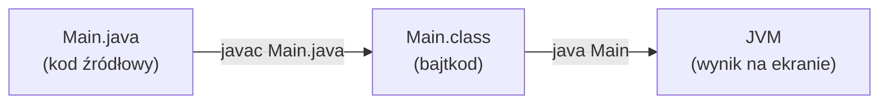

# Java 25 – kurs krok po kroku

Notatka do [[PPJ - Podstawy programowania w Javie]]. Prowadzi od pierwszego programu do tablic, w kolejności wykładów. Każdy przykład kodu był skompilowany i uruchomiony na **OpenJDK 25** (Temurin 25.0.4.1).

> [!tip] Jak się uczyć z tej notatki
> 1. Czytaj po jednym kroku.
> 2. Każdy przykład **przepisz ręcznie** (nie kopiuj) i uruchom.
> 3. Zanim uruchomisz, **zgadnij wynik**. Potem sprawdź.
> 4. Na końcu kroku zrób „Sprawdź się”. Odpowiedzi są zwinięte, rozwiń je dopiero po próbie.
>
> Zgodnie z [[#Zasady AI na PPJ|zasadami przedmiotu]] AI może pomagać przy nauce i zadaniach wykładowych, ale **nie na ćwiczeniach, kolokwiach ani egzaminie**.

## Spis treści
- [[#Krok 0 – Narzędzia i uruchamianie]]
- [[#Krok 1 – Pierwszy program]]
- [[#Krok 2 – Systemy liczbowe (dec, bin, oct, hex)]]
- [[#Krok 3 – Typy danych: ile bitów, jaki zakres, ile znaków]]
- [[#Krok 4 – Zmienne]]
- [[#Krok 5 – Literały]]
- [[#Krok 6 – Operatory]]
- [[#Krok 7 – Operatory bitowe]]
- [[#Krok 8 – Konwersja typów (rzutowanie)]]
- [[#Krok 9 – Tekst (String) i wczytywanie danych]]
- [[#Krok 10 – Operator warunkowy ?:]]
- [[#Krok 11 – Instrukcja if]]
- [[#Krok 12 – Instrukcja switch]]
- [[#Krok 13 – Pętle]]
- [[#Krok 14 – break i continue]]
- [[#Krok 15 – Typ wyliczeniowy enum]]
- [[#Krok 16 – Tablice]]
- [[#Krok 17 – Typowe błędy (lista kontrolna przed kolokwium)]]
- [[#Zadania do samodzielnego rozwiązania]]
- [[#Źródła]]

---

## Krok 0 – Narzędzia i uruchamianie

Potrzebujesz **JDK** (Java Development Kit). Masz zainstalowane JDK 25:

```
> java -version
openjdk version "25.0.4.1" 2026-08-18 LTS
```

Jak powstaje program w Javie:



| Polecenie | Co robi |
|---|---|
| `javac Main.java` | kompiluje, tworzy `Main.class` |
| `java Main` | uruchamia skompilowaną klasę (bez `.class`!) |
| `java Main.java` | kompiluje w pamięci i od razu uruchamia, **nie tworzy** pliku `.class` (tryb single-file source-code) |

Edytor: na zajęciach Notepad++ (żeby nauczyć się składni bez podpowiedzi), później IntelliJ IDEA.

---

## Krok 1 – Pierwszy program

### Wersja klasyczna (działa w każdej Javie)

```java
public class Main {
    public static void main(String[] args) {
        System.out.println("Hello PPJ");
    }
}
```

- `public class Main`: klasa publiczna. **Plik musi się nazywać `Main.java`** (wielkość liter ma znaczenie).
- `main`: punkt startowy programu. JVM szuka metody o nazwie dokładnie `main` (`Main` albo `pjatk` się skompiluje, ale nie uruchomi, zob. LAB_03 zad. 2).
- `System.out.println(...)`: wypisuje tekst i przechodzi do nowej linii.
- Każda instrukcja kończy się `;` albo klamrą `}`.

### Wersja Java 25 (tak pisze prowadzący)

Od **Javy 25** (JEP 512, funkcja już ostateczna, nie „preview”) metoda `main` **nie musi** być `public`, `static` ani mieć `String[] args`:

```java
public class Main {
    void main() {
        IO.println("Hello PPJ");
    }
}
```

Można też pominąć klasę. To jest **compact source file**: kompilator sam opakowuje kod w ukrytą klasę.

```java
void main() {
    IO.println("Hello PPJ");
}
```

> [!info] Klasa `IO` (Java 25, `java.lang.IO`)
> | Metoda | Działanie |
> |---|---|
> | `IO.println(x)` | wypisuje `x` + nowa linia |
> | `IO.println()` | pusta linia |
> | `IO.print(x)` | wypisuje `x` **bez** nowej linii |
> | `IO.readln()` | wczytuje linię tekstu z klawiatury (`String`) |
> | `IO.readln("Podaj: ")` | wypisuje komunikat i wczytuje linię |
>
> Trzeba pisać `IO.println`, a nie samo `println`: w ostatecznej wersji Javy 25 metody `IO` **nie są** importowane automatycznie.
> Compact source file importuje automatycznie cały moduł `java.base` (np. `Scanner`, `Arrays`, `List` bez `import`).

### print vs println (LAB_03 zad. 11)

```java
void main() {
    IO.print("Hello student!");
    IO.print("Hello PJATK!");
    IO.println();
    IO.println("Hello student!");
    IO.println("Hello PJATK!");
}
```
```
Hello student!Hello PJATK!
Hello student!
Hello PJATK!
```

### Komentarze

```java
void main() {
    // komentarz jednoliniowy
    /* komentarz
       wieloliniowy */
    /** komentarz dokumentacyjny (Javadoc) */
    IO.println("Komentarze nie zmieniają działania programu");
}
```

### Nazwy klas (LAB_03 zad. 10)
- dozwolone znaki: litery, cyfry, `_`, `$`; **nie można zaczynać od cyfry** (`1Hello` ❌, `Hello1` ✅),
- nie może to być słowo kluczowe (`class`, `int`...), a sam `_` jest zarezerwowany,
- `Hello` ≠ `hello`,
- konwencja: klasy **PascalCase** (`HelloWorld`), zmienne i metody **camelCase** (`liczbaStudentow`), stałe **UPPER_SNAKE_CASE** (`MAX_PUNKTY`).

> [!question]- Sprawdź się: co się stanie, gdy w pliku `Program1.java` napiszesz `public class Witaj`?
> Błąd kompilacji: `class Witaj is public, should be declared in a file named Witaj.java`. Klasa publiczna musi mieć tę samą nazwę co plik.

---

## Krok 2 – Systemy liczbowe (dec, bin, oct, hex)

Komputer przechowuje wszystko jako **bity** (0 i 1). Ten sam numer można zapisać w różnych systemach. Zmienia się tylko **zapis**, wartość jest ta sama.

| System | Podstawa | Cyfry | Prefiks w Javie | 42 w tym systemie |
|---|---|---|---|---|
| dziesiętny (dec) | 10 | 0–9 | brak | `42` |
| dwójkowy (bin) | 2 | 0, 1 | `0b` | `0b101010` |
| ósemkowy (oct) | 8 | 0–7 | `0` | `052` |
| szesnastkowy (hex) | 16 | 0–9, A–F | `0x` | `0x2A` |

### 2.1 Wagi pozycji: dowolny system → dziesiętny

Każda cyfra ma wagę **podstawa^pozycja** (pozycje liczymy od prawej, od 0).

**bin → dec:** `101010₂`

| pozycja | 5 | 4 | 3 | 2 | 1 | 0 |
|---|---|---|---|---|---|---|
| waga | 32 | 16 | 8 | 4 | 2 | 1 |
| cyfra | 1 | 0 | 1 | 0 | 1 | 0 |

= 32 + 8 + 2 = **42**

**hex → dec:** `0x1F4` = 1·16² + 15·16¹ + 4·16⁰ = 256 + 240 + 4 = **500**

**oct → dec:** `0755` = 7·8² + 5·8¹ + 5·8⁰ = 448 + 40 + 5 = **493**

> [!tip] Potęgi dwójki na pamięć
> 2⁰=1, 2¹=2, 2²=4, 2³=8, 2⁴=16, 2⁵=32, 2⁶=64, 2⁷=128, 2⁸=256, 2⁹=512, 2¹⁰=1024, 2¹⁵=32 768, 2¹⁶=65 536, 2³¹=2 147 483 648

### 2.2 Dzielenie z resztą: dziesiętny → dowolny system

Dzielisz przez podstawę, zapisujesz reszty, a wynik **czytasz od dołu do góry**.

**42 → bin**

| dzielenie | wynik | reszta |
|---|---|---|
| 42 / 2 | 21 | **0** |
| 21 / 2 | 10 | **1** |
| 10 / 2 | 5 | **0** |
| 5 / 2 | 2 | **1** |
| 2 / 2 | 1 | **0** |
| 1 / 2 | 0 | **1** ↑ |

czytamy od dołu: **101010₂**

**300 → hex**: 300/16 = 18 r **12 (C)**; 18/16 = 1 r **2**; 1/16 = 0 r **1** → **0x12C**

**100 → oct**: 100/8 = 12 r **4**; 12/8 = 1 r **4**; 1/8 = 0 r **1** → **0144**

### 2.3 Skrót: bin ↔ hex i bin ↔ oct (grupowanie bitów)

- **1 cyfra hex = 4 bity** (bo 16 = 2⁴)
- **1 cyfra oct = 3 bity** (bo 8 = 2³)

Grupujesz bity **od prawej**, a brakujące miejsca z lewej uzupełniasz zerami.

| dec | bin | hex | oct |
|---|---|---|---|
| 0 | 0000 | 0 | 0 |
| 1 | 0001 | 1 | 1 |
| 2 | 0010 | 2 | 2 |
| 3 | 0011 | 3 | 3 |
| 4 | 0100 | 4 | 4 |
| 5 | 0101 | 5 | 5 |
| 6 | 0110 | 6 | 6 |
| 7 | 0111 | 7 | 7 |
| 8 | 1000 | 8 | 10 |
| 9 | 1001 | 9 | 11 |
| 10 | 1010 | A | 12 |
| 11 | 1011 | B | 13 |
| 12 | 1100 | C | 14 |
| 13 | 1101 | D | 15 |
| 14 | 1110 | E | 16 |
| 15 | 1111 | F | 17 |

**Przykład:** `11010110₂`
- na hex: `1101 | 0110` → `D | 6` → **0xD6**
- na oct: `11 | 010 | 110` → `3 | 2 | 6` → **0326**
- kontrola: 0xD6 = 13·16 + 6 = **214**, 0326 = 3·64 + 2·8 + 6 = **214** ✅

**hex → oct** (przez bin): `0xAF` → `1010 1111` → `10 | 101 | 111` → **0257** (= 175)

### 2.4 Liczby ujemne: kod U2 (uzupełnienie do dwóch)

Typy całkowite w Javie (`byte`, `short`, `int`, `long`) są **ze znakiem** i zapisane w **U2** (JLS §4.2: *two's-complement*). Najstarszy bit ma wagę **ujemną**: w `byte` jest to −128.

**Jak zapisać −42 w `byte` (8 bitów):**
1. 42 = `0010 1010`
2. odwróć bity: `1101 0101`
3. dodaj 1: `1101 0110` → **−42**

Kontrola: `1101 0110` = **−128** + 64 + 16 + 4 + 2 = −128 + 86 = **−42** ✅

> [!note] Dlaczego `byte` ma zakres −128 do 127?
> 8 bitów daje 2⁸ = 256 kombinacji. Połowa jest na liczby ujemne (−128…−1), połowa na zero i dodatnie (0…127).
> `0111 1111` = 127 (max), `1000 0000` = −128 (min), `1111 1111` = −1.

### 2.5 Ułamki w systemie dwójkowym (dlaczego 0.1 + 0.2 ≠ 0.3)

Część ułamkową **mnożysz przez 2** i spisujesz części całkowite **od góry**:
- 0.625 · 2 = 1.25 → **1**
- 0.25 · 2 = 0.5 → **0**
- 0.5 · 2 = 1.0 → **1** (koniec, zostało 0)

0.625 = **0.101₂**. Ale 0.1 daje w dwójkowym **nieskończony** ułamek (0.000110011…), więc komputer przechowuje tylko przybliżenie:

```java
void main() {
    IO.println(0.1 + 0.2);   // 0.30000000000000004
}
```

### 2.6 Konwersje w Javie

```java
void main() {
    int n = 42;
    // liczba → tekst w danym systemie
    IO.println(Integer.toBinaryString(n));   // 101010
    IO.println(Integer.toOctalString(n));    // 52
    IO.println(Integer.toHexString(n));      // 2a
    IO.println(Integer.toString(n, 2));      // 101010 (dowolna podstawa 2–36)

    // tekst w danym systemie → liczba
    IO.println(Integer.parseInt("101010", 2)); // 42
    IO.println(Integer.parseInt("52", 8));     // 42
    IO.println(Integer.parseInt("2A", 16));    // 42

    // formatowanie
    IO.println(String.format("%x %X %o", 255, 255, 8)); // ff FF 10

    // literały w kodzie to ta sama wartość
    IO.println(42 == 0b101010 && 42 == 052 && 42 == 0x2A); // true
}
```

> [!warning] Liczby ujemne w `toBinaryString` / `toHexString`
> Te metody pokazują **surowe bity U2** (32 bity dla `int`):
> `Integer.toBinaryString(-42)` → `11111111111111111111111111010110`
> `Integer.toHexString(-1)` → `ffffffff`
> Natomiast `Integer.toString(-42, 2)` → `-101010` (znak minus + wartość bezwzględna).

> [!question]- Sprawdź się: zamień ręcznie, potem sprawdź w Javie
> 1. 77 → bin
> 2. `0b11111111` → dec, hex
> 3. `0x3C` → bin, oct
> 4. 0644 → dec
> 5. −1 w `byte` → bin
>
> **Odpowiedzi:**
> 1. 77 = 64 + 8 + 4 + 1 → `1001101`
> 2. 255, `0xFF`
> 3. `0011 1100` → `111100` → `111 | 100` → `074`
> 4. 6·64 + 4·8 + 4 = 384 + 32 + 4 = **420**
> 5. `1111 1111`

---

## Krok 3 – Typy danych: ile bitów, jaki zakres, ile znaków

Java ma **8 typów prostych** (prymitywnych). Ich rozmiar jest **taki sam na każdym komputerze**, bo określa go specyfikacja języka (JLS §4.2).

### 3.1 Tabela typów prostych

| Typ | Bity | Bajty | Zakres | Wartość domyślna* | Przykładowy literał |
|---|---|---|---|---|---|
| `byte` | 8 | 1 | −128 … 127 | `0` | `(byte) 10` |
| `short` | 16 | 2 | −32 768 … 32 767 | `0` | `(short) 10` |
| `int` | 32 | 4 | −2 147 483 648 … 2 147 483 647 | `0` | `10` |
| `long` | 64 | 8 | −9 223 372 036 854 775 808 … 9 223 372 036 854 775 807 | `0L` | `10L` |
| `float` | 32 | 4 | ok. ±3,4·10³⁸, ~6–7 cyfr znaczących | `0.0f` | `3.14f` |
| `double` | 64 | 8 | ok. ±1,8·10³⁰⁸, ~15–16 cyfr znaczących | `0.0` | `3.14` |
| `char` | 16 | 2 | 0 … 65 535 (`'\u0000'` … `'￿'`), **bez znaku** | `'\u0000'` | `'a'` |
| `boolean` | – | – | `true` / `false` | `false` | `true` |

\* Wartość domyślną dostają **pola klas i elementy tablic**. Zmienne lokalne (w metodzie) **nie mają** wartości domyślnej i trzeba je zainicjować przed użyciem.

- Zakres typu całkowitego ze znakiem na *n* bitach: **od −2ⁿ⁻¹ do 2ⁿ⁻¹ − 1**.
- `boolean`: specyfikacja **nie określa** rozmiaru w pamięci, zależy to od JVM (wykład 02).
- `float` i `double` to formaty IEEE 754 binary32 / binary64 (JLS §4.2).
- `char` to 16-bitowa jednostka **UTF-16**, więc jeden `char` przechowuje jeden z **65 536** kodów. Znaki spoza tego zakresu (np. część emoji) zajmują w `String` **dwa** `char`y.

### 3.2 Ile znaków (cyfr) zajmuje liczba w danym systemie

Przydatne przy zamianach i przy pytaniach typu „ile maksymalnie cyfr”:

| Typ | Bity | maks. cyfr bin | maks. cyfr hex (bity/4) | maks. cyfr oct (bity/3, w górę) | maks. cyfr dec |
|---|---|---|---|---|---|
| `byte` | 8 | 8 | 2 | 3 | 3 (127) |
| `short` | 16 | 16 | 4 | 6 | 5 (32 767) |
| `char` | 16 | 16 | 4 | 6 | 5 (65 535) |
| `int` | 32 | 32 | 8 | 11 | 10 (2 147 483 647) |
| `long` | 64 | 64 | 16 | 22 | 19 (9 223 372 036 854 775 807) |

Zweryfikowane w Javie: `Integer.toHexString(-1)` → `ffffffff` (8 znaków), `Integer.toOctalString(-1)` → `37777777777` (11 znaków), `Long.toHexString(-1L)` ma 16 znaków.

### 3.3 Stałe w klasach opakowujących

```java
void main() {
    IO.println(Integer.MAX_VALUE);   // 2147483647
    IO.println(Integer.MIN_VALUE);   // -2147483648
    IO.println(Integer.SIZE);        // 32 (bity)
    IO.println(Integer.BYTES);       // 4  (bajty)
    IO.println(Byte.SIZE + " " + Short.SIZE + " " + Character.SIZE + " "
            + Long.SIZE + " " + Float.SIZE + " " + Double.SIZE); // 8 16 16 64 32 64
    IO.println(Long.MAX_VALUE);      // 9223372036854775807
    IO.println((int) Character.MAX_VALUE); // 65535
}
```

### 3.4 Typy referencyjne (złożone)

Wszystko poza 8 typami prostymi to **typy referencyjne**: `String`, tablice, obiekty, `enum`. Zmienna przechowuje wtedy **odnośnik** (adres) do obiektu, a nie sam obiekt. Specjalna wartość `null` oznacza „brak obiektu”.

> [!question]- Sprawdź się
> 1. Ile różnych wartości może mieć `short`?
> 2. Jaki typ wybierzesz na liczbę mieszkańców Ziemi (~8,2 mld)?
> 3. Ile cyfr hex potrzeba na zapis dowolnego `int`?
>
> **Odpowiedzi:** 1. 2¹⁶ = 65 536. 2. `long`, bo `int` kończy się na ~2,1 mld. 3. 8.

---

## Krok 4 – Zmienne

**Zmienna** to nazwany obszar pamięci. Typ zmiennej określa: rozmiar, zakres wartości i sposób reprezentacji danych (wykład 02).

```java
void main() {
    int wiek;              // deklaracja
    wiek = 20;             // przypisanie (inicjalizacja)
    int rok = 2026;        // deklaracja + inicjalizacja
    int a = 1, b = 2, c;   // kilka zmiennych naraz
    c = a + b;

    double srednia = 4.5;
    char ocena = 'A';
    boolean zdane = true;
    String imie = "Ola";   // String to typ referencyjny

    final double PI = 3.14159; // final = stała, nie można zmienić
    // PI = 3;                 // błąd kompilacji

    var licznik = 10;      // var: kompilator sam ustala typ (tu int), od Javy 10

    IO.println(imie + " ma " + wiek + " lat, rok " + rok + ", c = " + c);
}
```

### Zasięg (scope)
Zmienna istnieje **od deklaracji do końca bloku `{ }`**, w którym ją zadeklarowano.

```java
void main() {
    int x = 1;
    {
        int y = 2;
        IO.println(x + y); // OK
    }
    // IO.println(y);      // błąd: y już nie istnieje
    for (int i = 0; i < 3; i++) { }
    // IO.println(i);      // błąd: i istnieje tylko w pętli
}
```

> [!warning] Zmienna lokalna musi mieć wartość przed użyciem
> ```java
> int x;
> IO.println(x); // błąd: variable x might not have been initialized
> ```

---

## Krok 5 – Literały

**Literał** to wartość zapisana bezpośrednio w kodzie (wykład 02).

| Rodzaj | Przykłady | Uwagi |
|---|---|---|
| logiczne | `true`, `false` | |
| całkowite | `10`, `0b1010`, `012`, `0xFF` | bez przyrostka to typ `int` |
| `long` | `10L`, `10l` | używaj **dużego `L`**, bo `l` wygląda jak `1` |
| zmiennoprzecinkowe | `3.14`, `3.`, `.14`, `1.5e3`, `1e-9` | bez przyrostka to `double` |
| `float` | `3.14f`, `2.f`, `.3F` | |
| znakowe | `'a'`, `'\n'`, `'\t'`, `'\123'` (ósemkowo), `'Ω'` (Ω, UTF-16) | apostrofy `' '` |
| tekstowe | `"Ala"`, `""` | cudzysłowy `" "` |
| null | `null` | tylko dla typów referencyjnych |

**Podkreślniki** poprawiają czytelność i nie zmieniają wartości: `1_000_000 == 1000000` (LAB_03 zad. 6). Nie mogą stać na początku, na końcu ani przy kropce/prefiksie.

Znaki specjalne: `\n` nowa linia, `\t` tabulator, `\\` backslash, `\'` apostrof, `\"` cudzysłów.

> [!warning] Literał za duży dla `int` (LAB_03 zad. 12)
> `IO.println(3000000000);` daje błąd `integer number too large`. Poprawka: `3000000000L`.

---

## Krok 6 – Operatory

### 6.1 Arytmetyczne

| Operator | Znaczenie | Przykład | Wynik |
|---|---|---|---|
| `+` | dodawanie | `7 + 2` | `9` |
| `-` | odejmowanie | `7 - 2` | `5` |
| `*` | mnożenie | `7 * 2` | `14` |
| `/` | dzielenie | `7 / 2` | **`3`** (całkowite!) |
| `/` | dzielenie | `7.0 / 2` | `3.5` |
| `%` | reszta z dzielenia | `7 % 2` | `1` |

> [!important] Dzielenie całkowite
> Jeśli **oba** argumenty są całkowite, wynik jest całkowity, a część ułamkowa jest **obcinana** (w stronę zera): `7 / 2 = 3`, `-7 / 2 = -3`.
> Żeby dostać ułamek, jeden argument musi być `double`: `(double) a / b` albo `a / 2.0`.
> Reszta ma znak **dzielnej**: `-7 % 3 = -1`, `7 % -3 = 1`.
> Dzielenie całkowite przez 0 rzuca `ArithmeticException`, a `1 / 0.0` daje `Infinity`.

`%` przydaje się do sprawdzania parzystości (`x % 2 == 0`), podzielności i wyciągania ostatniej cyfry (`x % 10`).

### 6.2 Inkrementacja i dekrementacja

| Zapis | Nazwa | Co zwraca w wyrażeniu |
|---|---|---|
| `++x` | preinkrementacja | **nową** wartość (najpierw zwiększa) |
| `x++` | postinkrementacja | **starą** wartość (zwiększa po użyciu) |
| `--x`, `x--` | dekrementacja | analogicznie |

```java
void main() {
    int x = 5;
    IO.println(x++); // 5 (potem x = 6)
    IO.println(++x); // 7
    int a = 5;
    int b = a++ + ++a; // 5 + 7
    IO.println(a + " " + b); // 7 12
}
```

### 6.3 Przypisania złożone
`x += 3` to `x = x + 3`. Analogicznie `-=`, `*=`, `/=`, `%=`.

> [!note] Ukryte rzutowanie
> `byte b = 10; b += 5;` się kompiluje (jest tu ukryte `(byte)`), ale `b = b + 5;` **nie**, bo `b + 5` ma typ `int`.

### 6.4 Porównania (wynik zawsze `boolean`)
`==` równe, `!=` różne, `<`, `>`, `<=`, `>=`.

> [!warning] `=` vs `==`
> `=` przypisuje, `==` porównuje. `if (x = 5)` dla `int` się nie skompiluje.

### 6.5 Logiczne

| a | b | `!a` | `a && b` (i) | `a \|\| b` (lub) | `a ^ b` (albo) |
|---|---|---|---|---|---|
| false | false | true | false | false | false |
| false | true | true | false | true | true |
| true | false | false | false | true | true |
| true | true | false | true | true | false |

**Skrócone wartościowanie:** `&&` nie sprawdza prawej strony, gdy lewa jest `false`, a `||` gdy lewa jest `true`. Dzięki temu można bezpiecznie napisać `b != 0 && a / b > 2`.

### 6.6 Priorytety (od najwyższego)

| Priorytet | Operatory | Wiązanie |
|---|---|---|
| 1 | `()` `[]` `.` | → |
| 2 | `x++` `x--` | → |
| 3 | `++x` `--x` `+x` `-x` `~` `!` `(typ)` | ← |
| 4 | `*` `/` `%` | → |
| 5 | `+` `-` | → |
| 6 | `<<` `>>` `>>>` | → |
| 7 | `<` `<=` `>` `>=` `instanceof` | → |
| 8 | `==` `!=` | → |
| 9 | `&` | → |
| 10 | `^` | → |
| 11 | `\|` | → |
| 12 | `&&` | → |
| 13 | `\|\|` | → |
| 14 | `? :` | ← |
| 15 | `=` `+=` `-=` ... | ← |

- `a - b + c` to `(a - b) + c` (wiązanie lewe)
- `a = b = c` to `a = (b = c)` (wiązanie prawe)
- W razie wątpliwości **dawaj nawiasy**.

### 6.7 Przepełnienie (overflow)

Gdy wynik nie mieści się w typie, „przewija się” na drugi koniec zakresu. **Java nie zgłasza błędu!**

```java
void main() {
    IO.println(Integer.MAX_VALUE + 1);            // -2147483648
    int a = 1_500_000_000, b = 1_500_000_000;
    IO.println(a + b);                            // -1294967296 (LAB_03 zad. 8)
    IO.println((long) a + b);                     // 3000000000
    IO.println(2 * 3 * 4 * 5 * 6 * 7 * 8 * 9 * 10 * 11 * 12 * 13 * 14 * 15 * 16 * 17);  // -288522240
    IO.println(2L * 3 * 4 * 5 * 6 * 7 * 8 * 9 * 10 * 11 * 12 * 13 * 14 * 15 * 16 * 17); // 355687428096000
}
```

> [!question]- Sprawdź się (wykład 02, zad. 2): a = 12, b = 5
> `a + b * 2` → **22** · `(a + b) * 2` → **34** · `a % b + 3` → **5** · `a > b && b > 0` → **true**

---

## Krok 7 – Operatory bitowe

Działają **tylko na typach całkowitych** i operują na pojedynczych bitach.

| Operator | Nazwa | Reguła dla bitu |
|---|---|---|
| `&` | AND | 1 tylko gdy oba bity są 1 |
| `\|` | OR | 1 gdy choć jeden bit jest 1 |
| `^` | XOR | 1 gdy bity są **różne** |
| `~` | NOT | odwraca każdy bit |
| `<<` | przesunięcie w lewo | dopisuje zera z prawej (×2 za każde miejsce) |
| `>>` | przesunięcie w prawo ze znakiem | powiela bit znaku (÷2, zaokrąglenie w dół) |
| `>>>` | przesunięcie w prawo bez znaku | dopisuje zera z lewej |

**Przykład (wykład 02, zad. 3): 42 i 15**

```
  42 = 0010 1010          42 = 0010 1010          42 = 0010 1010
& 15 = 0000 1111        | 15 = 0000 1111        ^ 15 = 0000 1111
     = 0000 1010 = 10        = 0010 1111 = 47        = 0010 0101 = 37
```

`~42`: `0010 1010` → `1101 0101` = **−43**. Ogólnie `~x == -x - 1`.

```java
void main() {
    IO.println(42 & 15);    // 10
    IO.println(42 | 15);    // 47
    IO.println(42 ^ 15);    // 37
    IO.println(~42);        // -43
    IO.println(5 << 2);     // 20   (5 · 2²)
    IO.println(-20 >> 2);   // -5   (znak zachowany)
    IO.println(-20 >>> 28); // 15   (z lewej wchodzą zera; int ma 32 bity)
    IO.println(-1 >>> 1);   // 2147483647
}
```

> [!note]
> Przed operacją bitową `byte`, `short` i `char` są promowane do `int` (32 bity). Dlatego `>>>` na ujemnym `byte` daje dużą liczbę `int`.
> `&`, `|`, `^` działają też na `boolean`, ale bez skróconego wartościowania (zawsze liczą obie strony).

---

## Krok 8 – Konwersja typów (rzutowanie)

Składnia: `(typ) wartość` (wykład 03).

### 8.1 Rozszerzająca (widening): automatyczna

Z mniejszego typu do większego nie tracimy informacji, więc Java robi to sama:

```
byte → short → int → long → float → double
              char ↗
```

```java
void main() {
    int i = 100;
    long l = i;      // OK, automatycznie
    double d = l;    // OK
    char c = 'A';
    int kod = c;     // 65
    IO.println(l + " " + d + " " + kod);
}
```

### 8.2 Zawężająca (narrowing): wymaga jawnego rzutowania

Grozi utratą danych, więc trzeba ją napisać jawnie:

```java
void main() {
    double d = 3.99;
    int i = (int) d;           // 3 (obcięcie, NIE zaokrąglenie)
    IO.println(i);
    IO.println((int) -3.99);   // -3
    IO.println(Math.round(3.5)); // 4 (zaokrąglenie)
    IO.println((byte) 200);    // -56  (zostaje 8 najmłodszych bitów)
    IO.println((short) 40000); // -25536
    IO.println((char) 97);     // a
    IO.println((int) 'A');     // 65
}
```

**Dlaczego `(byte) 200 == -56`?** 200 = `1100 1000`. W `byte` najstarszy bit to −128, więc −128 + 64 + 8 = **−56**.

### 8.3 Promocja w wyrażeniach

W działaniach arytmetycznych `byte`, `short` i `char` są zamieniane na `int`. Wynik ma typ „największego” argumentu (co najmniej `int`).

```java
void main() {
    byte a = 10, b = 20;
    // byte c = a + b;        // błąd: a + b to int
    byte c = (byte) (a + b);  // OK
    IO.println(c);
    IO.println('a' + 'b');      // 195 (int, kody 97 + 98)
    IO.println((char) ('a' + 1)); // b
    IO.println('7' - '0');      // 7 (zamiana znaku-cyfry na liczbę)
}
```

> [!question]- Sprawdź się (wykład 03, zad. 1)
> Temperatura 36,6 °C. Ile °F jako `int`? Wzór: F = C · 9/5 + 32.
>
> `(int) (36.6 * 9 / 5 + 32)` → 97.88 → **97**. Część ułamkowa jest obcięta, a nie zaokrąglona.
> Pułapka: `36.6 * (9 / 5)` da zły wynik, bo `9 / 5 == 1` (dzielenie całkowite).

---

## Krok 9 – Tekst (String) i wczytywanie danych

### 9.1 Łączenie tekstu (konkatenacja)

`+` z `String` skleja tekst. Wyrażenie liczy się **od lewej do prawej**:

```java
void main() {
    IO.println("" + 1 + 2);       // 12
    IO.println(1 + 2 + "");       // 3
    IO.println("Wynik: " + 1 + 2);   // Wynik: 12
    IO.println("Wynik: " + (1 + 2)); // Wynik: 3
    IO.println('a' + 'b');        // 195 (char + char = int!)
    IO.println("" + 'a' + 'b');   // ab
}
```

### 9.2 Podstawowe metody String

```java
void main() {
    String s = "Programowanie";
    IO.println(s.length());        // 13
    IO.println(s.charAt(0));       // P (indeksy od 0)
    IO.println(s.toUpperCase());   // PROGRAMOWANIE
    IO.println(s.substring(0, 7)); // Program (od 0 do 7, bez 7)
    IO.println(s.indexOf("gram")); // 3
    IO.println(s.contains("ram")); // true
}
```

### 9.3 Porównywanie Stringów: `equals`, nie `==`

```java
void main() {
    String s1 = "Ala";
    String s2 = new String("Ala");
    IO.println(s1 == s2);              // false: == porównuje ADRESY obiektów
    IO.println(s1.equals(s2));         // true: porównuje TREŚĆ
    IO.println("ala".equalsIgnoreCase(s1)); // true
}
```

> [!warning] Przykład z wykładu 04
> `if (dzisiaj2 == "Sobota" || dzisiaj2 == "Niedziela")` to błąd logiczny. Poprawnie:
> `if (dzisiaj2.equals("Sobota") || dzisiaj2.equals("Niedziela"))`.

### 9.4 Wczytywanie z klawiatury

**Sposób Java 25: `IO.readln`**

```java
void main() {
    String imie = IO.readln("Jak masz na imię? ");
    int wiek = Integer.parseInt(IO.readln("Ile masz lat? "));
    double wzrost = Double.parseDouble(IO.readln("Wzrost w m: "));
    IO.println("Cześć " + imie + ", za rok będziesz mieć " + (wiek + 1) + " lat.");
}
```

**Sposób klasyczny: `Scanner`** (LAB_03 zad. 9)

```java
import java.util.Scanner;

public class Wczytaj {
    public static void main(String[] args) {
        Scanner sc = new Scanner(System.in);
        System.out.print("Podaj dwie liczby: ");
        int a = sc.nextInt();
        int b = sc.nextInt();
        System.out.println("Suma: " + (a + b));
    }
}
```

`nextInt()`, `nextDouble()`, `next()` (jedno słowo), `nextLine()` (cała linia).

> [!warning] Przecinek czy kropka?
> `Scanner` i `String.format` używają **ustawień regionalnych systemu**. Na polskim Windowsie `nextDouble()` oczekuje `3,5`, a `String.format("%.2f", 3.14159)` daje `3,14`. `Double.parseDouble` zawsze wymaga kropki (`3.5`).

### 9.5 Formatowanie wyniku

```java
void main() {
    double x = 3.14159;
    IO.println(String.format("%.2f", x));          // 3,14 (2 miejsca po przecinku)
    IO.println(String.format("%5d|%-5d|", 42, 42)); // "   42|42   |"
    IO.println(String.format("%08d", 42));          // 00000042
}
```

---

## Krok 10 – Operator warunkowy ?:

Zwraca jedną z dwóch wartości w zależności od warunku:

```
warunek ? wartość_gdy_true : wartość_gdy_false
```

```java
void main() {
    int zm1 = 5, zm2 = 6;
    String wynik = (zm1 == zm2) ? "Równe" : "Różne";
    IO.println(wynik); // Różne

    // zagnieżdżony (czytelność spada, używaj z umiarem)
    String opis = (zm1 == zm2) ? "Równe" : ((zm1 < zm2) ? "zm1 < zm2" : "zm1 > zm2");
    IO.println(opis);  // zm1 < zm2

    int max = (zm1 > zm2) ? zm1 : zm2;
    IO.println(max);   // 6
}
```

---

## Krok 11 – Instrukcja if

```java
void main() {
    int punkty = 18;

    if (punkty >= 12.5) {
        IO.println("Zaliczone");
    } else {
        IO.println("Niezaliczone");
    }

    // else if: sprawdzane po kolei, wykona się PIERWSZY pasujący
    if (punkty >= 22.5) {
        IO.println("5");
    } else if (punkty >= 20) {
        IO.println("4.5");
    } else if (punkty >= 17.5) {
        IO.println("4");
    } else if (punkty >= 15) {
        IO.println("3.5");
    } else if (punkty >= 12.5) {
        IO.println("3");
    } else {
        IO.println("2");
    }
}
```
(Progi to 90/80/70/60/50% z 25 pkt, wg [[PPJ - Podstawy programowania w Javie|zasad zaliczenia]].)

> [!warning] Pułapki
> **1. Brak klamer:** do `if` należy tylko **jedna** instrukcja.
> ```java
> if (x > 0)
>     IO.println("dodatnia");
>     IO.println("to wykona się ZAWSZE");
> ```
> **2. Średnik po warunku:** `if (x > 0);` to `if` z instrukcją pustą, a blok `{...}` pod nim wykona się zawsze.
>
> **3. Wiszące `else`:** `else` należy do **najbliższego** `if` bez pary:
> ```java
> if (w1) if (w2) a(); else b();
> // to samo co:
> if (w1) { if (w2) a(); else b(); }
> ```
> **Rada: zawsze pisz klamry.**

> [!question]- Sprawdź się (wykład 03, zad. 2): największa z trzech liczb
> Wskazówka: najpierw załóż, że `max = a`. Potem porównaj `max` z `b`, a następnie z `c`.
> Wersja `?:`: `int max = (a > b) ? ((a > c) ? a : c) : ((b > c) ? b : c);`

---

## Krok 12 – Instrukcja switch

Wybiera działanie na podstawie **wartości** wyrażenia. Selektor może być typu `byte`, `short`, `char`, `int` (i ich klasami opakowującymi), `String` (od Javy 7), `enum` (od Javy 5) oraz, przy dopasowaniu wzorców, dowolny obiekt (od Javy 21).

### 12.1 Klasyczny switch (z dwukropkiem) i `break`

```java
void main() {
    String day = "Monday";
    switch (day) {
        case "Monday":
            IO.println("Start of the week");
            break;
        case "Friday":
            IO.println("End of the week");
            break;
        case "Saturday":
        case "Sunday":                 // kilka etykiet: ten sam kod
            IO.println("Weekend");
            break;
        default:
            IO.println("Midweek");
    }
}
```

> [!danger] Fall-through: brak `break`
> W składni z `:` po dopasowaniu wykonują się **wszystkie kolejne** `case`, aż do `break` albo końca switcha. Na slajdzie z wykładu 03 bez `break` dla `"Monday"` wypisze się *Start of the week*, *End of the week*, *Weekend*, *Midweek*.

### 12.2 Switch ze strzałką `->` (Java 14+): bez fall-through

```java
void main() {
    String day = "Sunday";
    switch (day) {
        case "Monday" -> IO.println("Start of the week");
        case "Friday" -> IO.println("End of the week");
        case "Saturday", "Sunday" -> IO.println("Weekend");
        default -> {
            IO.println("Midweek");
            IO.println("(blok kilku instrukcji)");
        }
    }
}
```

Strzałka wykonuje **tylko** swoją gałąź, więc `break` jest niepotrzebny.

### 12.3 Switch jako wyrażenie: zwraca wartość (Java 14+)

```java
void main() {
    String day = "Friday";

    String opis = switch (day) {
        case "Monday" -> "Start of the week";
        case "Friday" -> "End of the week";
        case "Saturday", "Sunday" -> "Weekend";
        default -> "Midweek";
    };                      // średnik, bo to przypisanie!
    IO.println(opis);

    // z yield (składnia z dwukropkiem albo blok przy strzałce)
    int dlugosc = switch (day) {
        case "Monday": yield 6;
        case "Friday": yield 6;
        default: {
            int n = day.length();
            yield n;
        }
    };
    IO.println(dlugosc);
}
```

Switch-wyrażenie musi być **wyczerpujące** (obsłużyć każdą możliwą wartość), więc zwykle potrzebuje `default`. Dla `enum` z wymienionymi wszystkimi stałymi `default` nie jest potrzebny.

### 12.4 Switch na `char` i `int`: kalkulator (wykład 03, zad. 3, szkic)

```java
void main() {
    double a = 8, b = 0;
    char op = '/';
    String wynik = switch (op) {
        case '+' -> "" + (a + b);
        case '-' -> "" + (a - b);
        case '*' -> "" + (a * b);
        case '/' -> (b == 0) ? "Błąd: dzielenie przez zero" : "" + (a / b);
        default -> "Nieznany operator";
    };
    IO.println(wynik);
}
```

### 12.5 Nowsze możliwości (dla ciekawych, były na wykładzie 03)

```java
void main() {
    Object obj = "Hello PJATK";

    // Java 21: pattern matching (dopasowanie typu) + case null
    String r = switch (obj) {
        case null -> "null";
        case Integer i -> "liczba " + i;
        case String s when s.length() > 10 -> "długi tekst"; // guard: when
        case String s -> "tekst";
        default -> "coś innego";
    };
    IO.println(r); // długi tekst

    // Java 21: wzorce rekordów
    record Point(int x, int y) {}
    Object p = new Point(10, 20);
    if (p instanceof Point(int x, int y)) {
        IO.println("x = " + x + ", y = " + y);
    }
}
```

> [!warning] Wzorce typów prostych to w Javie 25 **preview**
> Ten kod z wykładu 03 (`switch` na `long` i `case int val when ...`) w Javie 25 jest funkcją **preview** (JEP 507, 3. podgląd). Bez flag kompilator zgłasza: `primitive patterns are a preview feature and are disabled by default`.
> ```
> javac --release 25 --enable-preview Main.java
> java --enable-preview Main
> ```
> albo krócej: `java --enable-preview --source 25 Main.java`. Sprawdzone na Twoim `03/W03/Main.java`.

---

## Krok 13 – Pętle

Pętla powtarza instrukcje. **Musi mieć szansę się zakończyć** (wykład 04).

### 13.1 while: sprawdza warunek **przed** każdym obrotem

```java
void main() {
    int x = 0;
    while (x < 5) {
        IO.println("Hello " + x);
        x++;              // bez tego pętla jest nieskończona!
    }
}
```

Użyj, gdy **nie wiesz z góry**, ile razy coś się wykona (np. „wczytuj, dopóki użytkownik nie poda 0”).

### 13.2 do-while: wykona się **co najmniej raz**

```java
void main() {
    int liczba;
    do {
        liczba = Integer.parseInt(IO.readln("Podaj liczbę dodatnią: "));
    } while (liczba <= 0);   // średnik na końcu!
    IO.println("Dziękuję: " + liczba);
}
```

### 13.3 for: gdy znasz liczbę powtórzeń

```
for (inicjalizacja; warunek; krok) { ciało }
```

```java
void main() {
    for (int i = 0; i < 5; i++) {
        IO.println("i = " + i);   // 0 1 2 3 4
    }
    for (int i = 10; i > 0; i -= 3) {
        IO.print(i + " ");        // 10 7 4 1
    }
    IO.println();
    // kilka zmiennych naraz (z wykładu 04)
    for (int i = 0, j = 10; i < 5; i++, j *= 2) {
        IO.print(j + " ");        // 10 20 40 80 160
    }
    IO.println();
}
```

Kolejność: **inicjalizacja** (raz) → **warunek** → ciało → **krok** → warunek → ciało → ...
W kroku `for` nie ma znaczenia, czy napiszesz `i++`, czy `++i`.

### 13.4 for-each: po wszystkich elementach tablicy

```java
void main() {
    int[] oceny = {5, 4, 3, 5};
    for (int ocena : oceny) {
        IO.print(ocena + " ");
    }
    IO.println();
}
```
Nie daje dostępu do indeksu i nie pozwala zmienić elementów tablicy.

### 13.5 Pętle zagnieżdżone: tabliczka mnożenia

```java
void main() {
    for (int i = 1; i <= 10; i++) {
        for (int j = 1; j <= 10; j++) {
            IO.print(i * j + "\t");
        }
        IO.println();
    }
}
```

### 13.6 Pułapki z wykładu 04: zgadnij wynik!

```java
void main() {
    int x = 0;
    while (x++ < 5) { IO.print(x + " "); }  // 1 2 3 4 5  (porównuje starą wartość)
    IO.println();

    x = 0;
    while (++x < 5) { IO.print(x + " "); }  // 1 2 3 4    (porównuje nową wartość)
    IO.println();

    x = 0;
    while (++x < 5);                        // ŚREDNIK = pusta pętla!
    {
        IO.println(x);                      // 5 (blok wykona się raz, po pętli)
    }

    for (int i = 10; i < 5; i++) {
        IO.println("nigdy");                // warunek od razu false: 0 obrotów
    }
}
```

### 13.7 Pętle nieskończone

```java
// while (true) { ... }   albo   for (;;) { ... }
```
Zatrzymanie programu w terminalu: **Ctrl + C**.

> [!danger] `unreachable statement`
> Jeśli po pętli nieskończonej **bez `break`** jest jeszcze jakiś kod, kompilator zgłosi błąd `unreachable statement`, bo ten kod nigdy się nie wykona. Tak było w `04/Main1.java` (`for(;;) IO.println();`). Teraz ta pętla jest zakomentowana, a plik się kompiluje.

### Jaką pętlę wybrać?

| Sytuacja | Pętla |
|---|---|
| znana liczba powtórzeń | `for` |
| powtarzaj, dopóki warunek jest spełniony | `while` |
| wykonaj co najmniej raz (np. menu, walidacja) | `do-while` |
| przejdź po wszystkich elementach tablicy | for-each |

> [!question]- Sprawdź się (wykład 04, zad. 1 i 3)
> 1. Wypisz liczby parzyste 1–50 pętlami `for`, `while`, `do-while`.
> 2. Suma 1..N pętlą `while`.
>
> Wskazówki: 1) zacznij od 2 i zwiększaj o 2 **albo** sprawdzaj `i % 2 == 0`. 2) potrzebujesz zmiennej `suma = 0` i licznika. Kontrola: dla N = 100 wynik to 5050 (= N·(N+1)/2).

---

## Krok 14 – break i continue

- `break;` **kończy** całą pętlę (albo `switch`).
- `continue;` **pomija resztę bieżącego obrotu** i przechodzi do następnego.

```java
void main() {
    for (int i = 1; i <= 10; i++) {
        if (i == 7) break;          // stop przy 7
        if (i % 2 == 0) continue;   // pomiń parzyste
        IO.print(i + " ");          // 1 3 5
    }
    IO.println();

    // break z etykietą: wychodzi z ZEWNĘTRZNEJ pętli
    zewn:
    for (int i = 1; i <= 3; i++) {
        for (int j = 1; j <= 3; j++) {
            if (i * j == 4) break zewn;
            IO.print(i + "*" + j + " ");
        }
    }
    IO.println();                   // 1*1 1*2 1*3 2*1
}
```

> [!warning] `continue` w `while`: pętla nieskończona (zakomentowany kod z wykładu 04)
> ```java
> int x = 0;
> while (x < 10) {
>     if (x == 5) continue;   // x nigdy nie zwiększy się ponad 5!
>     IO.println(x);
>     x++;
> }
> ```
> Poprawka: zwiększ `x` **przed** `continue` albo użyj `for`, gdzie krok `i++` wykonuje się także po `continue`.

---

## Krok 15 – Typ wyliczeniowy enum

`enum` to zamknięty zbiór nazwanych stałych. Kod jest czytelniejszy, a kompilator pilnuje, żeby nie wpisać złej wartości (wykład 04).

```java
enum Poziom { LATWY, SREDNI, TRUDNY }

void main() {
    Poziom p = Poziom.SREDNI;
    // Poziom x = "SREDNI";  // błąd kompilacji: String to nie Poziom

    if (p == Poziom.LATWY) {          // enum można porównywać przez ==
        IO.println(100);
    } else if (p == Poziom.SREDNI) {
        IO.println(50);
    } else {
        IO.println(10);
    }

    int punkty = switch (p) {         // w case piszemy samą nazwę, bez Poziom.
        case LATWY -> 100;
        case SREDNI -> 50;
        case TRUDNY -> 10;            // wszystkie stałe obsłużone, więc default zbędny
    };
    IO.println(punkty);

    IO.println(p);                    // SREDNI
    IO.println(p.ordinal());          // 1 (numer od 0)
    IO.println(Poziom.valueOf("TRUDNY")); // String → enum
    for (Poziom x : Poziom.values()) IO.print(x + " "); // wszystkie stałe
    IO.println();
}
```

---

## Krok 16 – Tablice

**Tablica** to ciąg elementów **tego samego typu** o **stałym rozmiarze**. Elementy są numerowane **od 0 do `length - 1`**.

### 16.1 Tworzenie

```java
void main() {
    int[] a = new int[5];             // 5 elementów, wszystkie = 0
    int[] b = {3, 1, 4, 1, 5};        // od razu z wartościami
    String[] imiona = new String[3];  // wszystkie = null
    double[] d = new double[] {1.5, 2.5};

    a[0] = 10;                        // zapis
    a[4] = 50;                        // ostatni element
    IO.println(a[0] + b[2]);          // 14 (odczyt)
    IO.println(b.length);             // 5 (length bez nawiasów!)
    IO.println(b[b.length - 1]);      // 5 (ostatni element)
    IO.println(java.util.Arrays.toString(b)); // [3, 1, 4, 1, 5]
    IO.println(b);                    // coś jak [I@1b6d3586: adres, nie zawartość!
}
```

Wartości domyślne elementów: liczby `0` / `0.0`, `boolean` `false`, `char` `'\u0000'`, typy referencyjne `null`.

> [!danger] `ArrayIndexOutOfBoundsException`
> `int[] t = new int[5]; t[5] = 1;` się kompiluje, ale **w czasie działania** rzuca wyjątek, bo ostatni indeks to `4`. Typowy błąd: `i <= t.length` zamiast `i < t.length`.

### 16.2 Przechodzenie i typowe algorytmy

```java
void main() {
    int[] t = {7, -2, 9, 4, 0, 9};

    // wypisanie z indeksami
    for (int i = 0; i < t.length; i++) {
        IO.println("t[" + i + "] = " + t[i]);
    }

    // suma i średnia
    int suma = 0;
    for (int x : t) suma += x;
    double srednia = (double) suma / t.length;
    IO.println("suma = " + suma + ", średnia = " + srednia);

    // maksimum i jego indeks
    int max = t[0], idx = 0;          // startuj od pierwszego elementu, nie od 0!
    for (int i = 1; i < t.length; i++) {
        if (t[i] > max) { max = t[i]; idx = i; }
    }
    IO.println("max = " + max + " na indeksie " + idx);

    // zliczanie (ile parzystych)
    int parzyste = 0;
    for (int x : t) if (x % 2 == 0) parzyste++;
    IO.println("parzystych: " + parzyste);

    // odwracanie w miejscu
    for (int i = 0; i < t.length / 2; i++) {
        int tmp = t[i];
        t[i] = t[t.length - 1 - i];
        t[t.length - 1 - i] = tmp;
    }
    IO.println(java.util.Arrays.toString(t)); // [9, 0, 4, 9, -2, 7]

    // sortowanie gotową metodą
    java.util.Arrays.sort(t);
    IO.println(java.util.Arrays.toString(t)); // [-2, 0, 4, 7, 9, 9]
}
```

> [!tip] W compact source file nie musisz pisać `java.util.`
> Moduł `java.base` jest importowany automatycznie, więc wystarczy `Arrays.toString(t)`. W klasycznym pliku z `public class` dodaj `import java.util.Arrays;` na początku.

### 16.3 Tablica to referencja

```java
void main() {
    int[] a = {1, 2, 3};
    int[] b = a;          // b wskazuje na TĘ SAMĄ tablicę
    b[0] = 99;
    IO.println(a[0]);     // 99!

    int[] c = java.util.Arrays.copyOf(a, a.length); // prawdziwa kopia
    c[1] = 0;
    IO.println(a[1]);     // 2 (bez zmian)

    IO.println(a == c);                       // false (różne obiekty)
    IO.println(java.util.Arrays.equals(a, c)); // false (różna zawartość)
}
```

### 16.4 Tablice dwuwymiarowe

```java
void main() {
    int[][] m = new int[3][4];       // 3 wiersze, 4 kolumny
    int[][] n = {
        {1, 2, 3},
        {4, 5, 6}
    };
    IO.println(m.length);            // 3 (liczba wierszy)
    IO.println(m[0].length);         // 4 (liczba kolumn)
    IO.println(n[1][2]);             // 6 (wiersz 1, kolumna 2)

    for (int i = 0; i < n.length; i++) {
        for (int j = 0; j < n[i].length; j++) {
            IO.print(n[i][j] + "\t");
        }
        IO.println();
    }
    IO.println(java.util.Arrays.deepToString(n)); // [[1, 2, 3], [4, 5, 6]]
}
```

### 16.5 Tablica znaków i String

```java
void main() {
    String s = "kajak";
    char[] znaki = s.toCharArray();
    boolean palindrom = true;
    for (int i = 0; i < znaki.length / 2; i++) {
        if (znaki[i] != znaki[znaki.length - 1 - i]) {
            palindrom = false;
            break;
        }
    }
    IO.println(s + " palindrom? " + palindrom); // true
}
```

---

## Krok 17 – Typowe błędy (lista kontrolna przed kolokwium)

- [ ] Nazwa pliku = nazwa klasy publicznej (wielkość liter!).
- [ ] `;` na końcu instrukcji, ale **nie** po `if (...)`, `for (...)`, `while (...)`.
- [ ] `=` (przypisanie) vs `==` (porównanie).
- [ ] Stringi porównuję przez `.equals()`.
- [ ] `7 / 2 == 3`: do ułamków potrzebny `double`.
- [ ] Przepełnienie `int`: przy dużych liczbach używaj `long` i literałów z `L`.
- [ ] `(int) 3.99 == 3`: rzutowanie obcina.
- [ ] Klasyczny `switch` z `:` potrzebuje `break`, a `->` nie.
- [ ] Switch-wyrażenie kończy się `};`.
- [ ] Pętla ma warunek, który kiedyś będzie fałszywy (zmieniasz licznik?).
- [ ] `x++` vs `++x` w warunku pętli.
- [ ] Indeksy tablicy od `0` do `length - 1`, czyli w pętli `i < t.length`.
- [ ] `length` w tablicy, `length()` w `String`.
- [ ] Zmienne lokalne trzeba zainicjować przed odczytem.
- [ ] Zmienna z `for (int i ...)` nie istnieje po pętli.

---

## Zadania do samodzielnego rozwiązania

Celowo **bez gotowych rozwiązań**, tylko ze wskazówkami (zgodnie z zasadami PPJ). Jeśli utkniesz, poproś AI o *podpowiedź*, a nie o gotowy kod.

1. **Konwerter systemów.** Wczytaj liczbę dziesiętną i wypisz ją w bin, oct, hex: najpierw metodami `Integer`, potem **własną pętlą** (dzielenie z resztą). *Wskazówka: reszty dokładaj na początek Stringa: `wynik = reszta + wynik`. Dla hex reszty 10–15 zamień na `A`–`F`, np. `"0123456789ABCDEF".charAt(reszta)`.*
2. **Bin → dec bez `parseInt`.** Wczytaj tekst `"101010"` i policz wartość. *Wskazówka: idąc od lewej, `wartosc = wartosc * 2 + (znak - '0')`.*
3. **Bity liczby.** Wypisz 8 bitów zmiennej `byte` (także ujemnej) z użyciem `>>` i `& 1`. *Wskazówka: pętla od 7 do 0 i `(b >> i) & 1`.*
4. **Kalkulator** (wykład 03, zad. 3) z obsługą dzielenia przez zero i nieznanego operatora, na `switch` ze strzałkami.
5. **Menu w pętli** `do-while` + `switch`: 1 = dodaj, 2 = odejmij, 0 = koniec.
6. **FizzBuzz** 1–100: podzielne przez 3 → `Fizz`, przez 5 → `Buzz`, przez oba → `FizzBuzz`. *Wskazówka: kolejność warunków ma znaczenie.*
7. **Liczby pierwsze** do 100 (pętle zagnieżdżone + `break`).
8. **Tablica 10 liczb** z klawiatury: suma, średnia, min, max, ile większych od średniej.
9. **Choinka** z gwiazdek o wysokości `n` (pętle zagnieżdżone).
10. **Enum `Swiatlo`** (CZERWONE, ZOLTE, ZIELONE) i `switch`, który zwraca polecenie dla kierowcy.

---

## Zasady AI na PPJ
Z dokumentu `2627Z_win_PPJ_zasady_zaliczenia.pdf` (pkt 15–21):
- ✅ dozwolone przy nauce i **zadaniach wykładowych (ZW)**: dodatkowe przykłady, analiza błędów, debugowanie, weryfikacja rozwiązań. Zalecane podejście sokratejskie (pytania i wskazówki zamiast gotowców),
- ❌ niedozwolone przy **zadaniach ćwiczeniowych (ZC)** (chyba że prowadzący pozwoli), na **kolokwiach** i **egzaminie**,
- musisz umieć **wyjaśnić i zmodyfikować** każdy oddany kod.

---

## Źródła

**Materiały z przedmiotu** (w tym folderze):
- `01/W01/PPJ 01.pdf`: pierwszy program, kompilacja, uruchamianie
- `02/W02/PPJ 02.pdf`: literały, operatory, priorytety, operatory bitowe, instrukcje, zmienne i typy
- `03/W03/PPJ 03.pdf`: konwersja typów, `?:`, `if`, `switch` (historia od Javy 5 do 25)
- `04/PPJ 04.pdf`: pętle, `break`/`continue`, `enum`
- `03/lab_03_pl.pdf`: zadania laboratoryjne
- kod z wykładów: `02/W02/Main.java`, `03/W03/Main.java`, `04/Main.java`, `04/Main1.java`, `03/Lab03.java`

**Oficjalna dokumentacja:**
- [Java Language Specification SE 25, rozdz. 4 – Types, Values, and Variables](https://docs.oracle.com/javase/specs/jls/se25/html/jls-4.html) (rozmiary i zakresy typów, U2, IEEE 754)
- [Java Language Specification SE 25, rozdz. 14 – Blocks, Statements, and Patterns](https://docs.oracle.com/javase/specs/jls/se25/html/jls-14.html) (`if`, `switch`, pętle, `break`, `continue`)
- [Java Language Specification SE 25, rozdz. 15 – Expressions](https://docs.oracle.com/javase/specs/jls/se25/html/jls-15.html) (operatory)
- [JEP 512: Compact Source Files and Instance Main Methods](https://openjdk.org/jeps/512) (Java 25, `void main()`, klasa `IO`)
- [JEP 507: Primitive Types in Patterns, instanceof, and switch (Third Preview)](https://openjdk.org/jeps/507) (Java 25, preview)
- [Javadoc SE 25: `java.lang.Integer`](https://docs.oracle.com/en/java/javase/25/docs/api/java.base/java/lang/Integer.html) (`toBinaryString`, `parseInt`, `MAX_VALUE`, `SIZE`...)
- [Javadoc SE 25: `java.lang.IO`](https://docs.oracle.com/en/java/javase/25/docs/api/java.base/java/lang/IO.html)
- [Dev.java – oficjalny tutorial Oracle „Learn Java”](https://dev.java/learn/)
